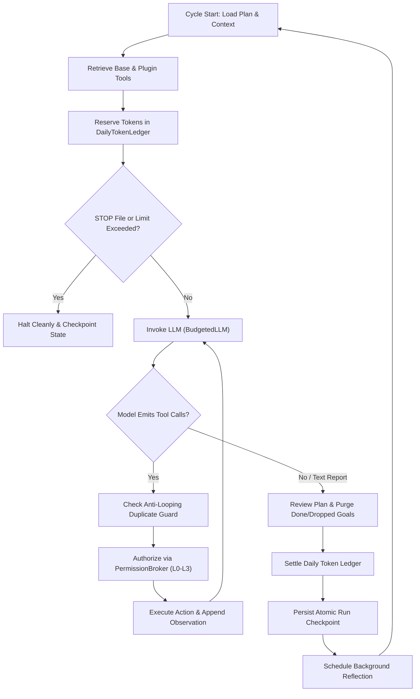

# SELF

[](https://github.com/FatinShadab/self/actions/workflows/ci.yml)
[](LICENSE)
[](CHANGELOG.md)
[](docs/plugins/overview.md)

SELF is an LLM-driven autonomous agent that executes inside an isolated Docker Linux container, explores its operating environment, and maintains its own evolving multi-goal plan. It synthesizes and tests Python tools at runtime, preserves persistent notes, verified environment facts, and bounded session handoffs across restarts, and supports modular specialization through a plugin system. When interacting with operators, SELF speaks plainly in the first person singular ("I", "me", "my") as a software system, evaluates human input as guidance to weigh rather than commands to obey, and halts immediately on human stop controls. The Docker container boundary—augmented by host-controlled configuration mounts and permission brokering—serves as the primary security barrier.

> [!WARNING]
> **Experimental Research Software:** SELF is an autonomous experimental program, not a hardened production service or multi-tenant security sandbox. Read [SECURITY.md](SECURITY.md) before supplying credentials or connecting to real networks.

---

## Current Status & Verification

### Dual Versioning Scheme
SELF maintains two distinct, decoupled version tracks:
- **Core Engine Releases (`core-v0.1.0-rc3`):** Tracks releases of the complete autonomous agent system, runtime loop coordinator, safety boundaries, container packaging, soak test suite, and operator tooling.
- **Plugin API Specification (`1.1.0` in `VERSION` and `CORE_API_VERSION`):** Strict SemVer specification governing the public plugin interface, manifest schema, dynamic tool registration, lifecycle hooks, and custom slash commands. Plugins declare compatibility ranges against this specification (e.g. `core_api: ">=1.1.0,<2.0.0"`).

### What Has Been Verified
- **Automated Offline Test Suites:** The repository includes harness and evaluation tests. The permission and plugin regression selection passed locally (37 tests). A full container test run has not been repeated for these changes.
- **Deterministic Soak Suite:** Scenarios B1 through B10 run continuously for 60 to 200 cycles against a scripted provider and historical replay fixtures (`scripts/soak.ps1`), validating per-cycle invariants: daily token ledger accounting, bounded handoffs (≤ 6,000 characters), plan hygiene, header deduplication, and absence of tight spins.
- **Static Documentation & Architecture Guards:** `scripts/check_architecture_docs.py` and `scripts/check_docs_claims.py` verify that all tool definitions (29 tools), events (142 events), state files (42 files), environment variables (44 vars), relative links, code symbols, and numerical claims match code ground truth.

### What Has NOT Been Verified
- **No Live Multi-Cycle Run on Release Candidate 3:** No extended multi-cycle autonomous run has been executed or validated against live commercial LLM endpoints using the `core-v0.1.0-rc3` release candidate.
- **Container Test Suite on Current Host:** The updated Docker image built successfully, but its full test suite has not been run in the container.
- **Unverified Provider Tiers:** Third-party provider free-tier quotas and rate limits remain unverified until verified by live research tools.

### Known Limitations
1. **Advisory Plugin Draft Validation:** `python -m agent.plugins validate` performs static AST and schema linting. It is not an OS sandbox; dynamic Python patterns (`__import__`, `getattr`) can bypass static checks. Security relies strictly on human promotion, SHA-256 hash pinning, and container isolation.
2. **Run Analysis Accounting Gaps:** `scripts/analyze-run.ps1` and `agent.reporting.run_analysis` inspect canonical `daily_token_budget.json` and `handoff_overflow.json`. However, due to event field naming mismatches between `token_spend` and `cycle_completed`, the analyzer reports 0 tokens per cycle, displays an unscaled default cap `20000000000000`, reports plan action as `omitted`, and analyzes only the first 30 cycles rather than the latest 30 (see Starter Issue 1).
3. **Default Root Container Privilege:** In the default profile, commands run as root inside the container namespace. Hard security depends on the container boundary (no host bind mounts beyond `./workspace` and read-only `./config`). For strict least-privilege operation, use the `hardened` profile.

---

## Quick Start

### 1. Offline Verification (No Keys or Credentials Required)

Run static documentation checks and offline unit tests on the host:

```powershell
# Verify architecture documentation and claim consistency
python scripts/check_architecture_docs.py
python scripts/check_docs_claims.py

# Run Plugin SDK CLI tools
python -m agent.plugins list
python -m agent.plugins check

# Run harness unit tests directly on host
$env:PYTHONPATH=".;agent"
python -m unittest discover -s agent/tests -v
```

Run the 60-cycle deterministic soak simulation:
```powershell
.\scripts\soak.ps1 -Seed 42
```

Build the container image and execute the full test suite (requires Docker):
```powershell
.\scripts\run-tests.ps1
```

### 2. Live Agent Run (Requires Provider API Keys)

Live runs communicate with external LLM providers and require valid credentials in `.env`:

```powershell
# 1. Initialize environment file
if (-not (Test-Path .env)) { Copy-Item .env.example .env }

# 2. Configure credentials in .env:
#    - OLLAMA_API_KEY (for Ollama Cloud)
#    - Or ANTHROPIC_API_KEY and ANTHROPIC_MODEL (for Anthropic)
#    - Optionally adjust SELF_MAX_TOKENS_PER_DAY (default: 200000)

# 3. Build container and execute bounded session
docker compose build
docker compose run --rm self --max-iterations 2 --token-budget 20000
```

*Required Environment Variable Names:*
- `OLLAMA_API_KEY` or `ANTHROPIC_API_KEY` (primary provider keys; values are never written to logs)
- `ANTHROPIC_MODEL` or `OLLAMA_MODEL` (model identifiers)
- `SELF_MAX_TOKENS_PER_DAY` (hard daily token ceiling enforced by `DailyTokenLedger`)

---

## How It Works

### The Autonomous Cycle
Each outer iteration (`AgentLoop.run_cycle`) progresses through four distinct phases:
1. **Plan & Context Assembly:** Loads active goals from `state/plan.json`, verifies environmental facts from `state/map.json`, checks pending human messages in `state/human_input.jsonl`, retrieves relevant episodic memories, and constructs the system prompt with capability ladder heuristics.
2. **Tool Retrieval:** Collects 29 built-in tools (file operations, shell commands, plan editors, self-dev tools) alongside dynamic custom tools and active namespaced plugin tools.
3. **Inner Tool Rounds:** Dispatches context to the LLM. If the model invokes tools, the harness executes them through `ToolRunner` or `PermissionBroker`, records observations, prevents exact repetition loops, and repeats until the model produces a text report or encounters a bound.
4. **Wrap-Up & Record:** Checks plan reviews, purges completed goals, records token expenditure against `DailyTokenLedger`, persists atomic checkpoints (`state/run_checkpoint.json`), and triggers background reflection workers if notable environment changes occurred.



### Core Subsystems
- **Tools:** 29 built-in tools covering cognition, shell execution, filesystem I/O, planning, provider benchmarking, and self-development, plus runtime synthesis via `create_tool`.
- **Memory & Notes:** Append-only episodic memory (`state/memory.jsonl`), verified environment facts (`state/map.json`), and bounded self-notes (`state/self_notes.md`).
- **Handoff:** Bounded wake/sleep summary (`state/handoff.json` capped at 6,000 characters) and human-readable session diary (`state/journal.md`).
- **Budgets & Stop Controls:** `DailyTokenLedger` enforcing `SELF_MAX_TOKENS_PER_DAY` with midnight UTC resets, coupled with immediate `/stop` command and `workspace/STOP` file honoring.
- **Permission Broker:** Evaluates action requests against four hierarchical risk levels (`L0_OBSERVE` to `L3_ACTUATION`). Built-in core actions have an L3 ceiling, while body `run_shell` and `write_file` have scoped L2 grants. Plugins default to L0 and can receive per-plugin ceilings in `config/plugins.json`.
- **Audit Trail:** Append-only cryptographic log (`state/audit_trail.jsonl`) recording action authorizations and execution outcomes with SHA-256 hash chaining.

---

## Capabilities

| Subsystem | Capabilities & Mechanisms |
| :--- | :--- |
| **Base Tools** | 29 built-in tools: `run_shell`, `read_file`, `write_file`, `list_dir`, `http_get`, `update_environment_map`, `read_plan`, `update_plan`, `create_tool`, model management tools (`list_models`, `probe_model`, `ask_model`, etc.), and 6 plugin self-dev tools. |
| **Plugin System** | Modular specialization framework for bodies and skills. Includes static SDK CLI (`new`, `validate`, `list`, `check`), 15-field manifest schema (`plugin.json`), cycle-boundary hot plug/unplug, SHA-256 hash pinning and L0–L3 permission ceilings via `config/plugins.json`, isolated state (`plugins/<name>/state/`), custom slash commands, and shipped `pet_companion` reference demo. |
| **Self-Development** | 5-rung capability ladder (existing tools -> helper model -> create tool -> develop plugin -> request capability). Cost ledger (`state/cost_ledger.jsonl`) tracking token/time baselines. 10-field proposals (`propose_plugin`), isolated drafts (`workspace/plugin_dev/<name>`), static validation, sandboxed child testing, 5-factor critic reviews, and mandatory stop-loss review checkpoints at 25%, 50%, and 100% of estimate. |
| **Reporting & Telemetry** | Session activity reports (`python -m agent.report`), 30-cycle execution trace analysis (`agent.reporting.run_analysis`), live diagnostic health checks (`scripts/live-check.ps1`), deterministic soak simulation (`scripts/soak.ps1`), and pre-live soak invariant gate (`scripts/live-soak-gate.ps1`). |

---

## Safety Model

1. **Container Security Boundary:** The primary security boundary is the Docker container. By default, the only host paths mounted are `./workspace` (at `/home/entity`) and `./config` (read-only at `/config`). The host filesystem, Docker socket, and evaluation harness are inaccessible.
2. **Human Control Supremacy:** Hard stop controls (`/stop`, `/pause`, `/resume`, `workspace/STOP`, SIGINT/SIGTERM) bypass autonomous cycles and immediately halt actuation. The running container cannot edit its host-mounted `config`; operators change plugin enablement and permission ceilings on the host.
3. **Permission Broker & Hash Pinning:** Core actions have an L3 ceiling by default. Body `run_shell` and `write_file` have scoped L2 grants; shell commands run as container root and can modify the mounted workspace. Plugin actions above L0 require an explicit per-plugin ceiling in the host-owned `config/plugins.json` or an existing grant in `config/permissions.json`. Plugin directories are verified against SHA-256 digests pinned in `config/plugins.json`.
4. **Token Ceilings & Stop-Loss:** Spend is constrained by `DailyTokenLedger` tracking against `SELF_MAX_TOKENS_PER_DAY`. In plugin development, spend reaching 25%, 50%, or 100% of upper bounds blocks draft modifications until an explicit plan decision is recorded.
5. **Limits of Static Validation:** Static AST checkers (`validate_plugin`) identify obvious syntax and manifest defects, but cannot guarantee absence of malicious dynamic behavior. Hard security relies on downstream human review, permission enforcement, and container isolation.
6. **Secrets Handling:** Known credentials and tokens are redacted before event logging and stripped from child process environments. API keys are never stored in workspace state or logs.

---

## Repository Map

```
self/
├── .github/      # CI workflows (ci.yml) and issue templates
├── agent/        # Core agent harness source code across 12 layered packages
├── config/       # Human configuration mounted read-only (plugins.json, permissions.json)
├── docs/         # Architecture, developer, operator, and migration documentation
├── eval/         # Host-only evaluation harness, benchmarks, and A/B experiment runner
├── plugins/      # Plugin developer guide (plugins/README.md) and starter template (_template)
├── scenarios/    # Deterministic simulation scenarios and test fixtures
├── scripts/      # Operator automation, soak test runners, and diagnostic scripts
└── workspace/    # Persistent runtime workspace (gitignored state, logs, tools)
```

### Where to Read Next
- **[docs/README.md](docs/README.md):** Complete index of all documentation, distinguishing internal vs. image-shipped files.
- **[plugins/README.md](plugins/README.md):** Hands-on developer guide explaining what a plugin is, how to develop one, and how to attach it to SELF.
- **[docs/operations.md](docs/operations.md):** Host-side operator runbook for testing, soak runs, diagnostic gates, and backups.
- **[docs/glossary.md](docs/glossary.md):** Canonical architectural definitions derived directly from code.
- **[docs/faq.md](docs/faq.md):** Plain answers to questions on safety, costs, stopping, and capabilities.
- **[docs/plugins/overview.md](docs/plugins/overview.md):** Plugin architecture overview and authoring guide.
- **[docs/architecture/BRIEFING.md](docs/architecture/BRIEFING.md):** Deep-dive architecture briefing and cycle specifications.

---

## Testing

### Suites and Verified Counts
The codebase contains two isolated test suites:
- **Agent Harness Suite (`agent/tests/`):** 353 collected tests covering all 12 harness packages, ContainerBody, SimBody, soak scenarios, and documentation guards.
- **Hidden Eval Suite (`eval/tests/`):** 20 tests verifying evaluation harness mechanics, scenario scoring, and strict container isolation.
- **Total Test Count:** 373 collected tests.

### Deterministic Soak Testing
The soak suite (`scripts/soak.ps1`) runs multi-cycle executions against a deterministic `ScriptedProvider` or historical replay fixture. It validates that state invariants (token budget accounting, bounded handoffs, plan hygiene, and spin-free daily pauses) hold across dozens of cycles. **What it does not prove:** Soak testing validates deterministic software invariants; it does not prove LLM reasoning quality or live API provider reliability.

---

## Contributing, Policies & License

- **Contributing:** Follow [CONTRIBUTING.md](CONTRIBUTING.md) for docstring standards (PEP 257) and test requirements.
- **Security:** Review [SECURITY.md](SECURITY.md) for reporting vulnerabilities and container hardening guidelines.
- **Code of Conduct:** Governed by [CODE_OF_CONDUCT.md](CODE_OF_CONDUCT.md).
- **Changelog:** Detailed version history in [CHANGELOG.md](CHANGELOG.md).
- **License:** Released under the [MIT License](LICENSE).
