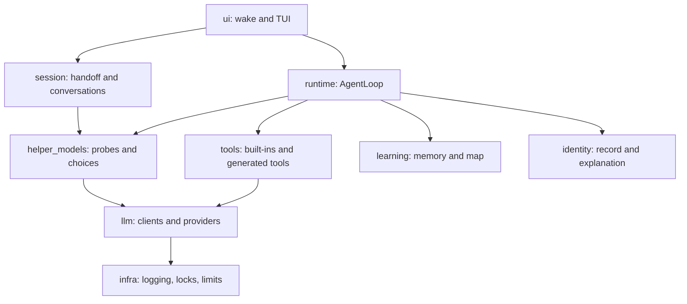

# SELF harness architecture

SELF is an image-owned Python harness that runs a bounded model and tool loop inside Docker. Durable state and generated tools live under `/home/entity`, the workspace bind mount. The harness tree under `/opt/agent` is root-owned and read-only; Docker is the security boundary.

## Layer order

Imports point downward in this order: `infra` → `llm` → `tools`, `learning`, `helper_models`, `identity` → `runtime` → `session`, `reporting` → `ui`. `identity` sits below `runtime` because `AgentLoop` constructs `IdentityStore`; the requested target order placed identity above runtime, which would require a behavior change to inject that dependency. The import guard checks the actual order and cycles.

## Newcomer reading order

Read [infra](infra/README.md) for event and state safety, [llm](llm/README.md) for calls and budgets, [tools](tools/README.md) and [learning](learning/README.md) for actions and memory, [helper_models](helper_models/README.md) for delegated work, [identity](identity/README.md) for durable self description, [runtime](runtime/README.md) for the action cycle, [session](session/README.md) for recovery, [ui](ui/README.md) for the terminal experience, and [reporting](reporting/README.md) for summaries.

## Root README phase map

| Root README section | Main directories |
| --- | --- |
| Phase 2: exploration loop | `runtime/`, `llm/` |
| Phase 3: self-written tools | `tools/` |
| Phase 4: learning across runs | `learning/`, `reporting/` |
| Phase 5: supplementary model providers | `llm/providers/`, `helper_models/` |
| Phase 6: hardening and operations | `infra/` |
| Phase 7: wake-up sessions and terminal UI | `session/`, `ui/` |
| Phase 8: first awakening and persistent identity | `identity/`, `ui/` |

## Glossary

| Term | Meaning |
| --- | --- |
| Workspace | Writable `/home/entity` state, logs, memory, and generated tools. |
| Harness | Image-owned code under `/opt/agent`; ordinary tool writes to it are rejected. |
| Helper model | Configured non-base model used for a bounded subtask or review. |
| Checkpoint | Persisted run state or bounded model-choice point, depending on context. |
| Handoff | Saved context and plan for the next wake session. |
| Calibration | Host-side comparison of pre-recorded model ratings with hidden benchmark scores. |
| Arm | A fixed harness configuration used for a randomized A/B run. |

The host-only evaluator lives in `../eval/` and is never mounted into the `self` service. See [migration notes](../docs/architecture-migration.md) for the old-to-new path map and baseline, and the [helper-model experiment](../docs/helper-model-experiment.md) for the run sequence.
