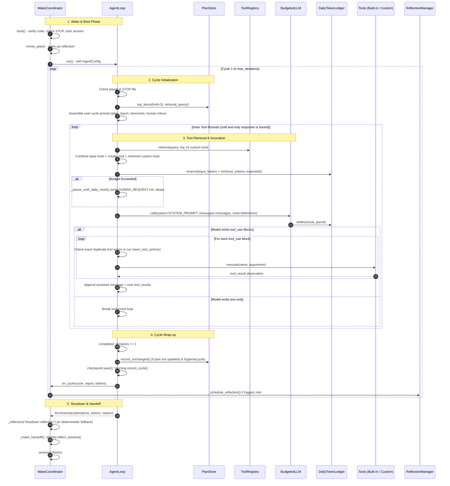
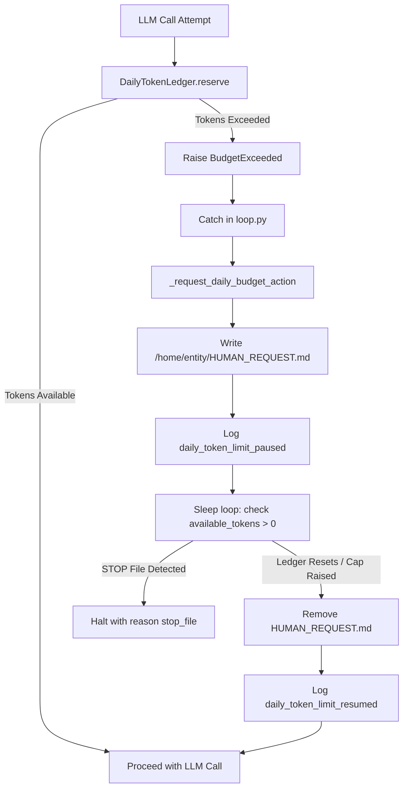

# Document 02: Runtime Loop & Cycle Execution

**Git Commit:** `14ffa606468920a97c672b39fbf3a43fccc52bdf`  
**Date:** 2026-10-17  
**Status:** Read-only architecture documentation

---

## 1. Cycle Step-by-Step Execution

The runtime is driven by `WakeCoordinator` `[read] agent/session/coordinator.py:61` (front-ended by `agent/ui/wake.py:38` for Textual TUI or executed directly via `agent/run.py:27` in headless mode) managing sessions, which in turn invokes `AgentLoop` `[read] agent/runtime/loop.py:167` to execute autonomous exploration cycles.

### Detailed Execution Stages

#### Step 1: Wake Boot & Orientation
`[read] agent/session/coordinator.py:270-346`:
1. `verify_startup_code_version()` hashes `/opt/agent` and logs warnings if it diverges from `HOST_AGENT_SOURCE_HASH` `[read] agent/session/version_check.py:32-41`.
2. `DailyTokenLedger._read()` validates or initializes `state/daily_token_budget.json` `[read] agent/infra/hardening.py:65-74`.
3. If `workspace/STOP` exists, boot aborts immediately without starting a session `[read] agent/session/coordinator.py:284-287`.
4. `SessionStore.start()` writes `state/active_session.json` and loads previous handoff `[read] agent/session/session.py:107-125`.
5. `self.body.orientation_changes()` checks for workspace changes, new tools, and uptime resets `[read] agent/body/container.py:539-562`.
6. `_spot_check_map()` verifies OS, CPU cores, and disk space against `state/map.json` `[read] agent/session/coordinator.py:241-260`.
7. `revise_plan()` runs a wake-up reflection to ensure the active plan is aligned before exploration `[read] agent/session/coordinator.py:466-477`.

#### Step 2: Cycle Initialization & Prompt Assembly
`[read] agent/runtime/loop.py:419-505`:
1. Check pause state (`_wait_while_paused()`) and STOP file (`_stopped()`).
2. Plugin boundary sync & hash verification: `PluginManager.sync_at_cycle_boundary()` re-reads human-owned `./config/plugins.json`, verifies full contents SHA-256 hashes against recorded pins, logs `plugin_hash_mismatch` upon tampering, disables/enables plugins, seeds starting goals into `PlanStore`, and injects clearly delimited embodiment and goal notes into prompts `[read] agent/plugins/manager.py:413-460, agent/runtime/loop.py:475-490`.
3. Plan query retrieval: `PlanStore.top_items()` retrieves active goals; `PlanStore.retrieval_query()` extracts goal keywords `[read] agent/learning/plan.py:180-210`.
4. Context assembly:
   - Self notes from `state/self_notes.md` `[read] agent/learning/learning.py:240`.
   - Verified environment map from `state/map.json` `[read] agent/learning/learning.py:105`.
   - Relevant memories retrieved via keyword matching from `state/memory.jsonl` `[read] agent/learning/learning.py:200`.
   - Plugin goal notes and starting seeds in a delimited section `[read] agent/plugins/manager.py:535`.
   - Legacy lessons from `workspace/memory/` `[read] agent/runtime/loop.py:127-164`.
5. Helper models evaluation prompt: If cycle 1 and helper models lack evaluations, an explicit evaluation directive is injected `[read] agent/runtime/loop.py:460-476`.
6. Human inbox messages: Consumed via `HumanInbox.consume()` from `state/human_input.jsonl` `[read] agent/session/session.py:60-75`.
7. Recent tool creation failure diagnostics extracted from `logs/actions.jsonl` `[read] agent/tools/tool_registry.py:202-218`.
8. System prompt: Assembled via `AgentLoop._system_prompt()`, combining core rules including the explicit 5-rung capability ladder (a. existing tools, b. helper model, c. create a tool, d. develop a plugin, e. request capability expansion from human; lowest rung preferred with justification) and cost floor principles with `self.body.describe()` via `assemble_system_prompt(self.body)` `[read] agent/runtime/loop.py:46-68`, active helper models registry summary, `IdentityStore.prompt_context()` `[read] agent/identity/identity.py:474`, and active plugin embodiment sections `[read] agent/plugins/manager.py:520`.
9. Active plugin project monitoring: `_check_active_plugin_projects()` monitors in-flight plugin development projects against estimates in `state/plugin_proposals.jsonl`; triggers stop-loss review alerts at 25%, 50%, and 100% thresholds (requiring explicit continue, reduce_scope, or abandon decisions updated in the plan), and injects an exploration nudge advising the agent to devote at least ~1 in 3 cycles to general plan items `[read] agent/runtime/loop.py:405-475`.

#### Step 3: Tool Rounds (`while True:` inner loop)
`[read] agent/runtime/loop.py:511-625`:
1. Check pause and STOP file at every turn.
2. In-flight human inputs: Any new human messages submitted while tools were running are injected into the message history `[read] agent/runtime/loop.py:522-533`.
3. Custom tool retrieval: `ToolRegistry.retrieve(query, top_k)` keyword-ranks tools in `workspace/tools/` `[read] agent/tools/tool_registry.py:195-200`.
4. Dynamic offerings assembled: Base tools + `create_tool` + retrieved custom tools + active plugin tools namespaced `<plugin>.<tool>` `[read] agent/runtime/loop.py:595`.
5. Daily token reservation: `BudgetedLLM.call()` calculates an estimated token reservation and reserves it in `DailyTokenLedger` with a file lock `[read] agent/llm/llm.py:72-84`.
6. LLM call: Dispatched to provider client with `max_tokens` set to model output ceiling.
7. Token settlement: Actual token usage is settled in the ledger; reservations released on network error `[read] agent/llm/llm.py:91-118`.
8. Tool execution:
   - If response contains no `tool_use` blocks, the tool round terminates `[read] agent/runtime/loop.py:567`.
   - If tool belongs to a vanished/disabled plugin, returns structured observation `{"ok": False, "error": "tool no longer available: plugin X disabled"}` without raising `[read] agent/runtime/loop.py:645`.
   - For each `tool_use` block:
     - Exact repetition check: If `(tool_name, arguments)` was already executed in this run, execution is blocked with an error observation `[read] agent/runtime/loop.py:583-588`.
     - Tool executed via `ToolRunner.execute()` `[read] agent/tools/base_tools.py:385-444` (delegating OS/container operations to `body`).
     - Tool result appended to `messages` as `tool_result` block `[read] agent/runtime/loop.py:602-609`.
     - If `ask_model` was called, a prompt reminds the agent it can optionally call `record_delegation_outcome` `[read] agent/runtime/loop.py:622-624`.
     - If `HUMAN_REQUEST.md` is detected, tool rounds break immediately `[read] agent/runtime/loop.py:615-618`.

#### Step 4: Cycle Wrap-up & Reflection
`[read] agent/runtime/loop.py:628-659`:
1. `completed_iterations += 1`.
2. Plan review check: If the plan was not modified during the cycle, `PlanStore.record_unchanged()` logs why the existing plan remains valid `[read] agent/runtime/loop.py:637-646`.
3. Plan hygiene: `PlanStore.hygiene()` clears completed or dropped items `[read] agent/learning/plan.py:550-575`.
4. Learning record: `LearningStore.record_cycle()` updates cycle statistics `[read] agent/learning/learning.py:275-285`.
5. Checkpoint: `RunCheckpoint.save()` updates `state/run_checkpoint.json` `[read] agent/infra/hardening.py:120-135`.
6. Periodic session checkpoint: Every 10 cycles or 300 seconds, `WakeCoordinator._checkpoint_cycle()` persists a full handoff snapshot to `state/sessions.jsonl` `[read] agent/session/coordinator.py:549-558`.
7. Background reflection: `WakeCoordinator._schedule_reflection()` evaluates triggers (tool failures, map updates, tool creation) and submits candidate to `ReflectionManager` `[read] agent/session/coordinator.py:160-174`.

#### Step 5: Shutdown & Inter-Session Handoff
`[read] agent/session/coordinator.py:704-754`:
1. If STOP was requested or 0 iterations completed, shutdown reflection is bypassed to prevent unwanted token spend `[read] agent/session/coordinator.py:715-724`.
2. Otherwise, `_reflection("shutdown reflection", ...)` queries the LLM for session achievements, updated plan, and lessons `[read] agent/session/coordinator.py:348-439`.
3. `IdentityStore.reflect_session()` evaluates whether any observed session behavior supports adding a new trait `[read] agent/identity/identity.py:580-640`.
4. `_make_handoff()` constructs a bounded handoff dictionary `[read] agent/session/coordinator.py:528-548`.
5. `SessionStore.finish()` archives session details to `state/sessions.jsonl`, saves `state/handoff.json`, and clears `state/active_session.json` `[read] agent/session/session.py:137-160`.

---

## 2. Iteration vs. Cycle Semantics

The terms "iteration" and "cycle" have precise, distinct meanings in this codebase:

| Term | Scope | Where Defined & Used | Meaning & Counting Rules |
| :--- | :--- | :--- | :--- |
| **Cycle** | Outer exploration turn | `[read] agent/runtime/loop.py:419` `cycle = 1` ... `cycle += 1` | 1-based index representing one complete turn of the outer exploration loop. Begins with prompt assembly and ends with cycle report and plan hygiene. |
| **Tool Round** | Inner dialogue turn | `[read] agent/runtime/loop.py:511` `while True:` | A single request/response turn with the LLM *within* a cycle. A cycle may execute 0, 1, or multiple tool rounds until the LLM returns text without tool calls. There is intentionally no fixed ceiling on tool rounds per cycle `[read] agent/runtime/loop.py:509`. |
| **Iteration** | Completed cycle counter | `[read] agent/runtime/loop.py:628` `completed_iterations += 1` | The number of *fully completed* cycles in a run. Only increments after all tool rounds finish and cycle report is generated. Returned in `RunSummary(iterations=completed_iterations)` `[read] agent/runtime/loop.py:685`. |

---

## 3. Pause, Stop, and STOP File Flow

### The Pause Flow
`[read] agent/runtime/loop.py:237-250, agent/ui/wake.py:707`:
- **Trigger:** TUI command `/pause` calls `coordinator.paused.set()` `[read] agent/ui/wake.py:2304`.
- **Enforcement:** `AgentLoop._wait_while_paused()` runs at cycle boundaries and before every tool execution round. It sleeps in 0.2s increments.
- **Precedence:** A detected STOP file immediately breaks the pause loop and halts.
- **Resume:** TUI command `/resume` calls `coordinator.paused.clear()` `[read] agent/ui/wake.py:2307`.

### The Stop Flow & STOP File
`[read] agent/runtime/loop.py:230-235, agent/ui/wake.py:2441-2445`:
- **Triggers:**
  1. TUI command `/stop` touches `/home/entity/STOP` and sets `coordinator.stop_requested = True` `[read] agent/ui/wake.py:2314`.
  2. Operating system signals `SIGINT` or `SIGTERM` invoke signal handlers that touch `/home/entity/STOP` and set `coordinator.stop_requested = True` `[read] agent/ui/wake.py:2441-2445`.
  3. Host operator creates `workspace/STOP` manually from host filesystem.
- **Enforcement:** `_stopped()` checks `(workspace / "STOP").exists()` at:
  - Cycle start `[read] agent/runtime/loop.py:430`.
  - Tool round start `[read] agent/runtime/loop.py:515`.
  - Before individual tool execution `[read] agent/runtime/loop.py:574`.
  - Before registering a new tool `[read] agent/tools/tool_registry.py:383`.
- **Guarantees:** When STOP is detected, all in-flight loops break immediately. No further LLM calls are made; shutdown reflection is skipped, and handoff is generated from existing state `[read] agent/ui/wake.py:1456-1465`.

---

## 4. Daily-Budget Pause Flow

`[read] agent/runtime/loop.py:251-292, agent/infra/hardening.py:75-115`:

1. **Reservation Check:** Before every LLM call, `DailyTokenLedger.reserve()` checks if `used_tokens + reserved_tokens + request > cap`. If exceeded, it raises `BudgetExceeded(kind="daily")` `[read] agent/infra/hardening.py:83-87`.
2. **Action Request:** `_request_daily_budget_action()` writes `/home/entity/HUMAN_REQUEST.md` advising the human to either increase `SELF_MAX_TOKENS_PER_DAY` in host `.env` or wait for UTC midnight reset `[read] agent/runtime/loop.py:251-274`.
3. **Safe Waiting Loop:** `_pause_until_daily_reset()` pauses execution, logging `daily_token_limit_paused`. It loops, checking every 1.0s whether available tokens have reset or increased `[read] agent/runtime/loop.py:275-292`.
4. **Resumption:** When `available_tokens() > 0`, the pending budget request is removed from `HUMAN_REQUEST.md`, `daily_token_limit_resumed` is logged, and the agent resumes without data loss.

---

## 5. Comprehensive Stop Reasons

Every stop reason that can terminate an `AgentLoop` run or a `WakeCoordinator` session:

| Stop Reason | Source Code Location | Context & Trigger Condition |
| :--- | :--- | :--- |
| `max_iterations` | `[read] agent/runtime/loop.py:399, 421` | Cycle count exceeded `config.max_iterations`. Normal clean termination for bounded runs. |
| `stop_file` | `[read] agent/runtime/loop.py:233, 431, 516, 575` | `/home/entity/STOP` file detected at cycle or tool round boundary. Clean termination without reflection call. |
| `human_request_pending`| `[read] agent/runtime/loop.py:436, 617, 656` | `/home/entity/HUMAN_REQUEST.md` exists on disk. Agent pauses work to await human intervention. |
| `wall_clock_budget` | `[read] agent/runtime/loop.py:428, 520` | Monotonic elapsed time exceeded `config.max_wall_clock_seconds`. |
| `provider_error` | `[read] agent/runtime/loop.py:558` | Unrecoverable exception from the LLM provider (after key rotations and retries exhausted). |
| `keyboard_interrupt` | `[read] agent/runtime/loop.py:744` | User pressed Ctrl+C in CLI mode (`SIGINT`). Caught in `loop.py:main()`. |
| `error` | `[read] agent/runtime/loop.py:748` | Unhandled fatal exception during CLI execution. |
| `clean_shutdown` | `[read] agent/ui/wake.py:1449, 1492` | Session-level status recorded in `state/sessions.jsonl` upon normal completion or requested stop. |
| `budget_exhausted` | `[read] agent/ui/wake.py:1449, 1492` | Session-level status recorded when loop stopped due to token or wall-clock budget. |
| `crash` | `[read] agent/session/session.py:118` | Recorded in `state/sessions.jsonl` on subsequent wake when an `active_session.json` was left in running state. |

---

## 6. Stalled Task De-Escalation & Non-Blocking Capability Workflow

### Permission Broker Panic Non-Halting Flow
1. **Safety Trigger:** If repeated tool errors trip the permission broker threshold (`PermissionBroker._consecutive_failures`), broker panic is signaled.
2. **De-Escalation Without Hard Stop:** Instead of writing `workspace/STOP` to disk, `StopWatcher.trigger_panic()` invokes emergency stop hooks on hardware/body while leaving the filesystem clean.
3. **Plan Demotion:** The loop demotes the stalled goal to `status="blocked"` with `priority=3` and reports the incident with actionable guidance and Task ID to `report_human.md`.
4. **Autonomous Continuation:** Panic is reset (`broker.reset_panic()`, `stop_watcher.reset_stop()`), and SELF immediately shifts focus to the next available goal in `PlanStore` rather than halting the session.

### Capability Request Lifecycle & Approval Workflow
1. **Request Creation:** When a new capability or external human action is requested (`request_capability`), a unique ID (`req-<id>`) is generated and tracked in `HUMAN_REQUEST.md` and `state/capability_requests.md`.
2. **Non-Blocking Continuation:** If other runnable goals remain in the plan, SELF marks the requesting task paused and continues with subsequent goals without stalling the entire agent loop. If all remaining goals are blocked/paused, SELF pauses cleanly (`reason="human_request_pending"`).
3. **Human Approval (`/approve [id]`):** Resolves the pending capability request or stalled task by ID, clears pause locks, sets the goal to `status="todo"` with `priority=1`, removes `report_human.md`, and wakes the loop to work on the approved task.
4. **Human Decline (`/decline [id] [reason]`):** Records the denial in `state/declined_capabilities.json`, writes negative knowledge to `state/map.json` and human input memory, clears pause locks, and allows SELF to proceed without the declined capability.
