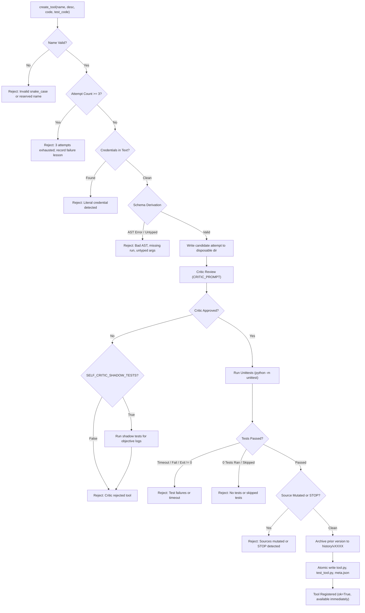

# Document 03: Tool Subsystem & Dynamic Tool Creation

**Git Commit:** `14ffa606468920a97c672b39fbf3a43fccc52bdf`  
**Date:** 2026-10-17  
**Status:** Read-only architecture documentation

---

## 1. Full Tool Inventory

The harness defines 23 tools (22 base tools in `agent/tools/base_tools.py` plus `create_tool` in `agent/tools/tool_registry.py`).

`ToolRunner` (`agent/tools/base_tools.py:270`) accepts an optional `Body` instance (defaulting to `ContainerBody` from `agent/body/container.py`). All 6 body-specific actions (`run_shell`, `read_file`, `write_file`, `list_dir`, `http_get`, `probe_local_ollama`) and core path enforcement are delegated directly to `self.body`. The tool names, argument schemas, and return formats remain strictly identical for backward compatibility with existing agent cognition and custom tools.

| Tool Name | Arguments | Return Shape | Module | Core vs. Body-Specific | Risk Class |
| :--- | :--- | :--- | :--- | :--- | :--- |
| `list_models` | None `{}` | `{"ok": bool, "base_model": str, "models": list[dict]}` | `agent/tools/base_tools.py:25` | **Core** (cognition) | Reads |
| `record_model_assessment`| `name: str, assessment: str, evidence: str, ratings?: dict, facts?: dict\|list` | `{"ok": bool, "name": str, "updated": bool}` | `agent/tools/base_tools.py:30` | **Core** (cognition) | Writes |
| `probe_model` | `name: str` | `{"ok": bool, "name": str, "probe_id": str, "cases": list[dict], "passed": int, "inconclusive": int}` | `agent/tools/base_tools.py:44` | **Core** (cognition) | Executes / Network |
| `research_model` | `name: str` | `{"ok": bool, "name": str, "facts": dict, "urls_tried": list[str]}` | `agent/tools/base_tools.py:50` | **Core** (cognition) | Network |
| `ask_model` | `model: str, prompt: str, task_type: str, reason: str, expected_benefit: str` | `{"ok": bool, "call_id": str, "model": str, "result": str, "tokens_used": int}` | `agent/tools/base_tools.py:56` | **Core** (cognition) | Network |
| `record_delegation_outcome` | `call_id: str, usefulness: str (enum), note: str` | `{"ok": bool, "recorded": bool}` | `agent/tools/base_tools.py:66` | **Core** (cognition) | Writes |
| `run_shell` | `cmd: str, timeout?: float (default 30)` | `{"output": str, "exit_code": int, "timed_out": bool, "output_bytes": int, "truncated": bool}` | `agent/tools/base_tools.py:75` | **Body-Specific** (Linux container shell) | Executes |
| `read_file` | `path: str, max_chars?: int (default 20000)` | `{"path": str, "content": str, "truncated": bool}` | `agent/tools/base_tools.py:87` | **Body-Specific** (Container filesystem) | Reads |
| `write_file` | `path: str, content: str, append?: bool (default False)` | `{"ok": bool, "path": str, "bytes_written": int}` | `agent/tools/base_tools.py:99` | **Body-Specific** (Container filesystem) | Writes |
| `list_dir` | `path: str, max_entries?: int (default 500)` | `{"path": str, "entries": list[str], "truncated": bool}` | `agent/tools/base_tools.py:112` | **Body-Specific** (Container filesystem) | Reads |
| `http_get` | `url: str, timeout?: float (default 20), max_chars?: int (default 20000)` | `{"status_code": int, "body": str, "headers": dict, "truncated": bool}` | `agent/tools/base_tools.py:124` | **Body-Specific** (Container network interface) | Network |
| `update_environment_map`| `entries: list[{"key": str, "value": any, "confidence": str, "evidence"?: str}]` | `{"ok": bool, "entries_updated": int}` | `agent/tools/base_tools.py:137` | **Core** (knowledge) | Writes |
| `read_plan` | `include_history?: bool` | `{"version": int, "plan": list[dict], "human_input_decisions": list[dict], "history"?: list[dict]}` | `agent/tools/base_tools.py:160` | **Core** (planning) | Reads |
| `update_plan` | `action: str (enum), reason: str, goal?: str, id?: str, evidence?: str, next_steps?: str, priority?: int, status?: str, order?: list, input?: str, decision?: str, source?: str` | `{"ok": bool, "plan_version": int, "action": str, "details": dict}` | `agent/tools/base_tools.py:165` | **Core** (planning) | Writes |
| `research_provider` | `provider: str` | `{"ok": bool, "provider": str, "official_page": str, "summary": str}` | `agent/tools/base_tools.py:217` | **Core** (providers) | Network |
| `record_provider_verification` | `provider: str, free_tier: dict, models: list[str], strengths: list[str], source_url: str` | `{"ok": bool, "provider": str, "saved": bool}` | `agent/tools/base_tools.py:222` | **Core** (providers) | Writes |
| `request_provider_key` | `provider: str` | `{"ok": bool, "request_path": str}` | `agent/tools/base_tools.py:230` | **Core** (human request) | Writes |
| `ask_brain` | `prompt: str, task_type?: str, model?: str, preferred_provider?: str, max_tokens?: int (default 512)` | `{"ok": bool, "response": str, "provider": str, "model": str}` | `agent/tools/base_tools.py:235` | **Core** (supplementary LLM) | Network |
| `benchmark_providers` | `providers?: list[str]` | `{"ok": bool, "scores": dict}` | `agent/tools/base_tools.py:243` | **Core** (benchmarks) | Network |
| `probe_local_ollama` | None `{}` | `{"ok": bool, "reachable": bool, "models": list[str]}` | `agent/tools/base_tools.py:248` | **Body-Specific** (Local container daemon) | Network / Reads |
| `request_capability` | `kind: str (enum), summary: str, reason: str, provider?: str, env_names?: list[str], signup_url?: str` | `{"ok": bool, "request_file": str, "kind": str}` | `agent/tools/base_tools.py:253` | **Core** (human boundary) | Writes |
| `propose_core_patch` | `name: str, diff: str, reasoning: str` | `{"ok": bool, "patch_file": str, "name": str}` | `agent/tools/base_tools.py:262` | **Core** (human boundary) | Writes |
| `create_tool` | `name: str, description: str, code: str, test_code: str` | `{"ok": bool, "name": str, "version": int, "path": str, "input_schema": dict, "message"?: str, "error"?: str, "attempts_remaining"?: int}` | `agent/tools/tool_registry.py:22` | **Core** (capability synthesis) | Executes / Writes / Network |

---

## 2. The `create_tool` Pipeline in Detail

`[read] agent/tools/tool_registry.py:225-427`:



### Stage 1: Static Validation & Schema Extraction
1. **Name check:** Must match `^[a-z][a-z0-9_]{0,63}$` and not match built-in tool names or `create_tool`, `select_model` `[read] agent/tools/tool_registry.py:227-228`.
2. **Attempt cap:** Maximum 3 attempts per tool name per run `[read] agent/tools/tool_registry.py:236-240`.
3. **Credential scan:** `logger.redactor.known(text) != text` checks `code`, `test_code`, and `description`. Rejects literal API keys or tokens `[read] agent/tools/tool_registry.py:252-253`.
4. **Schema derivation (`schema_from_code`):**
   - AST parses `code` `[read] agent/tools/tool_registry.py:90`.
   - Requires exactly one synchronous `run(...)` function `[read] agent/tools/tool_registry.py:97`.
   - Rejects `*args`, `**kwargs`, or positional-only arguments `[read] agent/tools/tool_registry.py:100`.
   - Checks type annotations: must be one of `str`, `int`, `float`, `bool`, `list`, `dict` `[read] agent/tools/tool_registry.py:111`.
   - Alternatively, accepts a literal `INPUT_SCHEMA` JSON Schema Draft 2020-12 object `[read] agent/tools/tool_registry.py:102-110`.
5. **Test code parse:** `ast.parse(test_code)` verifies test syntax `[read] agent/tools/tool_registry.py:255`.
6. **Disposable attempt directory:** Files written to `workspace/tools/<name>/attempts/<uuid>/tool.py` and `test_tool.py` `[read] agent/tools/tool_registry.py:246-258`.

### Stage 2: Critic Review
1. **Model selection:** `ModelDecisions.decide_model(moment="create_tool_critic")` selects either base model or a helper model (e.g. `SELF_CRITIC_MODEL`) `[read] agent/tools/tool_registry.py:260-273`.
2. **Critic prompt:** Uses `CRITIC_PROMPT` `[read] agent/tools/tool_registry.py:39-51` instructing the reviewer to treat code as data, flag bugs, check for credential leaks (reading environment markers), and require assertions.
3. **Response parsing & retry:** Expects `{"approved": bool, "issues": [...]}`. Re-prompts once if response was truncated or invalid JSON `[read] agent/tools/tool_registry.py:285-323`.
4. **Approval condition:** `approved == true` and `issues == []` `[read] agent/tools/tool_registry.py:347`.
5. **Shadow test policy:** If `SELF_CRITIC_SHADOW_TESTS` is enabled (`"true"` by default), rejected candidates still run unittests to record objective test logs before raising rejection `[read] agent/tools/tool_registry.py:348-350`.

### Stage 3: Isolated Test Execution
1. **Compatibility alias:** If tests use legacy import `from <name> import run`, harness copies `tool.py` to `<name>.py` inside the disposable attempt folder only `[read] agent/tools/tool_registry.py:352-357`.
2. **Environment isolation:** `_child_env()` strips all secret-containing environment variables from the test process `[read] agent/tools/tool_registry.py:219-224`.
3. **Execution command:** Runs `python -m unittest discover -s . -p test_tool.py -v` via `run_process` `[read] agent/tools/tool_registry.py:359`.
4. **Limits:** Hard timeout `test_timeout=15s`, output capped at 20,000 characters `[read] agent/tools/tool_registry.py:135, 147`.
5. **Verification criteria:**
   - `exit_code == 0`
   - `timed_out == False`
   - `truncated == False`
   - Regex matches `Ran (\d+) tests?` with count > 0 `[read] agent/tools/tool_registry.py:366-370`.
   - No `"skipped="` and no `"expected failures="` `[read] agent/tools/tool_registry.py:379-380`.

### Stage 4: Anti-Mutation Check & Atomic Registration
1. **Source integrity:** Candidate `tool.py` and `test_tool.py` are re-read and hashed to ensure the test process did not rewrite them `[read] agent/tools/tool_registry.py:381-382`.
2. **STOP check:** Ensures `/home/entity/STOP` was not created during test execution `[read] agent/tools/tool_registry.py:383-384`.
3. **History archive:** If updating an existing version, prior `tool.py`, `test_tool.py`, and `meta.json` are archived to `workspace/tools/<name>/history/v{version:04d}/` `[read] agent/tools/tool_registry.py:385-389`.
4. **Atomic deployment:** Written to temporary `.tmp` files and atomically renamed into place `[read] agent/tools/tool_registry.py:390-394`.
5. **Metadata record:** `meta.json` updated with `code_sha256`, `test_sha256`, `version += 1`, `registered = True` `[read] agent/tools/tool_registry.py:395-398`.
6. **Failure lesson:** If 3 consecutive creation attempts fail, a lesson is appended to `workspace/memory/lessons.jsonl` `[read] agent/tools/tool_registry.py:413-420`.

---

## 3. Storage, Loading, and Rejection Rules for Custom Tools

### On-Disk Structure
Custom tools are persisted in `workspace/tools/<name>/`:
```
workspace/tools/parse_mounts/
├── meta.json                # Metadata, hashes, schema, history [read]
├── tool.py                  # Registered implementation [read]
├── test_tool.py             # Registered unit tests [read]
├── attempts/                # Disposable attempt folders per creation try [read]
│   └── 6201a3.../
│       ├── tool.py
│       └── test_tool.py
└── history/                 # Versioned archive of prior registered releases [read]
    └── v0001/
        ├── meta.json
        ├── tool.py
        └── test_tool.py
```

### Loading & Rejection Flow (`ToolRegistry.refresh`)
`[read] agent/tools/tool_registry.py:170-194`:
- Scans immediate subdirectories of `workspace/tools/`.
- Validates folder name matches `^[a-z][a-z0-9_]{0,63}$`.
- Reads `meta.json`. Rejects if:
  1. `meta.json` is missing or corrupt.
  2. `registered != True`.
  3. `meta["name"] != folder.name`.
  4. Tool name is reserved.
  5. **External Mutation:** `digest("tool.py") != meta["code_sha256"]` or `digest("test_tool.py") != meta["test_sha256"]`.
- On rejection: logs `tool_load_rejected` and unloads tool from active registry.
- How to clear rejection: Re-test and re-register through `create_tool` `[read] agent/tools/tool_registry.py:189`.

### Custom Tool Execution Sandbox (`ToolRegistry.execute`)
`[read] agent/tools/tool_registry.py:428-448, agent/tools/tool_worker.py:1-28`:
1. Validates call arguments against `meta["input_schema"]` using `jsonschema.validate`.
2. Launches isolated child process: `python /opt/agent/tools/tool_worker.py` in `cwd=workspace/tools/<name>`.
3. Pass arguments via `sys.stdin` as JSON.
4. Strips all secret markers from child environment.
5. In `tool_worker.py`, stdout is redirected to `sys.stderr` during execution so arbitrary `print()` statements do not corrupt data `[read] agent/tools/tool_worker.py:20-21`.
6. Module executes `result = module.run(**arguments)`.
7. Worker prints envelope to real stdout: `SELF_TOOL_RESULT=<json_result>` `[read] agent/tools/tool_worker.py:23`.
8. Enforces execution timeout (30s) and output cap (20,000 chars).

---

## 4. Limits and Sandboxing for `run_shell`

`[read] agent/tools/base_tools.py:446-464, agent/infra/process_runner.py:1-85`:

| Layer | Limit / Sandboxing Property | Enforcement Mechanism |
| :--- | :--- | :--- |
| **Execution User** | `root` inside container | Set by Dockerfile `USER root` `[read] Dockerfile:50`. The agent has full root privileges inside the container's PID, user, and mount namespaces. |
| **Shell Interpreter**| `/bin/bash -lc "<cmd>"` | Invoked with login and command flags `[read] agent/tools/base_tools.py:461`. |
| **Working Directory**| `/home/entity` (`workspace`) | Set to `self.workspace` `[read] agent/tools/base_tools.py:461`. |
| **Execution Timeout**| `timeout` argument (default 30.0s) | Enforced by `process_runner.py` via `selectors.DefaultSelector` and process polling. Process tree is killed on timeout. |
| **Output Ceiling** | `20,000` characters | Streamed stdout/stderr is buffered up to `output_cap` (`SELF_MAX_OUTPUT_CHARS`). If exceeded, `truncated=True` and remainder discarded `[read] agent/infra/process_runner.py:65`. |
| **Credential Redaction** | Known secrets masked in logs | `command_started` and `command_output` event logs pass output through `EventLogger.redactor` `[read] agent/tools/base_tools.py:449-454`. |
| **Container Sandbox**| Docker container boundary | Linux cgroups enforce `mem_limit: 4g`, `cpus: 2`, `pids_limit: 512` `[read] docker-compose.yml:8-10`. Bridge networking prevents access to host network stack. |
| **Filesystem Boundary**| `/opt/agent` is read-only | Chmod `0555` dirs and `0444` files in container image `[read] Dockerfile:45-46`. |
| **Unenforced Shell Gaps**| **Shell commands run as root** | `run_shell` executes as root; file permission checks in `write_file` (like `_is_core_path`) are Python-level and do NOT block root commands like `chmod +w /opt/agent` or package removal via `apt-get` `[inferred: root in container retains standard Linux DAC override]`. |

---

## 5. Dynamic Plugin Tools & Unplug Resilience

`[read] agent/plugins/manager.py:270-360, agent/tools/base_tools.py:453-465, agent/runtime/loop.py:643-652`:
1. **Dynamic Tool Offerings:** Enabled plugins register tools namespaced as `<plugin>.<tool>` (e.g. `hello.greet`). These tools are appended to cycle model tool offerings alongside base tools and retrieved custom tools.
2. **Core Collision Protection:** Plugin tools cannot collide with core built-in tools (`TOOL_DEFINITIONS`) or `create_tool`. Any collision causes plugin loading to fail with `plugin_load_failed` without taking down the core engine.
3. **Unplug Resilience & Vanished Tools:** When a plugin is disabled or removed, its tools are immediately deregistered at the cycle boundary. If the LLM generates a tool call for a vanished plugin tool, the engine intercepts the call and returns a structured observation (`{"ok": False, "error": "tool no longer available: plugin X disabled"}`) instead of raising an exception.

