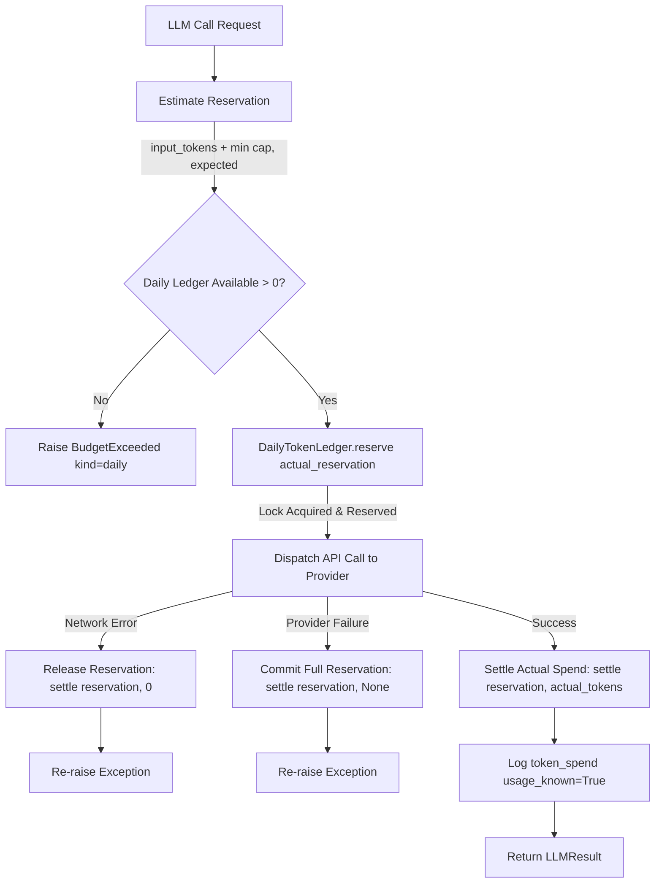

# Document 05: LLM Client & Multi-Model System

**Git Commit:** `14ffa606468920a97c672b39fbf3a43fccc52bdf`  
**Date:** 2026-10-17  
**Status:** Read-only architecture documentation

---

## 1. LLM Client Architecture

### `LLMClient`
`[read] agent/llm/llm.py:185-367`:
- **Provider Boundary:** Wraps the underlying API client (Ollama Cloud or Anthropic).
- **Credentials & Rotation:**
  - Reads keys via `_env_key_list("OLLAMA_API_KEYS", "OLLAMA_API_KEY", ...)` or `ANTHROPIC_API_KEYS` `[read] agent/llm/llm.py:192-207`.
  - Multiple keys are supported in a thread-safe rotating pool (`_key_lock`, `_key_index`) `[read] agent/llm/llm.py:223-246`.
  - When a provider responds with HTTP `401`, `403`, or `429`, `_rotate_key()` advances to the next key in the pool and logs `llm_key_rotated` `[read] agent/llm/llm.py:231-246, 316-320`.
- **Primary Model:** Fixed at startup (`base_model`). Default: `"gpt-oss:120b-cloud"` `[read] agent/llm/llm.py:215`. The primary model is fixed for the lifetime of the client and cannot be changed by the agent `[read] agent/llm/llm.py:227-229`.
- **Model Registry Association:** Constructs `ModelRegistry` initialized with `base_model` and helper models from `LLM_AVAILABLE_MODELS` `[read] agent/llm/llm.py:216-218`.

### Retries & Error Handling
`[read] agent/llm/llm.py:284-367`:
- **Max Retries:** 3 attempts per call with exponential backoff: `delay = 2.0 * (2 ** retry)` `[read] agent/llm/llm.py:322`.
- **Transient Network Errors (`_is_network_error`):**
  - Identified by instance (`ConnectionError`, `TimeoutError`, `OSError`) or class name (`APIConnectionError`, `ConnectTimeout`, `NetworkError`) `[read] agent/llm/llm.py:29-40`.
  - Network errors release the pre-allocated token reservation in `DailyTokenLedger` without penalizing the agent's budget `[read] agent/llm/llm.py:91-100`.
- **Model / Output Failures:**
  - Status codes `401`, `403`, `429` trigger key rotation.
  - Non-network failures settle the full reservation against the daily budget and log `token_spend(usage_known=False)` `[read] agent/llm/llm.py:101-108`.

---

## 2. Token Budgeting: `BudgetedLLM` & Daily Token Ledger

`[read] agent/llm/llm.py:43-119, agent/infra/hardening.py:50-115`:



### Pre-Call Token Reservation Formula
`[read] agent/llm/llm.py:70-75`:
```python
reserved_input = (len(json_payload.encode("utf-8")) + 1) // 2 + 512
expected_output = min(max_tokens, int(os.getenv("SELF_EXPECTED_OUTPUT_TOKENS", "1024")))
reservation_estimate = reserved_input + expected_output
```
- A call cannot proceed unless `available_tokens() >= reservation_estimate`.

### Daily Ledger Mechanism (`DailyTokenLedger`)
`[read] agent/infra/hardening.py:50-115`:
- **State File:** `workspace/state/daily_token_budget.json`, locked by `state/daily_token_budget.lock`.
- **Cap:** Configured by `SELF_MAX_TOKENS_PER_DAY` (default `200,000`).
- **Reset:** Automatically resets `used_tokens = 0` and `reserved_tokens = 0` when the calendar date advances past UTC midnight (`now_utc()[:10] != stored_date`) or when the cap value changes `[read] agent/infra/hardening.py:68-73`.
- **Exhaustion Behavior:** When budget is exhausted, `BudgetExceeded` is raised. The autonomous loop pauses in `_pause_until_daily_reset()`, writes `HUMAN_REQUEST.md`, and safely sleeps until the daily reset or cap increase `[read] agent/runtime/loop.py:275-292`.

---

## 3. Output Ceilings & Truncation Handling

`[read] agent/llm/llm.py:138-144, agent/llm/model_registry.py:273-299`:

### Output Ceiling Hierarchy
When determining `max_tokens` for any model call:
1. **Dynamic Environment Override:** `SELF_OUTPUT_CAP_<MODEL>` (e.g., `SELF_OUTPUT_CAP_GPT_OSS_120B_CLOUD`) takes highest precedence `[read] agent/llm/model_registry.py:275-283`.
2. **Registry Ceiling:** `output_cap` or `max_tokens` recorded in `state/models.json` `[read] agent/llm/model_registry.py:286-290`.
3. **Global Fallback:** `SELF_DEFAULT_OUTPUT_CEILING` (default: `32,768`) `[read] agent/llm/model_registry.py:293`.
4. **Assumed Ceiling Log:** If a model lacks an explicit ceiling, `assumed_output_ceiling` is logged once `[read] agent/llm/model_registry.py:294-297`.

### Truncation Detection (`response_truncated`)
`[read] agent/llm/llm.py:138-144`:
A model output is classified as truncated if:
- `stop_reason` (case-insensitive) is `"max_tokens"`, `"max_output_tokens"`, `"length"`, or `"token_limit"`.
- `output_tokens >= max_output_tokens` (protects against providers that stop at the cap without returning a specific length stop reason).
- Truncation events trigger `ModelRegistry.record_truncated_call(model)` and record objective checkpoint failure telemetry `[read] agent/tools/tool_registry.py:325-334`.

---

## 4. Model Registry & Provider Registry Schemas

### `ModelRegistry` (`state/models.json`)
`[read] agent/llm/model_registry.py:1-614`:
- **File Limits:** Max 32 models, 1 MB max file size.
- **Schema Version:** 3 (probe format version 2).
- **Model Entry Schema:**
  ```json
  {
    "name": "gpt-oss:120b-cloud",
    "role": "base",
    "configured": true,
    "status": "configured",
    "status_message": "",
    "last_failure_at": null,
    "agent_assessment": "550B/55B, ctx 262k+, status ok, call latency ~2.1s...",
    "assessment_evidence": "probe:8a4c0...",
    "ratings": {
      "reasoning": "high",
      "code": "high",
      "instruction_following": "high",
      "summarization": "high",
      "json_output": "high"
    },
    "ratings_at": "2026-10-17T10:00:00Z",
    "measured_stats": {
      "calls": 142,
      "failures": 0,
      "truncated_calls": 1,
      "network_errors": 0,
      "latency_ms_total": 298200,
      "latency_ms_probe_total": 7200,
      "probe_calls": 4
    },
    "facts": {
      "total_params": "550B",
      "active_params": "55B",
      "context_window": 262144
    },
    "probe_history": []
  }
  ```

### `ProviderRegistry` (`state/providers.json`)
`[read] agent/llm/providers/registry.py:1-210`:
- Stores verified free-tier limits, documentation source URLs, and model availability for providers discovered via `research_provider` and verified via `record_provider_verification`.

---

## 5. The Helper-Model Subsystem

The helper-model system enables the agent to investigate, assess, and delegate sub-tasks to supplementary models configured under the active provider key.

### 1. Capability Probes (`ModelProber.probe_model`)
`[read] agent/helper_models/model_probe.py:1-315`:
- **Cooldown & Caps:**
  - `SELF_PROBE_COOLDOWN_SECONDS` (default: 3,600s / 1 hr) `[read] agent/llm/model_registry.py:97`.
  - `SELF_PROBES_PER_MODEL_PER_SESSION` (default: 2 per model) `[read] agent/llm/model_registry.py:99`.
- **4 Standardized Probe Cases:**
  1. *Reasoning / Logic:* Bounded logic puzzle requiring deductive constraint satisfaction.
  2. *Code Generation:* Pure python string transformation with unit verification.
  3. *Instruction Following:* Formatting constraints and delimiter handling.
  4. *JSON Schema Compliance:* Emitting strictly conforming JSON matching a requested schema.
- **Inconclusive Handling:** If a probe test is inconclusive (e.g., unexpected token length or ambiguous response), it is tagged `inconclusive` rather than failed, directing the agent to treat it as unknown `[read] agent/helper_models/model_probe.py:255-260`.

### 2. Model Documentation Research (`ModelProber.research_model`)
`[read] agent/helper_models/model_probe.py:280-315`:
- Fetches official model documentation pages via HTTP.
- Extracts parameters (context window, parameter counts, pricing) and records facts tagged with `origin="web", verified=true` `[read] agent/llm/model_registry.py:550-570`.

### 3. Model Decision Picker (`ModelDecisions.decide_model`)
`[read] agent/helper_models/model_decisions.py:530-660`:
- **Purpose:** Decides whether to route a specific moment (`create_tool_critic`, `session_end_handoff`) to a helper model or keep it on the base model.
- **Decision Prompt:** Prompts the base model with a compact summary of configured helper models, explicit facts, measured latencies, truncation rates, and probe outcomes.
- **Blacklist / Cooldown:** Models with recent failures are temporarily excluded based on `SELF_MODEL_FAILURE_COOLDOWN_SECONDS` (default: 600s) `[read] agent/helper_models/model_decisions.py:77`.
- **Audit Logging:** Every routing decision is appended to `state/model_decisions.jsonl` `[read] agent/helper_models/model_decisions.py:645-660`.

### 4. Delegation (`ask_model`) & Outcome Tracking
`[read] agent/helper_models/model_decisions.py:380-480, agent/helper_models/model_outcomes.py:1-115`:
- **Delegation Constraints:**
  - Rejects calls to the base model (`ask_model is for helper models only`) `[read] agent/llm/model_registry.py:306-312`.
  - Maximum delegation prompt chars: 4,000 `[read] agent/helper_models/model_decisions.py:22`.
  - Output treated as untrusted text.
- **Outcome Recording:**
  - Objective metrics (latency, total tokens, parse failures, truncations) logged to `state/model_outcomes.jsonl` `[read] agent/helper_models/model_outcomes.py:25-45`.
  - Subjective agent assessment: Agent can optionally call `record_delegation_outcome(call_id, usefulness, note)` (`"used"`, `"partly_used"`, `"not_used"`, `"wrong"`) to log personal utility `[read] agent/tools/base_tools.py:66-73`.
