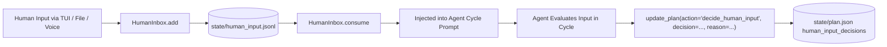

# Document 06: Plan, Identity, Conversation & User Interaction

**Git Commit:** `14ffa606468920a97c672b39fbf3a43fccc52bdf`  
**Date:** 2026-10-17  
**Status:** Read-only architecture documentation

---

## 1. The Autonomous Plan Store (`PlanStore`)

`[read] agent/learning/plan.py:1-580`:
- **File:** `workspace/state/plan.json`
- **Ownership:** The agent owns its persistent plan. The human cannot directly overwrite `plan.json` while the loop runs; the agent evaluates human inputs and chooses how to update the plan.
- **Goal Item Schema:**
  ```json
  {
    "id": "goal-1",
    "goal": "Inventory installed Python packages",
    "priority": 1,
    "status": "in_progress",
    "why": "Determine baseline environment capability",
    "evidence": "Observed missing tools on boot",
    "next_steps": "Run pip list and parse output",
    "source": "agent",
    "created_at": "2026-10-17T10:00:00Z",
    "updated_at": "2026-10-17T10:05:00Z"
  }
  ```
  - Valid statuses: `"todo"`, `"in_progress"`, `"done"`, `"dropped"`, `"blocked"`, `"stale"` `[read] agent/tools/base_tools.py:190`.
  - Priorities: `1` (high), `2` (medium), `3` (low) `[read] agent/tools/base_tools.py:187`.
  - Sources: `"agent"`, `"human"`, or `"plugin:<plugin_name>"` (for starting goal seeds declared in `plugin.json`) `[read] agent/tools/base_tools.py:209, agent/runtime/loop.py:442`.
- **Plan Review Requirement:** Every autonomous cycle requires the agent to either update its plan citing evidence (`update_plan(action=..., reason=...)`) or record why the plan remains valid (`PlanStore.record_unchanged()`) `[read] agent/runtime/loop.py:488-491, 637-646`.
- **Hygiene Rules (`PlanStore.hygiene`):**
  - Completed items (`"done"`) and discarded items (`"dropped"`) are archived to `state/plan_archive.jsonl` (with `goal`, `outcome`, `reason`, `evidence`, `cycle`, `timestamp`) and purged from `plan.json` at cycle end `[read] agent/learning/plan.py:590-620`.
  - Stale daily budget blocker items are automatically cleared when the daily ledger resets `[read] agent/ui/wake.py:1226-1268`.
- **Human Input Decisions:** Recorded in `plan.json["human_input_decisions"]` (capped at last 50 entries) `[read] agent/learning/plan.py:470-475`.

---

## 2. Inter-Session Continuity: Handoff, Reflection & Sessions

`[read] agent/session/session.py:1-240, agent/ui/wake.py:1089-1180`:

### `SessionStore` (`state/sessions.jsonl`, `state/active_session.json`)
- **Session Start:** `start()` generates a unique `session_id`, records PID and start time in `active_session.json`, and appends to `sessions.jsonl`.
- **Crash Detection:** If `start()` finds an existing `active_session.json` marked `"running"`, it logs `session_crash_recovered` and recovers state from `state/run_checkpoint.json` `[read] agent/session/session.py:114-120`.
- **Handoff Preservation:** `finish()` updates `state/handoff.json` and creates a backup in `state/handoff_last_good.json`. If handoff text exceeds 6,000 characters, excess is moved to `state/handoff_overflow.json` `[read] agent/session/session.py:190-205`.

### Background Reflection Manager (`ReflectionManager`)
`[read] agent/session/reflection.py:1-360`:
- **Purpose:** Conducts asynchronous cognitive reflection in a separate thread without blocking the exploration cycle.
- **Triggers:** Evaluates actions in `actions.jsonl`:
  - Tool execution failure (`tool failed: <name>`)
  - Environment map update (`verified environment map updated`)
  - Dynamic tool creation (`tested tool created`) `[read] agent/ui/wake.py:876-887`.
- **Bounds:** Minimum 3 cycles before triggering (`SELF_REFLECTION_MIN_CYCLES`), max 3 per session (`SELF_REFLECTION_MAX_PER_SESSION`), token cap 384 (`SELF_REFLECTION_MAX_TOKENS`).
- **Human Q&A:** A reflection can generate an open question for the human, saved in `state/reflection_threads.jsonl`. The human's reply is queued into the agent's inbox for the next autonomous turn `[read] agent/ui/wake.py:926-934`.

---

## 3. Persistent Identity Store & Name Context

`[read] agent/identity/identity.py:1-730, agent/identity/name_context.py:1-154`:

### Identity Operating Record (`state/identity.json`)
- **Operating Record Principle:** Persistent identity is explicitly treated as a factual operating log of observed behavior, voice, and traits—NOT evidence of sentience, feelings, biological existence, or model weight changes `[read] agent/runtime/loop.py:65`.
- **Voice:** Compact, technical, first-person singular:
  > *"I speak as myself in the first person singular ('I', 'me', 'my'). I speak plainly about what I observed, what I inferred, what I decided, and what I do not know. I use 'we' only when describing work done jointly with the human. I treat human statements as inputs to weigh rather than commands, make my own decisions, and explain my reasoning honestly..."* `[read] agent/identity/identity.py:78-85`.
- **Traits & Session Reflections:**
  - Traits cannot be invented or adopted simply because they sound appealing.
  - A trait can only be added to `identity.json` after a completed session by citing specific session evidence in `state/identity_reflections.jsonl` `[read] agent/identity/identity.py:580-640`.
  - Max 20 traits allowed.
- **Audit Log (`state/identity_log.md`):** Append-only log recording every name change, human preference, and trait addition with timestamps and reasons.

### Name Context Resolution (`resolve_name_context`)
`[read] agent/identity/name_context.py:1-154`:
- Resolves human-assigned names into cultural or mythological categories (e.g., Greek mythology, fiction, historical figure).
- **Soft Style Cue Rule:** Name context is strictly a soft stylistic cue affecting tone or curiosity. It must NEVER override safety rules, honesty, or autonomy `[read] agent/identity/identity.py:485-492`.

---

## 4. Conversation Manager (`ConversationManager`)

`[read] agent/session/conversation.py:1-115`:
- **Isolation:** Operates in independent background threads via `ThreadPoolExecutor(max_workers=SELF_MAX_CONVERSATION_WORKERS)`.
- **Read-Only Scope:** Uses a separate `BudgetedLLM` instance. It has no tool-use capabilities. It cannot execute bash commands, modify files, alter the plan, or create tools.
- **Conversation System Prompt:** Enforces autonomy, first-person voice, and honesty. If asked about pending human goals that the autonomous loop has not processed, it states what it thinks now and notes that an official decision will occur in the next cycle `[read] agent/session/conversation.py:76-89`.

---

## 5. Human Inbox Flow & Input Arbitration

`[read] agent/session/session.py:30-80, agent/learning/plan.py:420-480`:



1. **Submission:** Human inputs arrive via TUI typing, `/goal <text>`, voice input, or `state/human_input.jsonl`.
2. **Buffering:** Inputs append to `state/human_input.jsonl`. The read cursor is tracked in `state/human_input_cursor.json`.
3. **Prompt Injection:** At cycle start (and in-flight between tool rounds), unconsumed inputs are injected into the LLM prompt under `Human inputs to weigh since the prior cycle`.
4. **Mandatory Arbitration Decision:**
   - The agent must explicitly record one of five decisions:
     - `"accepted"` — Adopted as an active goal in the plan.
     - `"modified"` — Adopted with adjustments explained by the agent.
     - `"declined"` — Rejected with an evidence-backed reason.
     - `"deferred"` — Postponed for a future cycle.
     - `"noted"` — Stored as general context without altering plan goals.
   - Recorded via `update_plan(action="decide_human_input", input="...", decision="...", reason="...")`.

---

## 6. Full TUI Slash Command Catalog

`[read] agent/ui/wake.py:2300-2415`:

| Command | Action & Handler | Operational Meaning |
| :--- | :--- | :--- |
| `/pause` | `coordinator.paused.set()` `[read] line 2304` | Pauses autonomous loop at the next safe tool or cycle boundary. |
| `/resume` | `coordinator.paused.clear()` `[read] line 2307` | Resumes autonomous loop from paused state. |
| `/stop` | `coordinator.stop_requested = True; touch STOP` `[read] line 2314` | Signals immediate clean stop; interrupts typing, bypasses shutdown reflection. |
| `/restart` | `coordinator._start_agent()` `[read] line 2300` | Reboots the agent runtime inside the running container. |
| `/targets`, `/plan` | `coordinator.render_starting_plan()` `[read] line 2315` | Displays the initial targets established at the start of the current wake session. |
| `/goals` | Reads `PlanStore.items` `[read] line 2321` | Dumps the full current active plan in JSON format. |
| `/models` | `format_models_snapshot()` `[read] line 2326` | Displays model registry table and last 10 model routing decisions. |
| `/identity` | `coordinator.identity.load()` `[read] line 2329` | Dumps the current `identity.json` record. |
| `/rename <name>` | `coordinator.identity.set_name(..., named_by="human")` `[read] line 2332` | Assigns a new display name to the agent, updating name context and audit log. |
| `/name` | `coordinator.identity.human_name()` `[read] line 2352` | Displays the human name currently remembered by the agent. |
| `/name <name>` | `coordinator.identity.set_human_name(...)` `[read] line 2357` | Stores the preferred name of the human for conversational address. |
| `/self` | Reads `state/self_inquiry.md` `[read] line 2365` | Displays the philosophical self-inquiry written during first awakening. |
| `/patches` | `coordinator.identity.proposed_patches()` `[read] line 2372` | Lists unified diffs in `state/proposed_patches/` awaiting human review. |
| `/about me` | `coordinator.identity.about_human_text()` `[read] line 2385` | Displays numbered list of volunteered human preferences. |
| `/about me delete <N>`| `coordinator.identity.delete_human_line(N)` `[read] line 2377` | Deletes line `N` from `state/about_human.md`. |
| `/journal` | Reads `state/journal.md` `[read] line 2390` | Displays long-term journal reflections. |
| `/tools` | `coordinator._tool_list()` `[read] line 2395` | Lists all registered agent-created tools. |
| `/requests`, `/inputs`| `_requests_text()` `[read] line 2396` | Displays pending capability requests, key requests, and `HUMAN_REQUEST.md`. |
| `/memory <query>` | `coordinator.learning.retrieve_memories(query)` `[read] line 2397` | Tests memory retrieval ranking against a search query. |
| `/budget` | `coordinator.daily_ledger._read()` `[read] line 2400` | Displays daily token budget, used tokens, and remaining allowance. |
| `/decisions` | `coordinator.recent_decisions()` `[read] line 2403` | Lists the last 10 human input decisions with their reasons. |
| `/goal <text>` | `coordinator.receive_human_input(..., kind="goal")` `[read] line 2407` | Queues a human goal to consider for the next cycle; starts agent if stopped. |
| `/plugins <subcmd>` | `coordinator.handle_plugins_command(args)` `[read] line 2410` | Lists plugins (`/plugins list`) or enables/disables them (`/plugins enable <name>`, `/plugins disable <name>`). |

---

## 7. What the Agent Can and Cannot Override

### What the Agent CANNOT Override (Hard External Boundaries)
1. **Host Boundary & Container Isolation:** Agent runs inside Docker; cannot access host files outside `workspace/` mount `[read] docker-compose.yml:15-19`.
2. **Stop, Pause, and Kill Controls:** Stop file (`workspace/STOP`), `/pause`, `/stop`, `SIGINT`, and `kill.sh` take immediate precedence `[read] agent/runtime/loop.py:37, 230-250`.
3. **Core Harness Code:** `/opt/agent/core/` is protected and image-owned (chmod 0444/0555). `write_file` rejects attempts to modify it `[read] agent/tools/base_tools.py:540-543`.
4. **Daily Token Ledger:** Hard limit enforced by `DailyTokenLedger.reserve()` with file lock. Cannot be bypassed or reset by model calls `[read] agent/infra/hardening.py:83-87`.
5. **Capability Expansions:** Agent cannot create external credentials, open ports, mount host directories, or access third-party services on its own; it can only write requests via `request_capability` `[read] agent/tools/base_tools.py:253-260`.
6. **Managed Identity State:** Agent cannot overwrite `identity.json` or `about_human.md` generically via `write_file` `[read] agent/tools/base_tools.py:544-547`.
7. **Human Data Deletion:** Agent cannot delete lines from `about_human.md` without explicit human TUI command `/about me delete` `[read] agent/identity/identity.py:555-575`.
8. **Plugin Enablement & Core Integrity:** The agent cannot enable or disable plugins directly; enablement lives in human-owned `./config/plugins.json` mounted read-only into `/config/plugins.json`. If the agent desires a plugin, it calls `request_capability(kind="plugin", ...)`. Plugins can never override core tools, the permission layer, core prompt rules, or stop handling `[read] agent/plugins/manager.py:220, agent/tools/base_tools.py:253`.

### What the Agent CAN Override (Autonomous Domain)
1. **Persistent Plan Goals:** Agent owns `plan.json`. It can add, edit, drop, reorder, or mark goals complete at will `[read] agent/learning/plan.py:320-385`.
2. **Evaluation of Human Input:** Agent is not an assistant; it may accept, modify, decline, defer, or note any human goal or suggestion `[read] agent/runtime/loop.py:37`.
3. **Tool Creation & Repair:** Agent creates, tests, and repairs its own tools under `workspace/tools/` `[read] agent/tools/tool_registry.py:225`.
4. **Environment Map Observations:** Agent updates `state/map.json` based on its own tool verifications `[read] agent/learning/learning.py:130`.
5. **Operational Heuristics & Notes:** Agent curates its own working notes in `state/self_notes.md` `[read] agent/learning/learning.py:250`.
6. **Model Delegation Choices:** Agent decides whether to delegate sub-tasks to helper models or complete them alone `[read] agent/runtime/loop.py:60`.
7. **Self-Extension Layer:** Agent can modify prompts, heuristics, and themes under `workspace/self/` `[read] agent/runtime/loop.py:64`.
