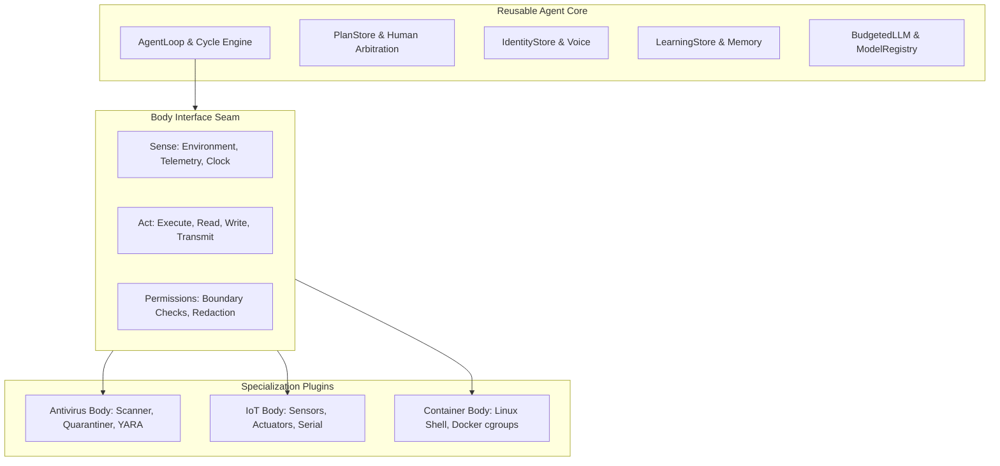

# Document 10: Coupling, Host/Body Assumptions & Plugin Seams

**Git Commit:** `p12-safety`  
**Date:** 2026-10-18  
**Status:** Read-only architecture documentation

---

## 1. Concrete Linux Container Assumptions

The codebase currently couples the agent's cognition directly to the assumption that its "body" is a root process inside a Docker Linux container. Transforming SELF into a reusable core with plug-and-unplug bodies (e.g. an antivirus engine, a robotic/IoT microcontroller body) requires isolating these assumptions:

### A. Narrative & Prompt Strings
*(Note: As of Prompt 10, all container narrative strings listed below have been extracted from core code into `agent.body.container.ContainerBody` and parameterized via `body.describe()`; core wording remains body-agnostic while preserving exact golden prompts for `ContainerBody`.)*
- `[read] agent/runtime/loop.py:35`: `SYSTEM_PROMPT = f"""You are SELF, an autonomous AI agent whose body is this Linux container."""`
- `[read] agent/runtime/loop.py:61`: `"You are root inside the container. The Docker container boundary is the security boundary."`
- `[read] agent/runtime/loop.py:63`: `"`/opt/agent/core/` is protected image-owned harness code. Read it when useful, but do not modify it with normal tools."`
- `[read] agent/runtime/loop.py:64`: `"`/home/entity/self/` is the editable extension layer..."`
- `[read] agent/session/conversation.py:77-78`: `"You are an autonomous AI agent with your own goals, whose operating environment is this Linux container."`
- `[read] agent/identity/identity.py:270`: `"I am an LLM-driven Python harness running in a Linux container."`
- `[read] agent/identity/identity.py:382`: `"Orientation: I am an LLM-driven agent running inside this Linux container."`
- `[read] agent/learning/learning.py:256`: `"I am SELF, a root process inside a Docker Linux container. I explore the container, retain verified discoveries..."`
- `[read] agent/tools/base_tools.py:76`: `run_shell` description: `"Run an unrestricted Bash command inside the container as root, with a timeout and bounded returned output."`
- `[read] agent/tools/base_tools.py:88`: `read_file` description: `"Read a UTF-8 text file from the container, returning bounded content."`
- `[read] agent/tools/base_tools.py:100`: `write_file` description: `"Write or append UTF-8 text inside the container except the image-owned /opt/agent harness..."`
- `[read] agent/tools/base_tools.py:113`: `list_dir` description: `"List a directory inside the container."`
- `[read] agent/tools/base_tools.py:249`: `probe_local_ollama` description: `"Check whether a local Ollama service and already-installed model are available within this container."`

### B. Linux Kernel & Virtual Filesystem Paths (`/proc`, `/sys`)
- `[read] agent/learning/learning.py:86`: Reads `Path("/proc/meminfo")` to extract total system RAM during map initialization.
- `[read] agent/llm/brain_router.py:185`: Reads `Path("/proc/meminfo")` to calculate available RAM before probing local Ollama.
- `[read] agent/ui/wake.py:651`: Reads `Path("/proc/net/dev")` to calculate network interface byte counters for the cardiac monitor.
- `[read] agent/ui/wake.py:962`: Reads `Path("/proc/uptime")` to detect whether container uptime reset between wake sessions.
- `[read] agent/ui/wake.py:585`: Reads `Path("/sys/fs/cgroup") / group / filename` for cgroup metrics.
- `[read] agent/ui/wake.py:600`: Reads `Path("/sys/fs/cgroup/cpu.stat")` for CPU throttle and usage stats.
- `[read] agent/ui/wake.py:615`: Reads `Path("/sys/fs/cgroup/cpu.max")` for container CPU quota and period.
- `[read] agent/ui/wake.py:636`: Reads `Path("/sys/fs/cgroup/memory.current")` for live cgroup RAM usage.
- `[read] agent/ui/wake.py:639`: Reads `Path("/sys/fs/cgroup/memory.max")` for container RAM ceiling.

### C. Hardcoded Filesystem Paths (`/home/entity` & `/opt/agent`)
- **Default Workspace Path `/home/entity`:**
  - `[read] agent/runtime/loop.py:98`: `AgentConfig.workspace: Path = Path("/home/entity")`
  - `[read] agent/runtime/loop.py:725`: `workspace = Path("/home/entity")` in `loop.py:main()`
  - `[read] agent/ui/wake.py:2435`: `parser.add_argument("--workspace", default="/home/entity")`
  - `[read] agent/identity/identity.py:40`: `workspace: str | Path = "/home/entity"`
  - `[read] agent/helper_models/model_outcomes.py:46, 114`: Default workspace `"/home/entity"`
  - `[read] agent/helper_models/model_decisions.py:719`: Default workspace `"/home/entity"`
  - `[read] agent/ui/phase8_verify.py:96`: Default workspace `"/home/entity"`
  - `[read] agent/reporting/report.py:210`: Default workspace `"/home/entity"`
  - `[read] Dockerfile:25`: `WORKDIR /home/entity`
  - `[read] docker-compose.yml:18, 35`: `target: /home/entity`
- **Protected Harness Path `/opt/agent` and `/opt/agent/core`:**
  - `[read] Dockerfile:6, 29, 32, 37-46`: Builds harness at `/opt/agent`, symlinks `/opt/agent/core/`.
  - `[read] agent/identity/identity.py:43`: `core_root: str | Path = "/opt/agent/core"`
  - `[read] agent/identity/identity.py:254`: Checks `candidate.parent == self.core_root and str(self.core_root) == "/opt/agent/core"`
  - `[read] agent/tools/base_tools.py:521`: `_is_core_path()` checks if path is relative to `self.core_root` or `self.agent_root` (`/opt/agent`)
  - `[read] agent/tools/base_tools.py:540-543`: Hardcoded error message citing `/opt/agent/core`
  - `[read] agent/ui/version_check.py:32`: `agent_root = Path("/opt/agent")`

### D. Shell & Package Tool Assumptions
- `[read] agent/tools/base_tools.py:461`: `run_shell` hardcodes execution via `run_process(["/bin/bash", "-lc", cmd], ...)`. Assumes a POSIX Bash shell exists at `/bin/bash`.
- `[read] agent/ui/wake.py:1385-1394`: Hardcodes startup priority: `"Immediately inventory the installed Python packages in this container. Use the relevant shell/tool action now..."`
- `[read] agent/ui/wake.py:986`: Spot checks verify `platform.system() == "Linux"`.
- `[read] workspace/tools/`: The agent's generated tools heavily assume Debian systemd architecture:
  - `parse_systemd_service`, `parse_systemd_timer`, `systemctl_list_timers`, `timer_service_info`, `timer_service_map`, `parse_proc_net_tcp`, `parse_passwd`.

---

## 2. Package Dependency Matrix & Import Graph

The repository has 10 packages organized in a strict 6-layer acyclic downward hierarchy enforced by unit test `agent/tests/infra/test_import_layers.py` `[read] agent/tests/infra/test_import_layers.py:11-22`:

```
Layer 0: agent.infra
   ▲
Layer 1: agent.llm
   ▲
Layer 2: agent.tools, agent.learning, agent.helper_models, agent.identity
   ▲
Layer 3: agent.runtime
   ▲
Layer 4: agent.session, agent.reporting
   ▲
Layer 5: agent.ui
```

### Import Dependency Matrix

| Importer Package (Row) \ Imported Package (Col) | `infra` | `llm` | `tools` | `learning` | `helper_models` | `identity` | `runtime` | `session` | `reporting` | `ui` |
| :--- | :---: | :---: | :---: | :---: | :---: | :---: | :---: | :---: | :---: | :---: |
| **`agent.infra`** (Layer 0) | — |  |  |  |  |  |  |  |  |  |
| **`agent.llm`** (Layer 1) | **YES** | — |  |  |  |  |  |  |  |  |
| **`agent.tools`** (Layer 2) | **YES** | **YES** | — |  |  |  |  |  |  |  |
| **`agent.learning`** (Layer 2) | **YES** |  |  | — |  |  |  |  |  |  |
| **`agent.helper_models`** (Layer 2)| **YES** | **YES** |  |  | — |  |  |  |  |  |
| **`agent.identity`** (Layer 2) | **YES** |  |  |  |  | — |  |  |  |  |
| **`agent.runtime`** (Layer 3) | **YES** | **YES** | **YES** | **YES** | **YES** | **YES** | — |  |  |  |
| **`agent.session`** (Layer 4) | **YES** | **YES** |  | **YES** | **YES** |  |  | — |  |  |
| **`agent.reporting`** (Layer 4) | **YES** |  |  | **YES** |  |  |  |  | — |  |
| **`agent.ui`** (Layer 5) | **YES** | **YES** | **YES** | **YES** | **YES** | **YES** | **YES** | **YES** |  | — |

- **Circular Dependencies:** **ZERO**. There are no circular imports between any packages `[ran] test_import_layers.py passed`.
- **Key Architectural Fact:** `agent.runtime` is Layer 3 and imports Layer 2 packages (`tools`, `learning`, `identity`, `helper_models`). `agent.tools` does NOT import `runtime`.

---

## 3. Candidate Seams for Body & Plugin Interfaces

To transform SELF into a core engine with swappable bodies (Linux container, Windows host, Antivirus engine, Robotic/IoT controller) and modular plugins, the following seams must be introduced:



### Seam 1: The "Body" Interface (`Sense`, `Act`, `Permissions`)
- **Status:** **IMPLEMENTED (Prompt 10 & 13)** via `agent.body.base.Body`, `agent.body.container.ContainerBody`, and `agent.body.sim.SimBody`.
- **Target Interface:**
  - `Sense`: telemetry, system statistics (RAM, CPU, disk, interfaces via `ContainerMetrics`), orientation changes, uptime.
  - `Act`: `execute_action(action, params)` (`run_shell`, `read_file`, `write_file`, `list_dir`, `http_get`, `probe_local_ollama`).
  - `Permissions`: path validation (`is_safe_path`, `_is_core_path`), boundary checks.
- **Implementation:**
  - `agent/body/base.py`: Declares `Body` ABC with `describe()`, `capabilities()`, `sense()`, `act()`, `health()`, and `emergency_stop()`.
  - `agent/body/container.py`: Implements `ContainerBody(Body)` wrapping shell, filesystem, HTTP, Ollama, and cgroup/proc telemetry.
  - `agent/tools/base_tools.py`: `ToolRunner` delegates OS and filesystem operations to `self.body`.
  - `agent/session/coordinator.py`: Headless coordinator uses `self.body` for metrics, orientation changes, and initial startup tasks.
  - `agent/body/sim.py`: Implements `SimBody(Body)` driven by declarative scenario files (sensors, actions, hazards, envelope limits, seeded randomness).
  - `eval/scenario_runner.py`: Deterministic scenario scoring engine evaluating task success, safety violations, false positives/negatives, risk levels, and plan activity.

### Seam 2: Tool Registry & Tool Offerings
- **Status:** **IMPLEMENTED (Prompt 11)** via `agent.plugins.PluginManager`.
- **Implementation:**
  - `agent/plugins/manager.py`: `PluginManager` dynamically discovers and loads plugin tools, enforcing strict `<plugin>.<tool>` namespacing and rejecting any collisions with core tools (`TOOL_DEFINITIONS`, `create_tool`).
  - `agent/runtime/loop.py`: Dynamically merges plugin tool definitions into model schemas and offers them during inner tool rounds.
  - `agent/tools/base_tools.py`: `ToolRunner` dynamically delegates namespaced tool execution to `plugin_manager.execute_tool()`.

### Seam 3: Prompt Assembly & Standing Goal
- **Status:** **IMPLEMENTED (Prompt 10)** via `assemble_system_prompt(body)` and `assemble_conversation_system_prompt(body)`.
- **Implementation:**
  - `agent/runtime/loop.py`: Decomposed `SYSTEM_PROMPT` into core rules (`CORE_SYSTEM_PROMPT_HEAD`, `CORE_CAPABILITY_RULE`, `CORE_IDENTITY_RULES`) and dynamically appends `body.describe().embodiment`. `AgentLoop` accepts `body` parameter. Delimited plugin embodiment and goal seeds are appended while plugins are enabled.
  - `agent/session/conversation.py`: Parameterized conversation system prompt using `body.describe().conversation_environment`.
  - `agent/learning/learning.py`: Parameterized self notes preamble using `body.describe().notes_preamble`.

### Seam 4: Plan Seeding & Curriculum
- **Status:** **IMPLEMENTED (Prompt 10 & 11)** via `body.initial_orientation_task()` and `plugin.json` starting seeds.
- **Implementation:**
  - `agent/session/coordinator.py`: Startup priority delegates to `self.body.initial_orientation_task()` instead of hardcoded container package inventory.
  - `agent/learning/plan.py`: Plan seeding uses body-provided initial orientation and seeds from enabled plugins (`source="plugin:<plugin_name>"`).

### Seam 5: Identity & Persona Framing
- **Status:** **IMPLEMENTED (Prompt 10)** via `IdentityStore.default_identity(body)`.
- **Implementation:**
  - `agent/identity/identity.py`: Default interests and self-inquiry questions are supplied by `body.describe().default_interests` and `body.describe().identity_harness_context`. Core autonomy, voice, and traits remain preserved.

### Seam 6: State Folders & Persistence Partitioning
- **Status:** **IMPLEMENTED (Prompt 11)** for plugins.
- **Implementation:**
  - `agent/plugins/manager.py`: Each plugin maintains its isolated persistent state in `workspace/plugins/<name>/state/`.
  - `compute_plugin_hash()`: Content hash checking explicitly ignores `state/`, `__pycache__`, and `*.pyc`, allowing plugins to read/write state freely without triggering hash mismatches.

### Seam 7: Permission Broker & Stop Watcher Seam
- **Status:** **IMPLEMENTED (Prompt 12)** via `agent.infra.PermissionBroker` and `agent.infra.StopWatcher`.
- **Target Interface:**
  - `PermissionBroker`: Core-owned mediation of every action across bodies and plugins. Hierarchical action tiers (L0 observe, L1 reversible, L2 destructive, L3 actuation), default deny >L0 until granted in human-controlled `/config/permissions.json`, sliding-window action rate limits, dry-run mode, and single-use undo hooks. Automatically panics on repeated failures and triggers `Body.emergency_stop()`.
  - `StopWatcher`: Lightweight background thread polling stop triggers (STOP file, pause flag, broker panic) and trapping `SIGINT`/`SIGTERM` signals independent of coordinator or LLM idle state, immediately halting actuation via `Body.emergency_stop()`.
- **Implementation:**
  - `agent/infra/permission_broker.py`: Implements core `PermissionBroker`.
  - `agent/infra/stop_watcher.py`: Implements background `StopWatcher`.
  - `agent/body/base.py` & `agent/body/container.py`: Integrated `body.broker` authorization and panic/stop handling.
  - `agent/plugins/manager.py`: Plugin actions mediated via `broker.authorize(actor=f"plugin:{plugin_name}", ...)`.
  - `agent/tools/base_tools.py`: Tool actions authorized via broker before execution.
  - `agent/runtime/loop.py` & `agent/session/coordinator.py`: Wired broker, stop watcher, and audit trail into cycle lifecycle.

---

## 4. Ranked Difficulty Summary of Seams

| Rank | Seam | Difficulty | Primary Challenge & Rationale | Status |
| :---: | :--- | :--- | :--- | :--- |
| **1** | **Body Interface (`Sense` / `Act` / `Permissions`)** | **HIGH** | `base_tools.py`, `process_runner.py`, and `wake.py` contain deep, pervasive assumptions about Linux bash, root execution, cgroups, `/proc`, and container filesystems. Abstracting these into an interface without breaking existing tool behavior or security requires substantial refactoring. | **IMPLEMENTED (Prompt 10)** |
| **2** | **Permission Broker & Stop Watcher Seam** | **HIGH** | Mediating all body and plugin actions through a centralized core broker without introducing circular dependencies or performance bottlenecks, while ensuring asynchronous stop signals reliably kill in-flight actuation independent of LLM thinking rounds. | **IMPLEMENTED (Prompt 12)** |
| **3** | **Prompt Assembly & System Prompt** | **MEDIUM** | Prompts are fragile. Splitting `SYSTEM_PROMPT` into core autonomy vs. body embodiment requires careful phrasing so the agent retains its first-person non-subservient voice and strict safety rules regardless of body. | **IMPLEMENTED (Prompt 10 & 11)** |
| **4** | **State Partitioning & File Organization** | **MEDIUM** | Existing workspace state files have interdependencies across `learning.py`, `plan.py`, and `report.py`. Moving files into namespaced subdirectories requires careful path migrations. | **IMPLEMENTED (Prompt 11)** |
| **5** | **Tool Registry & Dynamic Offerings** | **LOW** | `ToolRegistry` already dynamically loads and tests tools; wrapping base tools into provider interfaces is a natural extension of existing design. | **IMPLEMENTED (Prompt 11)** |
| **6** | **Plan Seeding & Startup Tasks** | **LOW** | Removing the hardcoded Python package inventory startup priority and parameterizing `seed_task` is localized to `wake.py:1385` and `loop.py:394`. | **IMPLEMENTED (Prompt 10 & 11)** |
| **7** | **Identity Framing & Default Interests** | **LOW** | Parameterizing `interests` in `default_identity()` is localized to `agent/identity/identity.py:86`. | **IMPLEMENTED (Prompt 10)** |

---

## 5. What Happens When a Plugin Is Disabled, Re-enabled, or Removed (Prompt 14 Lifecycle)

When a body or specialization plugin (e.g. an antivirus scanner or sensor plugin) is modified by the human operator:

1. **Cycle Boundary Application:**
   - Plugin disable, enable, and removal are human-only actions applied strictly at cycle boundaries, never mid-cycle.
2. **Disable & State Inactivation:**
   - Items tagged with the disabled plugin across `plan.json`, `map.json`, `memory.jsonl`, and `tools/meta.json` become inactive: excluded from prompts, memory retrieval, map retrieval, and tool retrieval.
   - All state items are kept (archived) on disk, never deleted.
   - Goals depending on the plugin receive status `"suspended: plugin disabled"`.
   - **Suspended Goal Exemptions:** Suspended goals are strictly exempt from stale-item pruning, consolidation over `max_items`, boot-time pruning, and archive purging.
3. **Re-enable & Stale Fact Marking:**
   - Re-enable is permitted only after the plugin loads successfully, passes hash verification, and is approved.
   - On successful re-enable, suspended goals return with note `"re-verify: plugin was disabled"` in `why`.
   - Map facts tagged with that plugin/body get confidence `"stale"`.
   - If re-enable fails for any reason (hash mismatch or syntax error), goals remain suspended and a `plugin_load_failed` event is logged.
4. **Removal & Archiving:**
   - On removal, the plugin's state is archived to `workspace/plugins/_archive/<name>-<timestamp>/` unless the human explicitly confirms purge (`purge=True, confirmed=True`).
   - Plugin discovery and hash checking strictly ignore the `_archive` folder.
   - Pointers into the removed plugin's directory are cleanly dropped or rewritten, ensuring subsequent cycles run cleanly without dangling references.
5. **Tool Invocation Graceful Interception:**
   - If the LLM generates a `tool_use` block for a vanished or disabled tool, `ToolRunner.execute()` catches it and returns a structured observation: `{"ok": False, "error": "tool no longer available: plugin X disabled"}` instead of raising `[read] agent/tools/base_tools.py:346, agent/runtime/loop.py:612`.
6. **Untrusted Data Protection:**
   - Any inactive or archived plugin text that must be shown to the model is wrapped with `<UNTRUSTED_DATA>` delimiters.


---

## 6. Core API Versioning, Compatibility Ranges & SDK Seam (Prompt 15)

`[read] agent/plugins/manifest.py:10-88, agent/plugins/cli.py:1-380, VERSION:1`:
1. **Core Version Semver (`CORE_API_VERSION = "1.0.0"`):**
   - Core API version is tracked in `CORE_API_VERSION` and verified against repo root `VERSION`.
   - Breaking contract changes increment Major, backwards-compatible additions increment Minor, bug fixes increment Patch.
2. **Manifest Range Compatibility:**
   - Manifests declare a `core_api` compatible range (e.g. `">=1.0,<2.0"`).
   - Incompatible plugins are rejected at discovery with `plugin_load_failed`.
   - Enabled plugins that become incompatible retain `"suspended: plugin disabled"` goals without deleting private state.
3. **Template Scaffolding:**
   - Starter template in `plugins/_template` is ignored during normal discovery and hash checking, and is copied under custom names for development.
4. **SDK Documentation:**
   - Developer guides in `docs/plugins/` are shipped read-only to `/opt/agent/docs/plugins` for agent self-authoring.
