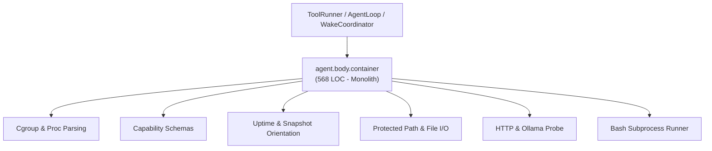
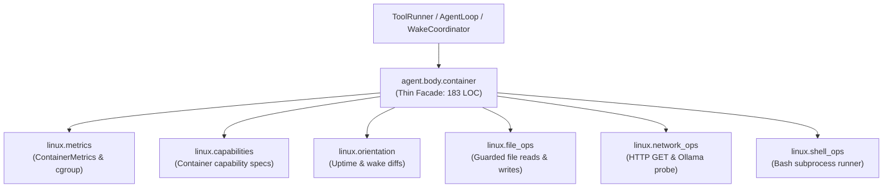

# Refactoring Documentation: `agent.body.container`

## 1. What the File Was For
Originally, [`agent/body/container.py`](../../agent/body/container.py) (~568 lines) served as the Linux container embodiment implementation (`ContainerBody`) for SELF:
- Cgroup and live container metrics: extracting CPU usage against quota/period, memory usage against cgroup limits, network I/O from `/proc/net/dev`, and disk reads from `io.stat` (`ContainerMetrics`, `_format_bytes`, `_read_int_file`, `_read_cgroup_value`).
- Container embodiment narratives and rules: providing golden system prompt sections for container embodiment, conversation context, identity orientation, and capability rules (`describe`).
- Container capabilities definitions: specifying schema, risk class, and reversibility for `run_shell`, `read_file`, `write_file`, `list_dir`, `http_get`, and `probe_local_ollama` (`capabilities`).
- Orientation change tracking: monitoring uptime and filesystem changes in workspace entries, tool metadata, and API key environment variables across wake/sleep sessions (`orientation_changes`, `get_uptime`).
- Action execution and isolation:
  - Sandboxed shell execution with streaming output and stream IDs (`run_shell`).
  - Core path and protected path guard verification (`_is_core_path`, `read_file`, `write_file`).
  - Directory listing without following symlinks (`list_dir`).
  - HTTP requests with redirect logging restricted to HTTP/HTTPS (`http_get`, `_log_network`).
  - Local Ollama status probing (`probe_local_ollama`).
  - Health check and emergency stop file creation (`health`, `emergency_stop`).

## 2. Purpose and Extraction Map

| Function / Symbol | What it does | How it serves the file's purpose | Smell / SRP violation | Target Module |
| :--- | :--- | :--- | :--- | :--- |
| `format_bytes`, `read_int_file`, `read_cgroup_value`, `ContainerMetrics` | Parses Linux cgroup files (`cpu.stat`, `memory.current`, `io.stat`) and formats human-readable resource snapshots. | Provides real-time container resource utilization metrics. | Low-level cgroup parsing mixed with embodiment orchestration. | [`agent/body/linux/metrics.py`](../../agent/body/linux/metrics.py) |
| `get_container_capabilities` | Declares schemas, risk classifications, and reversibility for container actions. | Exposes actionable capabilities to LLM tool runner. | Static schema definitions mixed with action executors. | [`agent/body/linux/capabilities.py`](../../agent/body/linux/capabilities.py) |
| `get_container_uptime`, `detect_orientation_changes` | Reads `/proc/uptime`, detects diffs in workspace, tools, credentials between wake cycles. | Informs agent of environmental restarts and external file modifications. | Orientation snapshot logic coupled to container body class. | [`agent/body/linux/orientation.py`](../../agent/body/linux/orientation.py) |
| `is_core_path`, `read_container_file`, `write_container_file`, `list_container_dir` | Enforces path protection on `/opt/agent`, validates identity preservation, performs file I/O. | Implements guarded filesystem manipulation actions. | Protected-path security checks mixed with core body methods. | [`agent/body/linux/file_ops.py`](../../agent/body/linux/file_ops.py) |
| `log_network`, `http_get_request`, `probe_local_ollama_endpoint` | Dispatches outbound HTTP requests with redirect logging; probes local Ollama tag API. | Enables network sensing and local model availability checks. | Network HTTP client logic embedded in container body. | [`agent/body/linux/network_ops.py`](../../agent/body/linux/network_ops.py) |
| `run_container_shell` | Executes shell commands using bash subprocess under child output cap with stream logging. | Powers the `run_shell` capability. | Subprocess management and output streaming mixed in body class. | [`agent/body/linux/shell_ops.py`](../../agent/body/linux/shell_ops.py) |
| `ContainerBody` | Thin facade and composition root maintaining full backward compatibility. | Primary embodiment entry point for Docker Linux containers. | High cohesion; delegates specialized tasks to submodules. | [`agent/body/container.py`](../../agent/body/container.py) |

## 3. Dependency Structure (Before vs After)

### Before Refactoring

### After Refactoring

## 4. Facade Re-exports Kept
All former public, protected, and test-accessed symbols and instance attributes remain available on `ContainerBody` and `agent.body.container`:
- `ContainerBody`:
  - `workspace`, `logger`, `core_root`, `agent_root`, `output_cap`, `identity`, `broker`, `metrics`, `DEFAULT_OUTPUT_CAP`.
  - `describe()`, `capabilities()`, `get_uptime()`, `orientation_changes(snapshot_path=None)`, `sense()`, `act(action, **kwargs)`.
  - `run_shell(cmd, timeout=30)`
  - `_is_core_path(path)`
  - `read_file(path, max_chars=DEFAULT_OUTPUT_CAP)`
  - `write_file(path, content, append=False)`
  - `list_dir(path, max_entries=500)`
  - `_log_network(url, method="GET", **extra)`
  - `http_get(url, timeout=20, max_chars=DEFAULT_OUTPUT_CAP)`
  - `probe_local_ollama()`
  - `health()`, `emergency_stop()`.
- Re-exports via `__all__`:
  - `ContainerBody`
  - `ContainerMetrics`
  - `_format_bytes`
  - `_read_cgroup_value`
  - `_read_int_file`
  - `run_process`

## 5. Patch-target and Testing Changes
- **Known Patch Target Preserved**: `@patch("agent.body.container.run_process")` is actively used in `agent/tests/body/test_body.py`. `run_process` is imported into `agent.body.container` and passed as `run_process_fn=run_process` into `run_container_shell`. Any mock applied to `agent.body.container.run_process` intercepts shell command execution without requiring test modifications.
- **Golden Prompts Character-for-Character**: `ContainerBody.describe()` returns `BodyDescription` with unmodified prompt constants from `agent.prompts.container_body`, passing all character-for-character assertions in `tests/body/test_golden_prompts.py`.
- Direct logger calls: `logger.log("command_started", ...)`, `logger.log("command_output", ...)`, `logger.log("command_finished", ...)`, `logger.log("tool_created", ...)`, and `logger.log("network_request", ...)` remain direct `logger.log(...)` calls in the submodules, preserving all 135 verified events counted by `scripts/check_docs_claims.py`.
- All 24 tests in `agent/tests/body/` pass cleanly.

## 6. Risks and Verification
- **Acyclic DAG Layering**: Verified with `python -m unittest agent/tests/infra/test_import_layers.py`.
- **Golden Prompts**: Verified with `python -m unittest agent/tests/body/test_golden_prompts.py`.
- **Body Test Suite**: Verified with `python -m unittest discover -s agent/tests/body -v` (24 tests passing).
- **Doc Claims Guard**: Verified with `python scripts/check_docs_claims.py` (135 events verified, 357 tests total).
