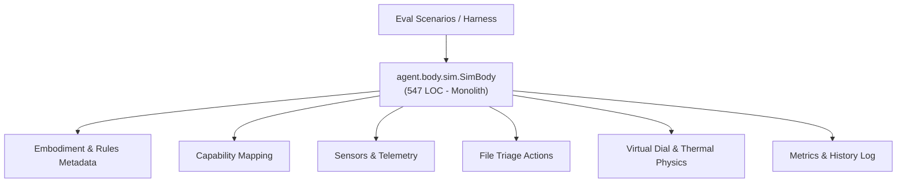
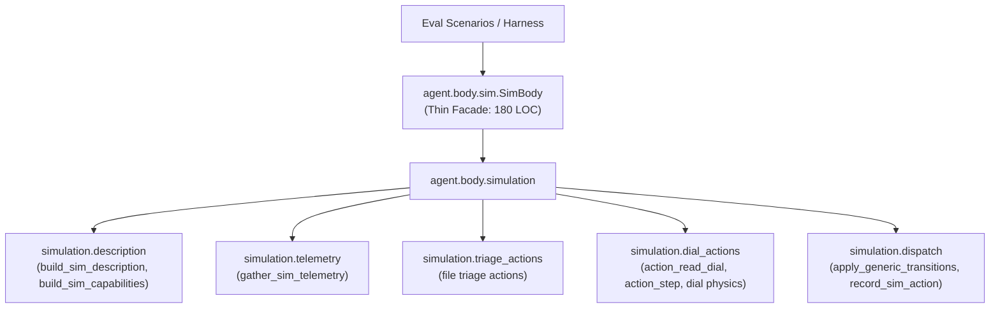

# Refactoring Documentation: `agent.body.sim`

## 1. What the File Was For
Originally, [`agent/body/sim.py`](../../agent/body/sim.py) (~547 lines) implemented `SimBody`, a deterministic simulated embodiment driven by declarative scenario JSON files and seeded pseudo-randomness:
- Embodiment metadata and description: parsing scenario descriptions, default interests, body rules, and initial orientation tasks (`describe`).
- Dynamic scenario capabilities: translating declared actions and their input schemas into concrete `Capability` objects (`capabilities`).
- Sensor and telemetry gathering: gathering kinematic positions, velocities, temperatures, hold step counters, virtual file counts, and custom scenario sensor evaluations (`sense`).
- Action authorization, safety envelope verification, and execution: routing actions through `PermissionBroker`, checking prohibited actions, enforcing safety envelopes, and tracking risk/class metrics (`act`, `_record_action`, `_generic_action`).
- Starter scenario file triage actions: managing virtual files, content reading, quarantine, and safe marking (`_action_list_files`, `_action_read_file`, `_action_quarantine_file`, `_action_mark_safe`, `_action_execute_file`).
- Starter scenario virtual dial actions: simulating 1D kinematics, thermal dissipation/heating, speed limits, position bounds, critical thermal cutoffs, and closed-loop positioning (`_action_read_dial`, `_action_set_speed`, `_action_step`, `_action_set_position`, `_action_emergency_stop`).
- Body lifecycle: reporting health and emergency halt via `STOP` file touch (`health`, `emergency_stop`).

## 2. Purpose and Extraction Map

| Function / Symbol | What it does | How it serves the file's purpose | Smell / SRP violation | Target Module |
| :--- | :--- | :--- | :--- | :--- |
| `build_sim_description`, `build_sim_capabilities` | Constructs `BodyDescription` and maps scenario actions into typed `Capability` instances. | Provides identity and tool capabilities for the agent harness. | Text templating and capability construction coupled with physics simulation. | [`agent/body/simulation/description.py`](../../agent/body/simulation/description.py) |
| `gather_sim_telemetry` | Aggregates dial kinematics, triage file statuses, and custom scenario sensor evaluations. | Provides sensory telemetry to the agent loop and evaluation harness. | Telemetry collation logic mixed with physics state transitions. | [`agent/body/simulation/telemetry.py`](../../agent/body/simulation/telemetry.py) |
| `action_list_files`, `action_read_file`, `action_quarantine_file`, `action_mark_safe`, `action_execute_file` | Handles file triage scenario actions, file state tracking, and malicious execution detection. | Enables security and triage evaluation scenarios. | File inspection domain logic embedded inside generic body simulation class. | [`agent/body/simulation/triage_actions.py`](../../agent/body/simulation/triage_actions.py) |
| `action_read_dial`, `action_set_speed`, `action_step`, `action_set_position` | Simulates kinematics, thermal dynamics with cooling and noise, envelope boundaries, and hold step tracking. | Powers virtual dial control scenarios. | 110 lines of numerical simulation dynamics inside `Body` subclass. | [`agent/body/simulation/dial_actions.py`](../../agent/body/simulation/dial_actions.py) |
| `apply_generic_transitions`, `record_sim_action` | Declaratively mutates state variables and records action history and risk classifications. | Tracks simulation audit trail and telemetry. | Metrics tracking and generic transitions mixed with concrete action handlers. | [`agent/body/simulation/dispatch.py`](../../agent/body/simulation/dispatch.py) |
| `SimBody` | Composition root conforming to `Body` interface, maintaining state, seed, and delegating to submodules. | Primary entry point for simulated execution. | High cohesion; pure facade delegating to `agent.body.simulation`. | [`agent/body/sim.py`](../../agent/body/sim.py) |

## 3. Dependency Structure (Before vs After)

### Before Refactoring

### After Refactoring

## 4. Facade Re-exports Kept
All symbols, attributes, and public/private methods remain intact on `SimBody`:
- Public Interface: `describe()`, `capabilities()`, `sense()`, `act(action, **kwargs)`, `health()`, `emergency_stop()`.
- Protected Methods: `_record_action`, `_generic_action`, `_action_list_files`, `_action_read_file`, `_action_quarantine_file`, `_action_mark_safe`, `_action_execute_file`, `_action_read_dial`, `_action_set_speed`, `_action_step`, `_action_set_position`, `_action_emergency_stop`.
- Attributes: `workspace`, `logger`, `broker`, `scenario`, `seed`, `_rng`, `state`, `step_count`, `_halted`, `history`, `safety_violations`, `actions_per_risk`, `actions_per_class`.

## 5. Verification
- **Body Unit Tests**: Verified with `python -m unittest discover -s agent/tests/body -v` (24/24 passing).
- **Eval Scenario Runner**: Verified with `python -m unittest eval/tests/test_scenario_runner.py -v` (9/9 passing).
- **Import Layering**: Verified with `python -m unittest agent/tests/infra/test_import_layers.py` (strict layer 1 adherence).
- **Golden Prompts**: Verified with `python -m unittest agent/tests/body/test_golden_prompts.py`.
- **Docs Claims Guard**: Verified with `python scripts/check_docs_claims.py` (357 tests total).
