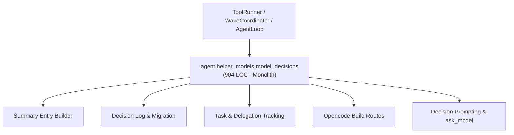
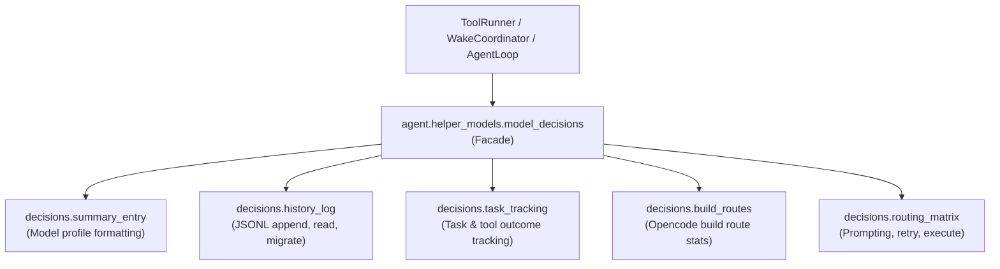

# Refactoring Documentation: `agent.helper_models.model_decisions`

## 1. What the File Was For
Originally, [`agent/helper_models/model_decisions.py`](../../agent/helper_models/model_decisions.py) (~904 lines) served as the central engine for helper model decisions, delegation execution, routing matrix prompting, task observations, and build route stats. It entangled together multiple unrelated concerns:
- Model candidate summary generation (`_summary_entry`, extracting web/facts, probe latencies, truncation rates).
- Decision logging, JSONL persistence, legacy schema migration, and CLI summary printing (`append_decision_record`, `migrate_legacy_records`, `read_last_decisions`, `print_decision_summary`).
- Task outcomes, delegation observations, and per-tool usage tracking (`record_delegation_outcome`, `record_task_outcomes`, `task_provider_errors`, `record_tool_outcome`, `record_task_observation`).
- Opencode build route routing, build outcomes, and delegation statistics (`record_build_route`, `record_build_outcome`, `build_route_stats`).
- Routing matrix prompt construction, JSON fenced output parsing, truncation retries, model availability checks, and live model execution (`get_available_models`, `execute_decide_model`, `execute_ask_model`).

## 2. Purpose and Extraction Map

| Function / Symbol | What it does | How it serves the file's purpose | Smell / SRP violation | Target Module |
| :--- | :--- | :--- | :--- | :--- |
| `build_summary_entry` | Formats a model candidate profile with facts, latency, truncation, and rating stats. | Provides model metadata for picker decision prompt. | Profile formatting mixed into routing engine. | [`agent/helper_models/decisions/summary_entry.py`](../../agent/helper_models/decisions/summary_entry.py) |
| `append_decision_record`, `migrate_legacy_records`, `read_last_decisions`, `print_decision_summary` | Reads and appends decision entries to `model_decisions.jsonl`. | Persists decision audits and generates terminal summaries. | I/O and log format migration mixed with prompt execution. | [`agent/helper_models/decisions/history_log.py`](../../agent/helper_models/decisions/history_log.py) |
| `record_delegation_outcome`, `record_task_outcomes`, `task_provider_errors`, `record_tool_outcome`, `record_task_observation` | Records delegation outcomes, task observations, and provider errors. | Tracks helper model efficacy and delegation behavior per cycle. | Task telemetry and observation state mixed into model routing. | [`agent/helper_models/decisions/task_tracking.py`](../../agent/helper_models/decisions/task_tracking.py) |
| `record_build_route`, `record_build_outcome`, `build_route_stats` | Logs opencode build routes and calculates delegation ratios. | Tracks opencode build routes and provider status. | Specialized opencode routing stats coupled to general model decisions. | [`agent/helper_models/decisions/build_routes.py`](../../agent/helper_models/decisions/build_routes.py) |
| `get_available_models`, `execute_decide_model`, `execute_ask_model`, JSON extraction helpers | Manages candidate options, builds decision prompt, calls LLM, and retries truncation. | Executes model choice and `ask_model` tool delegations. | Heavy orchestration and prompt assembly logic. | [`agent/helper_models/decisions/routing_matrix.py`](../../agent/helper_models/decisions/routing_matrix.py) |
| `ModelDecisions` | Thin facade maintaining complete backward compatibility. | Public entry point for helper model decisions and tracking. | Refactored from 904 LOC to a clean facade delegating to focused submodules. | [`agent/helper_models/model_decisions.py`](../../agent/helper_models/model_decisions.py) |

## 3. Dependency Structure (Before vs After)

### Before Refactoring

### After Refactoring

## 4. Facade Re-exports Kept
All former public and static symbols remain available directly on `ModelDecisions` or the `agent.helper_models.model_decisions` module:
- `ModelDecisions`: The primary class, maintaining:
  - `@staticmethod _summary_entry(entry: dict[str, Any]) -> dict[str, Any]`: preserved as tests invoke `ModelDecisions._summary_entry`.
  - `path`, `outcomes_path`, `task_obs_path`, `task_outcomes_path`, `build_routes_path`, `build_outcomes_path`.
  - `checkpoint_moment_cache`: per-moment cached decisions.
  - `summary_entry`, `record_decision`, `last_decision_for`, `last_decisions`, `count_decisions_by_origin`.
  - `decide_model`, `record_task_outcomes`, `record_delegation_outcome`, `task_provider_errors`.
  - `record_tool_outcome`, `record_task_observation`, `record_build_route`, `record_build_outcome`.
  - `build_route_stats`, `ask_model`, `get_available_models`.
- Module-level helpers:
  - `print_decision_summary`
  - `read_last_decisions`
  - `migrate_legacy_records`
  - `append_decision_record`
  - `build_summary_entry`
  - `record_delegation_outcome`
  - `record_task_outcomes`
  - `task_provider_errors`
  - `record_tool_outcome`
  - `record_task_observation`
  - `record_build_route`
  - `record_build_outcome`
  - `build_route_stats`
  - `get_available_models`
  - `execute_decide_model`
  - `execute_ask_model`

## 5. Patch-target and Testing Changes
- Tests in `agent/tests/helper_models/test_model_decisions.py` and `agent/tests/helper_models/test_model_probe.py` directly call `ModelDecisions._summary_entry(entry)` on the class. A static method `_summary_entry = staticmethod(build_summary_entry)` was preserved directly on `ModelDecisions` so no test patch paths or call sites were broken.
- Import layer boundaries (Layer 2 `helper_models`) are strictly respected: all `decisions/*` submodules import only from Layer 0 (`infra`), Layer 1 (`llm`), and Layer 2 (`helper_models`).

## 6. Risks and Verification
- **Acyclic DAG Layering**: Verified with `python -m unittest agent/tests/infra/test_import_layers.py`.
- **Golden Prompts**: Verified with `python -m unittest agent/tests/body/test_golden_prompts.py`.
- **Opencode Compatibility**: Verified with `python -m pytest agent/opencode/tests/ -v`.
- **Helper Models Suite**: Verified with `python -m unittest discover -s agent/tests/helper_models -t agent/tests -v` (32 tests passing).
- **Doc Claims Guard**: Verified with `python scripts/check_docs_claims.py`.
