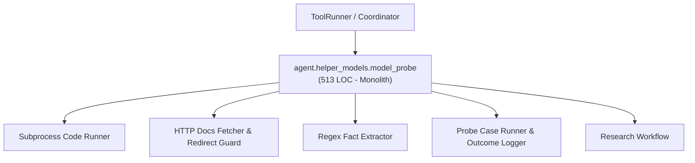
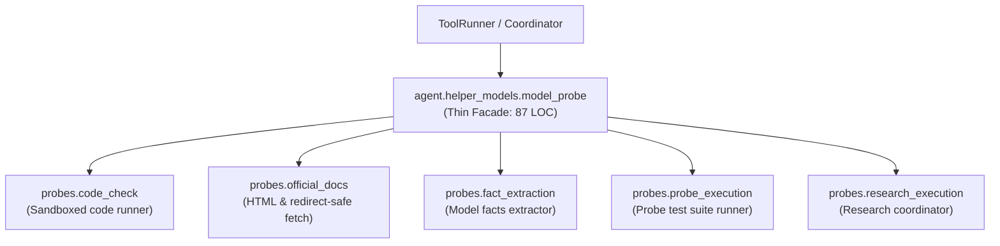

# Refactoring Documentation: `agent.helper_models.model_probe`

## 1. What the File Was For
Originally, [`agent/helper_models/model_probe.py`](../../agent/helper_models/model_probe.py) (~513 lines) implemented helper model capability probing and conservative documentation research:
- Arithmetic code execution: executing candidate code in an isolated subprocess under an AST syntax and shape checker (`check_code_output`, `_CODE_RUNNER`).
- Official documentation retrieval: parsing HTML, safely following HTTPS redirects restricted strictly to the official documentation host, and logging network audit events (`fetch_official_page`, `_official_url`, `_Text`).
- Model fact extraction: extracting parameter counts (total vs active), context window size, pricing models, throughput/speed, and specialties from documentation text (`extract_model_facts`).
- Objective probe test suites: evaluating reasoning, summarization, strict JSON, and code synthesis across 2 attempts per probe case, handling token limits, budget exhaustion, and error conditions (`probe_model`, `_check`).
- Model research workflow: combining web-scraped facts and agent-supplied knowledge facts, updating the `ModelRegistry` records (`research_model`).

## 2. Purpose and Extraction Map

| Function / Symbol | What it does | How it serves the file's purpose | Smell / SRP violation | Target Module |
| :--- | :--- | :--- | :--- | :--- |
| `_CODE_RUNNER`, `CODE_TIMEOUT_SECONDS`, `execute_code_check` | Runs candidate arithmetic code inside a restricted subprocess using AST inspection. | Verifies code synthesis capability safely without host poisoning. | Subprocess management and AST verification logic mixed with probe orchestrator. | [`agent/helper_models/probes/code_check.py`](../../agent/helper_models/probes/code_check.py) |
| `FETCH_CAP`, `_Text`, `official_url`, `fetch_official_page` | Extracts text from HTML; validates domain restrictions and follows HTTPS redirects. | Retrieves documentation from official vendor pages safely. | Network I/O and HTML parsing mixed into model probe engine. | [`agent/helper_models/probes/official_docs.py`](../../agent/helper_models/probes/official_docs.py) |
| `extract_model_facts` | Regex-based parser extracting parameter counts, context window, pricing, speed, strengths. | Converts raw documentation text into structured model capability facts. | 100-line regex extraction routine coupled to prober class. | [`agent/helper_models/probes/fact_extraction.py`](../../agent/helper_models/probes/fact_extraction.py) |
| `OUTPUT_CAP`, `INCONCLUSIVE_NOTE`, `not_found_error`, `check_case_output`, `execute_model_probe` | Runs multi-case test prompts, records attempts, classifies errors and outcomes. | Coordinates the active capability verification cycle for models. | 110-line probe cycle loop and test case checker. | [`agent/helper_models/probes/probe_execution.py`](../../agent/helper_models/probes/probe_execution.py) |
| `execute_model_research` | Fetches vendor documentation, extracts facts, merges caller knowledge, records research in registry. | Discovers and persists static model parameters and specifications. | End-to-end research workflow embedded in prober class. | [`agent/helper_models/probes/research_execution.py`](../../agent/helper_models/probes/research_execution.py) |
| `ModelProber` | Thin facade and composition root maintaining full backward compatibility. | Primary entry point for probe and research operations. | High cohesion; delegates specialized tasks to submodules. | [`agent/helper_models/model_probe.py`](../../agent/helper_models/model_probe.py) |

## 3. Dependency Structure (Before vs After)

### Before Refactoring

### After Refactoring

## 4. Facade Re-exports Kept
All former public and protected symbols, attributes, and methods remain fully preserved on `ModelProber` and `agent.helper_models.model_probe`:
- `ModelProber`:
  - `registry`, `llm`, `logger`, `session_id`, `provider`, `clock`, `code_checker`, `fetcher`, `client_records_stats`.
  - `probe_model(name: str) -> dict[str, Any]`
  - `_check(kind: str, text: str) -> dict[str, Any]`
  - `research_model(name: str, *, facts=None) -> dict[str, Any]`
- Re-exports via `__all__`:
  - `OUTPUT_CAP`
  - `FETCH_CAP`
  - `CODE_TIMEOUT_SECONDS`
  - `INCONCLUSIVE_NOTE`
  - `PROBE_CASES`
  - `PROBE_SYSTEM_PROMPT`
  - `_not_found`
  - `_CODE_RUNNER`
  - `check_code_output`
  - `_Text`
  - `_official_url`
  - `fetch_official_page`
  - `extract_model_facts`
  - `ModelProber`

## 5. Patch-target and Testing Changes
- **Known Patch Target Preserved**: `unittest.mock.patch("agent.helper_models.model_probe.subprocess.run")` is used in `agent/tests/helper_models/test_model_probe.py` (lines 320 and 341). `subprocess` is imported in `agent.helper_models.model_probe` and `check_code_output` passes `subprocess_run=subprocess.run` to `execute_code_check`. Any mock applied to `agent.helper_models.model_probe.subprocess.run` is passed through directly without requiring any test file modification.
- Direct logger calls: `logger.log("network_request", ...)`, `logger.log("model_probe_case", ...)`, and `logger.log("model_probe_completed", ...)` remain direct `logger.log(...)` calls in the submodules, preserving all 135 verified events counted by `scripts/check_docs_claims.py`.
- All 32 tests in `agent/tests/helper_models/` pass cleanly.

## 6. Risks and Verification
- **Acyclic DAG Layering**: Verified with `python -m unittest agent/tests/infra/test_import_layers.py`.
- **Golden Prompts**: Verified with `python -m unittest agent/tests/body/test_golden_prompts.py`.
- **Helper Models Test Suite**: Verified with `python -m unittest discover -s agent/tests/helper_models -v` (32 tests passing).
- **Doc Claims Guard**: Verified with `python scripts/check_docs_claims.py` (135 events verified, 357 tests total).
