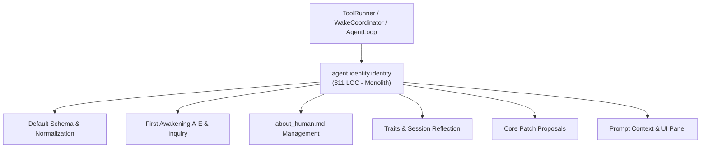
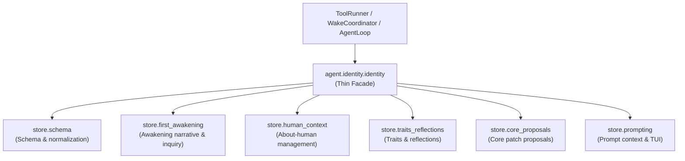

# Refactoring Documentation: `agent.identity.identity`

## 1. What the File Was For
Originally, [`agent/identity/identity.py`](../../agent/identity/identity.py) (~811 lines) served as the persistent identity manager, narrative first-awakening orchestrator, and human-volunteered context store. It tangled together several distinct responsibilities:
- Identity schema defaults, field normalization, and bounded string sanitization (`default_identity`, `load`, `_safe`, `_safe_name_context`).
- Low-level atomic file writing and append-only identity logging (`_atomic_json`, `_append_text`, `_append_identity_log`).
- Five-stage first awakening lifecycle (`run_first_awakening` executing A–E, editable layer bootstrapping, `_write_self_inquiry`, `_write_code_explanation`, and `_initialize_human_file`).
- Human context and preference tracking (`set_human_name`, `record_human_answer`, `about_human_text`, `delete_human_line`).
- Evidence-based trait accumulation, session reflection questionnaires, and oversize identity compaction (`add_trait`, `reflect_session`, `compact_if_needed`).
- Proposed core patch review management (`propose_core_patch`, `proposed_patches`).
- Per-cycle prompt context assembly and terminal UI panel formatting (`prompt_context`, `self_panel_text`).

## 2. Purpose and Extraction Map

| Function / Symbol | What it does | How it serves the file's purpose | Smell / SRP violation | Target Module |
| :--- | :--- | :--- | :--- | :--- |
| `IDENTITY_MAX_BYTES`, `IDENTITY_CONTEXT_MAX_CHARS`, `NAME_MAX_CHARS`, `now`, `clean_line` | Constants and line clean helpers. | Declares bounds and timestamps for identity storage. | Constants and string bounds co-located with heavy orchestrator logic. | [`agent/identity/store/constants.py`](../../agent/identity/store/constants.py) |
| `get_default_identity`, `normalize_identity`, `sanitize_name_context`, `safe_text` | Schema construction, normalization, and bounds enforcement. | Converts arbitrary JSON into strict typed identity structures. | Data normalization and schema verification embedded in identity storage. | [`agent/identity/store/schema.py`](../../agent/identity/store/schema.py) |
| `ensure_editable_layer`, `core_reference`, `write_self_inquiry`, `write_code_explanation`, `initialize_human_file` | Bootstraps workspace `self/` layer, inspects core sources, and writes markdown records. | Executes initial orientation and self-inquiry narrative. | Narrative writing and filesystem inspection entangled with persistent store. | [`agent/identity/store/first_awakening.py`](../../agent/identity/store/first_awakening.py) |
| `save_human_name`, `append_human_answer`, `read_about_human_text`, `delete_about_human_line` | Manages `about_human.md` and user-supplied preferred name. | Records volunteered user information without inference. | Human relationship file management mixed with autonomous identity. | [`agent/identity/store/human_context.py`](../../agent/identity/store/human_context.py) |
| `identity_has_trait`, `add_trait_to_identity`, `reflect_on_session`, `compact_identity_record` | Evaluates logged actions for traits, writes reflections, and compacts records. | Accumulates evidence-backed personality traits from actions. | Post-session audit log analysis and record truncation coupled to store. | [`agent/identity/store/traits_reflections.py`](../../agent/identity/store/traits_reflections.py) |
| `list_proposed_patches`, `save_proposed_core_patch` | Formats and validates host-side core patch proposals. | Allows agent to suggest harness improvements safely. | Patch generation and review queuing tangled with identity state. | [`agent/identity/store/core_proposals.py`](../../agent/identity/store/core_proposals.py) |
| `build_identity_prompt_context`, `format_self_panel_text` | Renders JSON prompt context with active plugin embodiments and UI panel text. | Supplies identity instructions to LLM and TUI. | UI and prompt string formatting co-located with persistence. | [`agent/identity/store/prompting.py`](../../agent/identity/store/prompting.py) |
| `IdentityStore` | Thin facade and composition root maintaining full backward compatibility. | Owns SELF's durable identity files with an audit trail. | Refactored from 811 LOC to a focused class delegating to submodules. | [`agent/identity/identity.py`](../../agent/identity/identity.py) |

## 3. Dependency Structure (Before vs After)

### Before Refactoring

### After Refactoring

## 4. Facade Re-exports Kept
All former public symbols and instance attributes remain available on `IdentityStore` and `agent.identity.identity`:
- `IdentityStore`:
  - `workspace`, `state`, `self_root`, `core_root`, `max_bytes`, `logger`, `body`.
  - `path`, `log_path`, `inquiry_path`, `explanation_path`, `human_path`, `awakening_path`, `awakening_notes_path`, `reflections_path`, `proposals_path`.
  - `exists` (property)
  - `default_identity(cls, body)` (classmethod)
  - `_safe(value, limit)`
  - `_read_json(path)`
  - `_atomic_json(path, value)`
  - `_append_text(path, text)`
  - `_append_identity_log(change, why, session_id)`
  - `load()`
  - `_safe_name_context(context)`
  - `initialize(session_id)`
  - `ensure_editable_layer()`
  - `_mark_stage(stage, session_id, learned)`
  - `_core_reference(filename, needle)`
  - `_write_self_inquiry()`
  - `_write_code_explanation()`
  - `_initialize_human_file()`
  - `run_first_awakening(session_id)`
  - `display_name()`, `awaiting_name()`, `human_name()`, `set_human_name(name, session_id)`
  - `voice()`, `prompt_context(active_plugins)`
  - `set_plugin_embodiment(plugin_name, notes)`, `remove_plugin_embodiment(plugin_name)`
  - `is_managed_path(path)`
  - `set_name(name, session_id, named_by)`
  - `record_human_answer(text, session_id)`, `about_human_text(limit)`, `delete_human_line(line_number, session_id)`
  - `_append_jsonl(path, record)`, `_identity_has_trait(trait)`, `add_trait(trait, evidence, session_id)`
  - `reflect_session(session_id, started_at, summary)`, `compact_if_needed(session_id)`
  - `proposed_patches()`, `propose_core_patch(name, diff, reasoning, session_id)`
  - `self_panel_text()`
- Constants:
  - `IDENTITY_MAX_BYTES`
  - `IDENTITY_CONTEXT_MAX_CHARS`
  - `NAME_MAX_CHARS`
  - `now`
  - `clean_line`
  - `_clean_line`

## 5. Patch-target and Testing Changes
- All test suites (`agent/tests/identity/test_identity.py`, `agent/tests/identity/test_autonomy_relation.py`) directly accessing `IdentityStore` instance attributes, running first awakening, renaming, and proposing patches pass without test code changes.
- AST event discovery in `scripts/check_docs_claims.py` requires literal `logger.log("event_name", ...)` calls. Event logging calls in `store/*` retain direct `logger.log(...)` signatures to keep the 135-event claim exact.

## 6. Risks and Verification
- **Acyclic DAG Layering**: Verified with `python -m unittest agent/tests/infra/test_import_layers.py`.
- **Golden Prompts**: Verified with `python -m unittest agent/tests/body/test_golden_prompts.py`.
- **Identity Test Suite**: Verified with `python -m unittest discover -s agent/tests/identity -t agent/tests -v` (12 tests passing).
- **Doc Claims Guard**: Verified with `python scripts/check_docs_claims.py` (135 events verified, 357 tests total).
