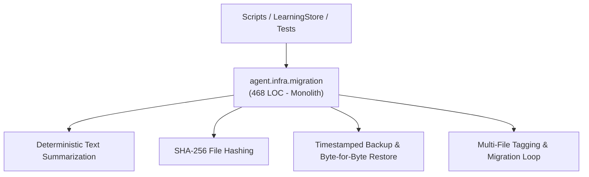
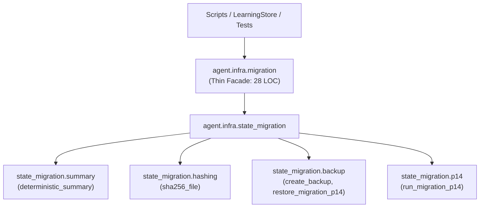

# Refactoring Documentation: `agent.infra.migration`

## 1. What the File Was For
Originally, [`agent/infra/migration.py`](../../agent/infra/migration.py) (~468 lines) implemented migration and byte-for-byte restore routines for Prompt 14 tagged state and bounded memory lessons:
- Deterministic bounded summarization: parsing cycle reports and raw text, removing markdown formatting and boilerplate, ranking findings sections, cutting cleanly at sentence/clause boundaries, and producing compact summaries within a character budget (`deterministic_summary`).
- Cryptographic hash verification: computing SHA-256 digests over files (`sha256_file`).
- State backup creation and byte-for-byte restore: copying candidate state files (`memory.jsonl`, `map.json`, `plan.json`, `identity.json`, `self_notes.md`, `tools/*/meta.json`) into timestamped directories, generating `backup_manifest.json`, and verifying exact SHA-256 matches during recovery (`create_backup`, `restore_migration_p14`).
- Single-pass migration: updating memory entries with report pointers and summaries, tagging map entries, tagging plan items, tagging identity interests, ensuring self-notes header tagging, tagging tool metadata, and generating `migration_p14.log` (`run_migration_p14`).

## 2. Purpose and Extraction Map

| Function / Symbol | What it does | How it serves the file's purpose | Smell / SRP violation | Target Module |
| :--- | :--- | :--- | :--- | :--- |
| `deterministic_summary` | Strips markdown, ranks section headers, and truncates text at sentence/clause boundaries. | Bounds memory lesson size to prevent context overflow while preserving findings. | Complex 170-line regex and text processing pipeline. | [`agent/infra/state_migration/summary.py`](../../agent/infra/state_migration/summary.py) |
| `sha256_file` | Reads file in 64KB chunks and computes SHA-256 hexadecimal hash. | Provides cryptographic verification for backup manifests and file restoration. | Utility function mixed with migration business logic. | [`agent/infra/state_migration/hashing.py`](../../agent/infra/state_migration/hashing.py) |
| `create_backup`, `restore_migration_p14` | Archives state files with SHA-256 manifest and restores them with byte-for-byte verification. | Ensures migrations can be rolled back safely and losslessly. | File system operations coupled with state transformation routines. | [`agent/infra/state_migration/backup.py`](../../agent/infra/state_migration/backup.py) |
| `run_migration_p14` | Executes Prompt 14 migration across memory, map, plan, identity, notes, and tool metadata. | Upgrades older unversioned state to tagged and bounded schemas. | Monolithic 230-line procedure modifying 6 distinct state formats. | [`agent/infra/state_migration/p14.py`](../../agent/infra/state_migration/p14.py) |
| `agent.infra.migration` | Thin facade re-exporting all symbols for complete backward compatibility. | Preserves existing import paths in `scripts/migrate_p14_tagged_state.py` and tests. | High cohesion; pure facade delegating to `agent.infra.state_migration`. | [`agent/infra/migration.py`](../../agent/infra/migration.py) |

## 3. Dependency Structure (Before vs After)

### Before Refactoring

### After Refactoring

## 4. Facade Re-exports Kept
All functions remain exported with `__all__`:
- `create_backup`
- `deterministic_summary`
- `restore_migration_p14`
- `run_migration_p14`
- `sha256_file`

## 5. Verification
- **Migration Unit Tests**: Verified with `python -m unittest agent/tests/infra/test_migration.py -v` (22/22 passing).
- **Tagged State Acceptance Tests**: Verified with `python -m unittest agent/tests/plugins/test_tagged_state.py -v` (6/6 passing).
- **Import Layering**: Verified with `python -m unittest agent/tests/infra/test_import_layers.py` (strict layer 0 compliance).
- **Golden Prompts**: Verified with `python -m unittest agent/tests/body/test_golden_prompts.py`.
- **Docs Claims Guard**: Verified with `python scripts/check_docs_claims.py` (357 tests total).
