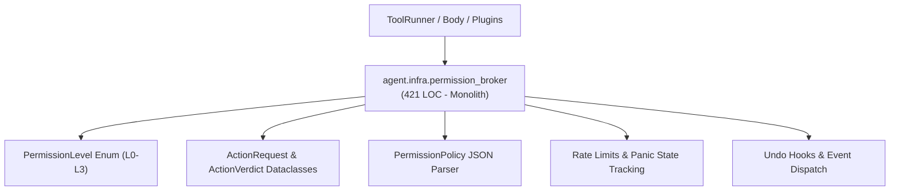
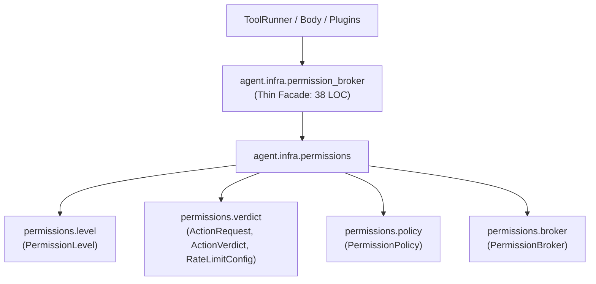

# Refactoring Documentation: `agent.infra.permission_broker`

## 1. What the File Was For
Originally, [`agent/infra/permission_broker.py`](../../agent/infra/permission_broker.py) (~421 lines) served as the centralized governance gatekeeper controlling action authorization across core, body, and plugins:
- Permission levels: establishing a 4-level hierarchy (`L0` observe, `L1` reversible, `L2` destructive/irreversible, `L3` physical actuation) and type coercion from strings or integers (`PermissionLevel`).
- Request and verdict structures: standardizing action requests (`ActionRequest`), authorization verdicts (`ActionVerdict`), and per-action-class rate limit specifications (`RateLimitConfig`).
- Policy resolution: loading and parsing human-configured permissions from `config/permissions.json`, resolving scoped actor-action grants (`source:action`), global action grants, source/namespace grants, and fallback defaults (`PermissionPolicy`).
- Authorization broker: checking dry-run simulations, verifying panic states, evaluating permission levels, enforcing sliding-window action rate limits, managing reversible action undo hooks, counting consecutive failures/denials, triggering emergency panic cutoffs, and logging governance events (`PermissionBroker`).

## 2. Purpose and Extraction Map

| Function / Symbol | What it does | How it serves the file's purpose | Smell / SRP violation | Target Module |
| :--- | :--- | :--- | :--- | :--- |
| `PermissionLevel` | Defines enum hierarchy (L0-L3) and converts ints/strings to typed levels. | Canonical type for security levels throughout the system. | Mixed with broker orchestration and file I/O. | [`agent/infra/permissions/level.py`](../../agent/infra/permissions/level.py) |
| `ActionRequest`, `ActionVerdict`, `RateLimitConfig` | Dataclasses representing authorization input, verdict, and rate limit rules. | Standardized interfaces for action requests and broker decisions. | Data structures co-located with policy parsing and gatekeeping. | [`agent/infra/permissions/verdict.py`](../../agent/infra/permissions/verdict.py) |
| `PermissionPolicy` | Parses `permissions.json` and resolves max allowed level for source + action. | Implements human-in-the-loop permission policy definitions. | Policy file loading and rule resolution mixed with runtime enforcement. | [`agent/infra/permissions/policy.py`](../../agent/infra/permissions/policy.py) |
| `PermissionBroker` | Enforces policy, rate limits, undo hooks, panic thresholds, and event logging. | Central gatekeeper protecting runtime from unauthorized or runaway actions. | 250-line class with multiple concurrent responsibilities. | [`agent/infra/permissions/broker.py`](../../agent/infra/permissions/broker.py) |
| `agent.infra.permission_broker` | Thin facade re-exporting all symbols for complete backward compatibility. | Preserves all existing import paths and documentation symbol citations. | High cohesion; pure facade delegating to `agent.infra.permissions`. | [`agent/infra/permission_broker.py`](../../agent/infra/permission_broker.py) |

## 3. Dependency Structure (Before vs After)

### Before Refactoring

### After Refactoring

## 4. Facade Re-exports Kept
All symbols remain re-exported via `agent.infra.permission_broker` with explicit assignments:
- `ActionRequest`
- `ActionVerdict`
- `PermissionBroker`
- `PermissionLevel`
- `PermissionPolicy`
- `RateLimitConfig`

## 5. Verification
- **Permission Broker Unit Tests**: Verified with `python -m unittest agent/tests/infra/test_permission_broker.py -v` (6/6 passing).
- **Import Layering**: Verified with `python -m unittest agent/tests/infra/test_import_layers.py` (strict layer 0 compliance).
- **Golden Prompts**: Verified with `python -m unittest agent/tests/body/test_golden_prompts.py`.
- **Docs Claims Guard**: Verified with `python scripts/check_docs_claims.py` (135 events verified, 357 tests total).
