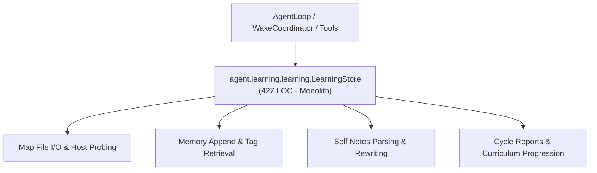
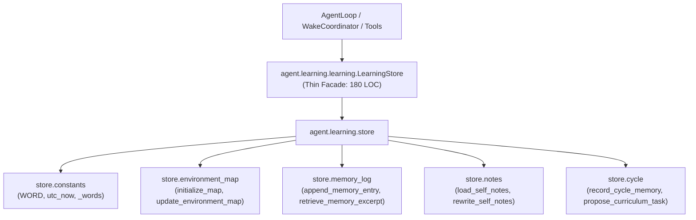

# Refactoring Documentation: `agent.learning.learning`

## 1. What the File Was For
Originally, [`agent/learning/learning.py`](../../agent/learning/learning.py) (~427 lines) implemented `LearningStore`, which manages persistent, bounded state files for environment discoveries, episodic memories, and self-notes:
- Constants & tokenization: word tokenization via regex (`WORD`, `_words`), confidence levels (`VALID_CONFIDENCE`), and UTC timestamps (`utc_now`).
- Environment map: loading, writing, migrating legacy aliases (e.g. `python_packages` to `packages`), bootstrap probing (`/proc/meminfo`, disk usage, platform), recording verified facts with evidence, marking facts stale on plugin/body transitions, and generating context strings for LLM prompts (`_initial_entries`, `_entry`, `_load_map`, `_write_map`, `initialize`, `mark_facts_stale_for_body`, `update_map`, `update_runtime`, `map_context`).
- Memory records & retrieval: appending JSON records to append-only `memory.jsonl` with bounded strings and redaction, reading memory records, and ranking memories against queries using keyword/tag intersection scores (`append_memory`, `memory_entries`, `retrieve_memories`).
- Self-notes: loading `self_notes.md` with plugin-scoped filtering, and rewriting notes with preamble, current environment map, and recent lessons (`load_notes`, `rewrite_notes`).
- Cycle execution memory & curriculum: recording cycle outcomes, writing full text reports to `state/reports/`, generating bounded summaries for lessons, and selecting practice curriculum tasks based on success history (`record_cycle`, `propose_curriculum`).

## 2. Purpose and Extraction Map

| Function / Symbol | What it does | How it serves the file's purpose | Smell / SRP violation | Target Module |
| :--- | :--- | :--- | :--- | :--- |
| `WORD`, `VALID_CONFIDENCE`, `utc_now`, `_words` | Regex patterns, valid confidence sets, UTC timestamp formatting, and keyword tokenization. | Common tokenization and validation across memory and map systems. | Low-level string operations in persistence class. | [`agent/learning/store/constants.py`](../../agent/learning/store/constants.py) |
| `build_entry`, `initial_entries`, `load_map`, `write_map`, `initialize_map`, `mark_facts_stale`, `update_environment_map`, `format_map_context` | Manages `state/map.json`, initializes defaults, migrates legacy package aliases, and marks stale facts. | Maintains verified environment facts (OS, RAM, disk, network, tools). | 170 lines of map schema manipulation, OS probing, and prompt formatting. | [`agent/learning/store/environment_map.py`](../../agent/learning/store/environment_map.py) |
| `append_memory_entry`, `read_memory_entries`, `retrieve_memory_excerpt` | Appends redacted JSON records to `memory.jsonl` and computes keyword/tag relevance scores. | Provides episodic memory persistence and retrieval for cycle prompts. | Append-only file I/O mixed with ranking algorithms. | [`agent/learning/store/memory_log.py`](../../agent/learning/store/memory_log.py) |
| `load_self_notes`, `rewrite_self_notes` | Loads `self_notes.md`, filters sections by active plugins, and rewrites notes with preamble and recent lessons. | Maintains compact self-notes within character budget (`notes_cap`). | Markdown parsing and string concatenation mixed with store management. | [`agent/learning/store/notes.py`](../../agent/learning/store/notes.py) |
| `record_cycle_memory`, `propose_curriculum_task` | Writes report files to `state/reports/`, calls summarization, appends memory, and advances curriculum. | Links cycle execution loop to durable memory and curriculum progression. | Cycle report writing and curriculum selection coupled to state storage. | [`agent/learning/store/cycle.py`](../../agent/learning/store/cycle.py) |
| `LearningStore` | Thin composition facade coordinating environment map, memory log, self notes, and cycle history. | Primary API used by `AgentLoop`, `WakeCoordinator`, and tools. | High cohesion; pure facade delegating to `agent.learning.store`. | [`agent/learning/learning.py`](../../agent/learning/learning.py) |

## 3. Dependency Structure (Before vs After)

### Before Refactoring

### After Refactoring

## 4. Facade Re-exports Kept
All symbols, attributes, and public/private methods remain intact on `LearningStore` and `agent.learning.learning`:
- Attributes: `workspace`, `state_dir`, `memory_path`, `map_path`, `notes_path`, `notes_cap`, `logger`, `body`.
- Methods: `initialize()`, `_initial_entries(now)`, `_entry(...)`, `_load_map()`, `_write_map(data)`, `mark_facts_stale_for_body(body_or_plugin)`, `update_map(entries, ...)`, `update_runtime(tool_names, limits)`, `append_memory(...)`, `memory_entries()`, `retrieve_memories(query, limit, active_plugins)`, `map_context(active_plugins)`, `load_notes(active_plugins)`, `rewrite_notes()`, `record_cycle(...)`, `propose_curriculum()`.
- Re-exports via `__all__`:
  - `LearningStore`
  - `VALID_CONFIDENCE`
  - `WORD`
  - `_words`
  - `utc_now`

## 5. Verification
- **Learning Store Unit Tests**: Verified with `python -m unittest agent/tests/learning/test_learning.py -v` (5/5 passing).
- **All Learning Suite Tests**: Verified with `python -m unittest discover -s agent/tests/learning -v` (18/18 passing).
- **Import Layering**: Verified with `python -m unittest agent/tests/infra/test_import_layers.py` (strict layer 2 compliance).
- **Golden Prompts**: Verified with `python -m unittest agent/tests/body/test_golden_prompts.py`.
- **Docs Claims Guard**: Verified with `python scripts/check_docs_claims.py` (135 events verified, 357 tests total).
