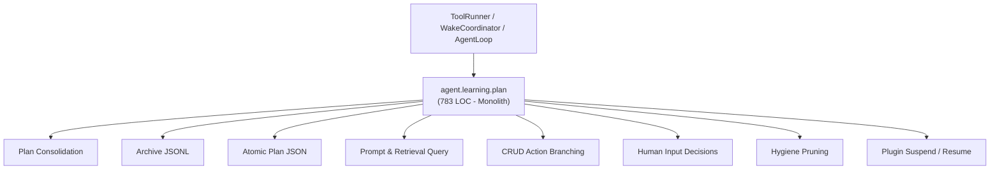
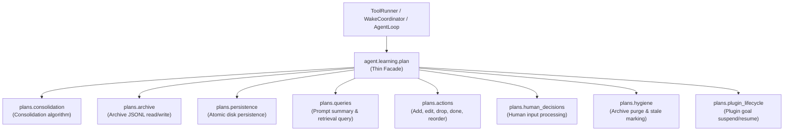

# Refactoring Documentation: `agent.learning.plan`

## 1. What the File Was For
Originally, [`agent/learning/plan.py`](../../agent/learning/plan.py) (~783 lines) served as the persistent, agent-owned autonomous plan store. It tangled together several distinct responsibilities:
- Goal size consolidation algorithms (`consolidate_plan_items`).
- Plan archive persistence and queries (`_append_archive`, `get_archived_items`).
- Plan disk serialization, atomic writing, and seed goal construction (`load`, `_save_atomic`, `initialize`).
- Plan query filtering and prompt formatting (`top_items`, `retrieval_query`, `prompt_summary`).
- CRUD action dispatching (`update_plan` handling add, edit, drop, mark_done, reorder, unchanged, decide_plugin_review, plus `_find_item`).
- Human input decision tracking and reason enforcement (`record_human_input_decision`).
- Plan hygiene routines (purging completed/dropped goals to archive, marking stale items, and applying consolidation).
- Plugin lifecycle state transitions on goals (`suspend_plugin_goals`, `resume_plugin_goals`).

## 2. Purpose and Extraction Map

| Function / Symbol | What it does | How it serves the file's purpose | Smell / SRP violation | Target Module |
| :--- | :--- | :--- | :--- | :--- |
| `consolidate_plan_items` | Consolidates excess active goals and completed milestones into bounded items. | Prevents unbounded growth without truncating active objectives. | Complex array manipulation mixed with persistence store. | [`agent/learning/plans/consolidation.py`](../../agent/learning/plans/consolidation.py) |
| `append_archive_records`, `read_archived_items` | Appends purged goals to `plan_archive.jsonl` and reads archive lines. | Maintains long-term history of achieved milestones. | Archive file I/O mixed into active plan storage. | [`agent/learning/plans/archive.py`](../../agent/learning/plans/archive.py) |
| `save_plan_atomic`, `load_plan_data`, `build_seed_goal`, `now_utc` | Loads, seeds, and atomically writes `state/plan.json`. | Ensures durable crash-consistent persistence. | Atomic file I/O and JSON serialization mixed with business rules. | [`agent/learning/plans/persistence.py`](../../agent/learning/plans/persistence.py) |
| `filter_top_items`, `build_retrieval_query`, `format_prompt_summary` | Selects top goals, formats retrieval query, and generates prompt text. | Informs cycle prompt and tool retrieval. | Text presentation and filtering mixed with CRUD logic. | [`agent/learning/plans/queries.py`](../../agent/learning/plans/queries.py) |
| `find_plan_item`, `apply_add_action`, `apply_edit_action`, `apply_drop_action`, `apply_mark_done_action`, `apply_reorder_action`, `apply_plugin_review_action` | Dispatches specific mutation operations on the goals list. | Implements agent update_plan tool semantics. | Giant 180-line if-elif branch in update_plan. | [`agent/learning/plans/actions.py`](../../agent/learning/plans/actions.py) |
| `process_human_input_decision` | Validates autonomous decision on human input and updates decisions log. | Records agent decisions regarding human suggestions. | Interaction decision parsing mixed with goal lifecycle. | [`agent/learning/plans/human_decisions.py`](../../agent/learning/plans/human_decisions.py) |
| `apply_plan_hygiene` | Purges completed/dropped goals to archive, marks stale goals, and caps count. | Maintains hygiene without deleting suspended plugin goals. | Multi-stage lifecycle pruning entangled with store class. | [`agent/learning/plans/hygiene.py`](../../agent/learning/plans/hygiene.py) |
| `suspend_plugin_goals`, `resume_plugin_goals`, `SUSPENDED_PLUGIN_STATUS` | Transitions goal statuses when plugins are enabled or disabled. | Preserves plugin goals without deleting them on disable. | Plugin lifecycle transitions mixed into general plan store. | [`agent/learning/plans/plugin_lifecycle.py`](../../agent/learning/plans/plugin_lifecycle.py) |
| `PlanStore` | Composition root and thin facade maintaining full backward compatibility. | Coordinates plan store subsystems and provides public tool interface. | High cohesion; delegates specialized responsibilities to submodules. | [`agent/learning/plan.py`](../../agent/learning/plan.py) |

## 3. Dependency Structure (Before vs After)

### Before Refactoring

### After Refactoring

## 4. Facade Re-exports Kept
All former public symbols and attributes remain available directly from `agent.learning.plan`:
- `PlanStore`: The primary class, maintaining:
  - `workspace`, `logger`, `state_dir`, `plan_path`, `archive_path`, `max_items`, `plan_version`, `items`, `human_input_decisions`, `plugin_project_decisions`, `_next_id`.
  - `_append_archive(records)`
  - `get_archived_items(limit)`
  - `initialize(seed_task, default_step)`
  - `load()`
  - `_save_atomic(diff, reason, cycle)`
  - `read_plan(include_history, **extra)`
  - `_find_item(target)`
  - `update_plan(...)`
  - `record_unchanged(cycle, reason, evidence, source)`
  - `record_human_input_decision(...)`
  - `top_items(limit, active_plugins)`
  - `retrieval_query()`
  - `prompt_summary(active_plugins)`
  - `hygiene(cycle, max_stale_cycles)`
  - `suspend_plugin_goals(plugin_name, cycle)`
  - `resume_plugin_goals(plugin_name, cycle)`
- Constants and helper functions:
  - `COMPLETED_PLAN_STATUSES`
  - `ACTIVE_PLAN_STATUSES`
  - `SUSPENDED_PLAN_STATUS_PREFIX`
  - `SUSPENDED_PLUGIN_STATUS` ("suspended: plugin disabled")
  - `WORD`
  - `SEED_STANDING_GOAL`
  - `now_utc`
  - `visible_plan_items`
  - `consolidate_plan_items`

## 5. Patch-target and Testing Changes
- Tests accessing `loop.plan_store.items`, `loop.plan_store.plan_version`, `plan_store.initialize()`, `plan_store.update_plan()`, `plan_store.top_items()`, and `plan_store.retrieval_query()` continue to function seamlessly without modifications.
- Import layer boundaries (Layer 2 `learning`) are strictly respected: all `plans/*` submodules import only from Layer 0 (`infra`, `prompts`) and Layer 2 (`learning`).

## 6. Risks and Verification
- **Acyclic DAG Layering**: Verified with `python -m unittest agent/tests/infra/test_import_layers.py`.
- **Golden Prompts**: Verified with `python -m unittest agent/tests/body/test_golden_prompts.py`.
- **Tagged State Acceptance**: Verified with `python -m unittest agent/tests/plugins/test_tagged_state.py`.
- **Learning Test Suite**: Verified with `python -m unittest discover -s agent/tests/learning -t agent/tests -v` (18 tests passing).
- **Doc Claims Guard**: Verified with `python scripts/check_docs_claims.py`.
