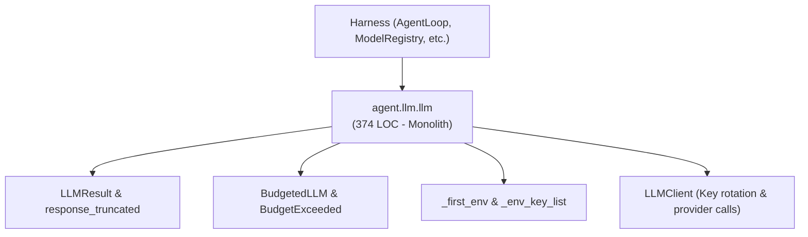
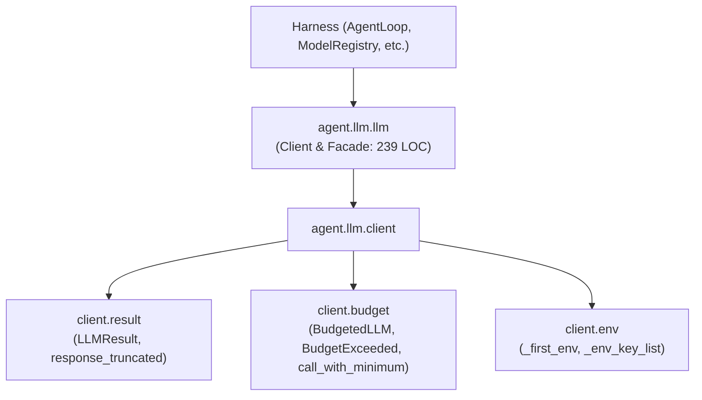

# Refactoring Documentation: `agent.llm.llm`

## 1. What the File Was For
Originally, [`agent/llm/llm.py`](../../agent/llm/llm.py) (~374 lines) served as the primary LLM provider interaction boundary and token management subsystem:
- Response representation & truncation detection: `LLMResult` dataclass (content, tokens, stop reason, max cap) and `response_truncated()` helper detecting length stops or thinking-token truncations.
- Token budgeting & network error classification: `BudgetExceeded` exception, `_is_network_error()` transport classifier, `BudgetedLLM` wrapper integrating with `DailyTokenLedger` for pre-call token reservations and post-call settlements, and `call_with_minimum()` helper.
- Environment & configuration parsing: `_first_env()` and `_env_key_list()` parsing string, delimited, and JSON-array API key configurations.
- Provider client orchestration: `LLMClient` managing client initialization (Anthropic / Ollama), key rotation upon quota/limit errors, exponential backoff retries on transient errors, model registry latency tracking, and event emission.

## 2. Purpose and Extraction Map

| Function / Symbol | What it does | How it serves the file's purpose | Smell / SRP violation | Target Module |
| :--- | :--- | :--- | :--- | :--- |
| `LLMResult`, `response_truncated` | Response dataclass and length/thinking truncation detection. | Standardized response contract and truncation signal across LLM consumers. | Co-located with network error classification and client loops. | [`agent/llm/client/result.py`](../../agent/llm/client/result.py) |
| `BudgetExceeded`, `_is_network_error`, `BudgetedLLM`, `call_with_minimum` | Daily token budget enforcement, pre-call reservation, settlement, and transient error classification. | Ensures token usage does not breach daily limits; releases budget on network failures. | Mixed budgeting lifecycle with provider client wiring. | [`agent/llm/client/budget.py`](../../agent/llm/client/budget.py) |
| `_first_env`, `_env_key_list` | Parses API keys and configuration values from environment variables. | Extracts and cleans provider keys from various formats (CSV, JSON, newlines). | Low-level configuration parsing mixed with model calling logic. | [`agent/llm/client/env.py`](../../agent/llm/client/env.py) |
| `LLMClient` | Provider abstraction, key rotation, retries, and call dispatch. | Central model call executor and provider interface. | Retained in module to maintain critical test patch targets. | [`agent/llm/llm.py`](../../agent/llm/llm.py) |
| `agent.llm.llm` | Module facade preserving all historical public functions, classes, and patch targets. | Complete backward compatibility for tests and harness consumers. | High cohesion; wires submodules into client facade. | [`agent/llm/llm.py`](../../agent/llm/llm.py) |

## 3. Dependency Structure (Before vs After)

### Before Refactoring

### After Refactoring

## 4. Mock Patch Targets Preserved
The following critical test patch targets remain bound to `agent.llm.llm`:
- `agent.llm.llm.Anthropic`
- `agent.llm.llm.reserve_provider_call`
- `agent.llm.llm.time.sleep`

Because `LLMClient` directly accesses these module globals in `agent/llm/llm.py`, existing unit tests patching these targets execute without modification.

## 5. Facade Re-exports Kept
All symbols remain re-exported via `agent.llm.llm` with explicit assignments:
- `Anthropic`
- `BudgetExceeded`
- `BudgetedLLM`
- `LLMClient`
- `LLMResult`
- `_env_key_list`
- `_first_env`
- `_is_network_error`
- `call_with_minimum`
- `reserve_provider_call`
- `response_truncated`

## 6. Verification
- **LLM Unit Tests**: Verified with `python -m unittest discover -s agent/tests/llm -v` (21/21 passing).
- **Import Layering**: Verified with `python -m unittest agent/tests/infra/test_import_layers.py` (strict layer 1 compliance).
- **Golden Prompts**: Verified with `python -m unittest agent/tests/body/test_golden_prompts.py`.
- **Docs Claims Guard**: Verified with `python scripts/check_docs_claims.py` (135 events verified, 357 tests total).
