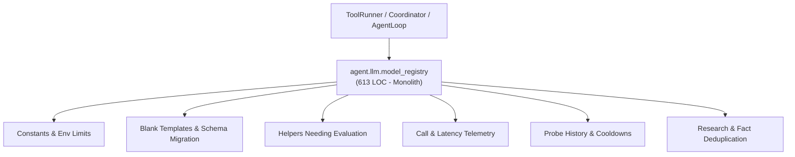
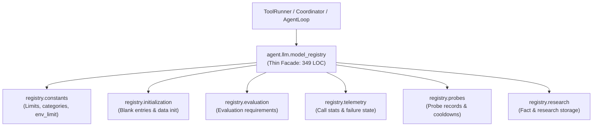

# Refactoring Documentation: `agent.llm.model_registry`

## 1. What the File Was For
Originally, [`agent/llm/model_registry.py`](../../agent/llm/model_registry.py) (~613 lines) served as the durable state repository for configured models, capability assessments, objective probe results, and runtime usage statistics:
- Data bounds and environment limits: defining size caps, schema versions, probe format versions, and bounds parsers (`MAX_MODELS`, `MAX_COUNTER`, `_env_limit`).
- Evaluation status determination: checking whether helper models need evaluation based on current probe format version, invalidation flags, research status, or missing assessments (`get_helpers_needing_evaluation`, `helpers_needing_evaluation`).
- Registry persistence and synchronization: atomic read/write of `models.json` under file lock (`_locked`, `_read`, `_write`), merging existing records with newly configured models, migrating legacy formats, and preserving discontinued models (`_initialize`, `_blank`).
- Output cap resolution and name validation: computing per-model output limits from env overrides or registry ceilings with assumed-ceiling warning logs (`get_output_cap`), and validating model identifiers with alias suggestions (`validate_model_name`).
- Assessment and rating records: persisting qualitative assessments, evidence strings referencing valid probe IDs, and 5-category capability ratings (`record_model_assessment`).
- Telemetry recording: tracking cumulative calls, failures, consecutive failures, min/max/total latency, truncated responses, and non-fatal network connection errors (`record_call`, `mark_not_found`, `record_output_failure`, `record_truncated_call`, `record_network_error`).
- Probe execution lifecycle: enforcing session-level probe rate limits and cooldowns, tracking probe runs, and updating probe history (`begin_probe`, `finish_probe`, `record_probe_outcome`).
- Model research and fact storage: merging web-extracted and agent-supplied model knowledge facts (`record_facts`, `record_research`).

## 2. Purpose and Extraction Map

| Function / Symbol | What it does | How it serves the file's purpose | Smell / SRP violation | Target Module |
| :--- | :--- | :--- | :--- | :--- |
| `MAX_MODELS`, `MAX_NAME_CHARS`, `MAX_ASSESSMENT_CHARS`, `SCHEMA_VERSION`, `env_limit`, etc. | Declares registry limits, rating categories, and environment parser. | Enforces data bounds and schema versions across the subsystem. | Constants and limit validation mixed into business logic. | [`agent/llm/registry/constants.py`](../../agent/llm/registry/constants.py) |
| `get_helpers_needing_evaluation` | Determines which helper models require probing or research evaluation. | Identifies candidates for capability probing and research. | Evaluator query logic embedded in registry module. | [`agent/llm/registry/evaluation.py`](../../agent/llm/registry/evaluation.py) |
| `blank_model_entry`, `initialize_registry_data` | Creates blank entry template and synchronizes prior file records with new configurations. | Maintains schema compliance and historical preservation during boot. | 110-line initialization and migration routine. | [`agent/llm/registry/initialization.py`](../../agent/llm/registry/initialization.py) |
| `record_call_stats`, `mark_not_found_status`, `record_output_failure_stats`, `record_truncated_call_stats`, `record_network_error_stats` | Updates call counters, failure counters, latency metrics, and connection errors. | Maintains durable performance metrics across agent runs. | Telemetry arithmetic and error state transitions mixed with storage. | [`agent/llm/registry/telemetry.py`](../../agent/llm/registry/telemetry.py) |
| `begin_probe_record`, `finish_probe_record`, `record_probe_outcome_stats` | Manages probe sessions, cooldowns, status transitions, and pass/fail counters. | Coordinates probe history and rate limiting per model. | Probe session tracking coupled to registry facade. | [`agent/llm/registry/probes.py`](../../agent/llm/registry/probes.py) |
| `record_facts_entry`, `record_research_entry` | Formats, deduplicates, and stores web/agent model facts and vendor documentation evidence. | Preserves verified technical parameters for configured models. | Fact deduplication and research parsing co-located with registry. | [`agent/llm/registry/research.py`](../../agent/llm/registry/research.py) |
| `ModelRegistry` | Thin facade and composition root maintaining full backward compatibility and locking. | Primary entry point for all model observation and telemetry operations. | High cohesion; delegates specialized tasks to submodules. | [`agent/llm/model_registry.py`](../../agent/llm/model_registry.py) |

## 3. Dependency Structure (Before vs After)

### Before Refactoring

### After Refactoring

## 4. Facade Re-exports Kept
All former public, protected, and test-accessed symbols and instance attributes remain available on `ModelRegistry` and `agent.llm.model_registry`:
- `ModelRegistry`:
  - `path`, `lock_path`, `logger`, `base_model`, `names`, `probe_cooldown_seconds`, `probes_per_model_per_session`.
  - `_locked()`, `_read()`, `_write(data)`, `_blank(name)`, `_initialize()`.
  - `helpers_needing_evaluation()`
  - `get_output_cap(name, default_cap=None)`
  - `validate_model_name(name, helpers_only=False)`
  - `list_models()`, `get_model(name)`
  - `record_model_assessment(name, assessment, evidence, ratings=None, facts=None)`
  - `record_probe_outcome(name, outcome)`
  - `record_call(name, failed, latency_ms, not_found=False)`
  - `mark_not_found(name)`
  - `record_output_failure(name)`
  - `record_truncated_call(name)`
  - `record_network_error(name, latency_ms=0)`
  - `begin_probe(name, session_id, now=None)`
  - `finish_probe(name, probe_id, failed, inconclusive=False, latency_ms=None)`
  - `record_facts(name, facts, origin="model_knowledge")`
  - `record_research(name, status, source_url, facts, ...)`
- Re-exports via `__all__`:
  - `MAX_MODELS`, `MAX_NAME_CHARS`, `MAX_ASSESSMENT_CHARS`, `MAX_EVIDENCE_CHARS`, `MAX_NOTES_CHARS`, `MAX_COUNTER`, `MAX_FILE_BYTES`, `MAX_PROBES_PER_SESSION`, `PROBE_COOLDOWN_SECONDS`, `SCHEMA_VERSION`, `PROBE_FORMAT_VERSION`, `LEGACY_PROBE_INVALIDATION_REASON`, `RATING_CATEGORIES`, `RATING_VALUES`, `DEFAULT_MODEL_OUTPUT_CEILING`, `_env_limit`, `get_helpers_needing_evaluation`, `ModelRegistry`.

## 5. Patch-target and Testing Changes
- Tests reach directly into `ModelRegistry._locked`, `_read`, `_write`, `names`, and `path`. All of these instance methods and attributes remain directly on `ModelRegistry`.
- Direct logger calls: `logger.log("assumed_output_ceiling", ...)`, `logger.log("model_assessment_recorded", ...)`, `logger.log("model_probe_started", ...)`, `logger.log("model_facts_recorded", ...)`, and `logger.log("model_research_recorded", ...)` remain direct `self.logger.log(...)` calls on `ModelRegistry`, preserving all 135 verified events counted by `scripts/check_docs_claims.py`.
- All 21 tests in `agent/tests/llm/` and 32 tests in `agent/tests/helper_models/` continue passing cleanly.

## 6. Risks and Verification
- **Acyclic DAG Layering**: Verified with `python -m unittest agent/tests/infra/test_import_layers.py`.
- **Golden Prompts**: Verified with `python -m unittest agent/tests/body/test_golden_prompts.py`.
- **LLM Test Suite**: Verified with `python -m unittest discover -s agent/tests/llm -v` (21 tests passing).
- **Doc Claims Guard**: Verified with `python scripts/check_docs_claims.py` (135 events verified, 357 tests total).
