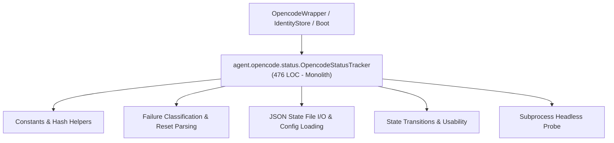
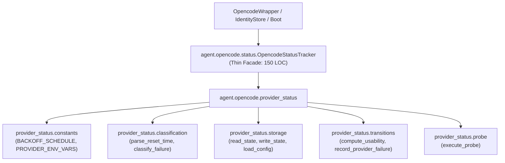

# Refactoring Documentation: `agent.opencode.status`

## 1. What the File Was For
Originally, [`agent/opencode/status.py`](../../agent/opencode/status.py) (~476 lines) managed opencode availability status, health tracking, and provider failure classification:
- Constants and hash helpers: defining backoff intervals (`BACKOFF_SCHEDULE`), provider environment variable mappings (`PROVIDER_ENV_VARS`, `PROVIDER_STANDARD_ENV`), UTC time utilities, and SHA-256 API key hashing (`_hash_key`).
- Error classification and reset parsing: regex extraction of rate-limit retry durations in seconds/minutes/hours (`parse_reset_time`), and exit-code/error-message classification into `ok`, `invalid_key`, `quota_daily`, `throttled`, and `transient` (`classify_failure`).
- Persistent state management: cross-process locked reading and atomic write replacement of `state/opencode_status.json` (`_read_state`, `_write_state`, `_initial_state`, `_ensure_initialized`, `_load_config`).
- Provider lifecycle and usability: syncing key changes from environment variables, recording successes and failures with exponential backoffs, and evaluating cross-provider usability and probe readiness (`sync_keys_with_environment`, `get_provider_state`, `record_success`, `record_failure`, `usability`).
- Headless probing: running lightweight CLI probes (`opencode run --auto --standalone ...`) to revive throttled providers (`probe`).

## 2. Purpose and Extraction Map

| Function / Symbol | What it does | How it serves the file's purpose | Smell / SRP violation | Target Module |
| :--- | :--- | :--- | :--- | :--- |
| `BACKOFF_SCHEDULE`, `PROVIDER_ENV_VARS`, `PROVIDER_STANDARD_ENV`, `_hash_key`, `_now_utc`, `_iso_now` | Backoff schedule, environment variable mappings, UTC timestamps, and SHA-256 key hashing. | Baseline constants and utilities ensuring secrets are hashed rather than stored raw. | Constants and hashing utilities mixed with state persistence. | [`agent/opencode/provider_status/constants.py`](../../agent/opencode/provider_status/constants.py) |
| `parse_reset_time`, `classify_failure` | Regex-based retry interval extraction and process error text categorizer. | Diagnoses why an opencode provider run failed and determines backoff duration. | Text parsing algorithms coupled with state machine management. | [`agent/opencode/provider_status/classification.py`](../../agent/opencode/provider_status/classification.py) |
| `load_config`, `blank_provider_state`, `initial_state`, `read_state`, `write_state`, `ensure_initialized` | Reads/writes `opencode_status.json` and loads `scripts/opencode/config.json`. | Provides atomic disk persistence for provider availability. | JSON serialization and disk I/O mixed with provider state transitions. | [`agent/opencode/provider_status/storage.py`](../../agent/opencode/provider_status/storage.py) |
| `sync_environment_keys`, `record_provider_success`, `record_provider_failure`, `compute_usability` | Synchronizes environment keys, increments failure counts, computes backoffs, and checks usability. | Drives provider state transitions between available, throttled, invalid, and probe_due. | Complex state transition rules embedded in monolith class. | [`agent/opencode/provider_status/transitions.py`](../../agent/opencode/provider_status/transitions.py) |
| `execute_probe` | Executes lightweight headless opencode probe command with isolated environment variables. | Tests whether a throttled provider has recovered. | Subprocess execution and timeout handling mixed with status queries. | [`agent/opencode/provider_status/probe.py`](../../agent/opencode/provider_status/probe.py) |
| `OpencodeStatusTracker` | Thin composition facade coordinating state storage, transitions, and probe execution. | Primary API used by `IdentityStore`, `OpencodeWrapper`, and session boot. | High cohesion; pure facade delegating to `agent.opencode.provider_status`. | [`agent/opencode/status.py`](../../agent/opencode/status.py) |

## 3. Dependency Structure (Before vs After)

### Before Refactoring

### After Refactoring

## 4. Facade Re-exports Kept
All symbols, attributes, and public/private methods remain intact on `OpencodeStatusTracker` and `agent.opencode.status`:
- Class `OpencodeStatusTracker`:
  - Attributes: `workspace`, `state_path`, `lock_path`, `binary_path`, `config_path`, `runner_fn`.
  - Methods: `_load_config()`, `_blank_provider_state(provider)`, `_ensure_initialized()`, `_initial_state()`, `_read_state()`, `_write_state(data)`, `sync_keys_with_environment()`, `get_provider_state(provider)`, `record_success(provider)`, `record_failure(provider, category, error_text, reset_seconds=None)`, `usability()`, `probe(provider)`.
- Re-exports via `__all__`:
  - `BACKOFF_SCHEDULE`
  - `OpencodeStatusTracker`
  - `PROVIDER_ENV_VARS`
  - `PROVIDER_STANDARD_ENV`
  - `_hash_key`
  - `_iso_now`
  - `_now_utc`
  - `classify_failure`
  - `parse_reset_time`

## 5. Verification
- **Opencode Status Unit Tests**: Verified with `python -m unittest agent/opencode/tests/test_status.py -v` (19/19 passing).
- **Opencode Wrapper Unit Tests**: Verified with `python -m unittest agent/opencode/tests/test_wrapper.py -v` (12/12 passing).
- **Full Opencode Pytest Suite**: Verified with `python -m pytest agent/opencode/tests/ -v` (45/45 passing).
- **Doc Claims Guard**: Verified with `python scripts/check_docs_claims.py` (357 tests total).
