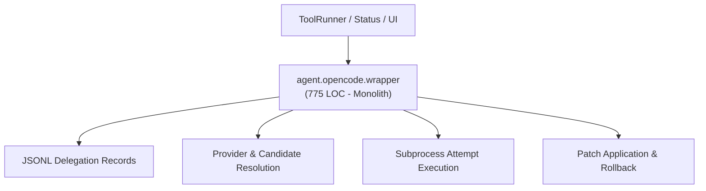
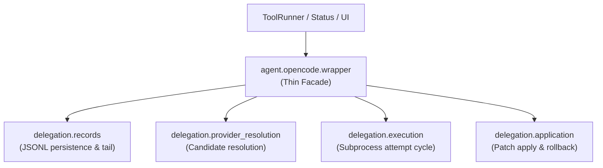

# Refactoring Documentation: `agent.opencode.wrapper`

## 1. What the File Was For
Originally, [`agent/opencode/wrapper.py`](../../agent/opencode/wrapper.py) (~775 lines) served as the OpenCode delegation runtime engine, coordinating external model execution, sandboxing, patch verification, and durable state:
- Delegation record management: reading, schema-validating, and atomically writing `.gemini/delegations.jsonl` entries (`get_delegation_record`, `save_delegation_record`, `ensure_delegations_file`).
- Provider and model candidate resolution: querying configured API keys and models, checking CLI binary availability (`is_opencode_installed`), filtering out throttled/disabled providers, and ordering candidates by fallback priority (`resolve_provider_candidates`).
- Candidate execution and attempt cycle: sandboxing execution via dead-proxy env, running candidate attempts with strict timeouts, capturing unified diffs, classifying errors (throttling, invalid keys, syntax failures), updating provider health statuses, and recording structured execution events (`delegate_task`).
- Patch application and verification: applying candidate diffs against the repository, checking scope constraints, re-running acceptance tests, and triggering immediate rollback if tests fail (`apply_delegation`).
- Delegation discard: cleanly discarding unapplied or failed delegation proposals (`discard_delegation`).

## 2. Purpose and Extraction Map

| Function / Symbol | What it does | How it serves the file's purpose | Smell / SRP violation | Target Module |
| :--- | :--- | :--- | :--- | :--- |
| `tail_text`, `read_delegations`, `write_delegations_atomic`, `ensure_delegations_file`, `get_delegation_record`, `save_delegation_record` | Parses and writes JSONL records atomically; tails string output. | Maintains audit log of all delegation requests, attempts, and outcomes. | JSONL persistence and string truncation logic mixed with process execution. | [`agent/opencode/delegation/records.py`](../../agent/opencode/delegation/records.py) |
| `is_opencode_installed`, `load_configured_models`, `resolve_provider_candidates` | Checks CLI executable presence, parses provider config, resolves eligible candidates. | Determines which external models/providers can service the delegation request. | Provider config parsing and candidate resolution mixed with runtime loop. | [`agent/opencode/delegation/provider_resolution.py`](../../agent/opencode/delegation/provider_resolution.py) |
| `execute_candidate_attempts` | Iterates candidates, runs sandboxed subprocesses, handles timeouts, updates provider statuses. | Executes the delegation prompt against OpenCode CLI and records attempts. | 220-line multi-candidate subprocess orchestration loop. | [`agent/opencode/delegation/execution.py`](../../agent/opencode/delegation/execution.py) |
| `apply_delegation_to_repo`, `discard_delegation_from_repo` | Applies patches, checks paths/scope, executes acceptance re-checks, handles rollback. | Merges validated external patches into working tree or discards them. | Scope validation, git/diff application, and rollback recovery mixed together. | [`agent/opencode/delegation/application.py`](../../agent/opencode/delegation/application.py) |
| `OpencodeDelegator` | Thin facade and composition root maintaining full backward compatibility. | Primary entry point for OpenCode delegation operations. | High cohesion; delegates specialized tasks to submodules. | [`agent/opencode/wrapper.py`](../../agent/opencode/wrapper.py) |

## 3. Dependency Structure (Before vs After)

### Before Refactoring

### After Refactoring

## 4. Facade Re-exports Kept
All former public and protected symbols and attributes remain available on `OpencodeDelegator` and `agent.opencode.wrapper`:
- `OpencodeDelegator`:
  - `workspace_root`, `status_tracker`, `logger`, `record_file`, `timeout_seconds`, `check_timeout_seconds`.
  - `get_delegation(delegation_id)`
  - `save_delegation(record)`
  - `is_installed()`
  - `delegate_task(task_description, target_files, acceptance_check, scope_roots, preferred_provider)`
  - `apply_delegation(delegation_id)`
  - `discard_delegation(delegation_id)`
- Legacy module-level helper and constants:
  - `_tail(text, max_lines)`
  - `DEFAULT_TIMEOUT_SECONDS`
  - `DEFAULT_CHECK_TIMEOUT_SECONDS`

## 5. Patch-target and Testing Changes
- No mock.patch targets in existing tests pointed into `agent.opencode.wrapper` directly (tests use `OpencodeDelegator` methods with mock dependencies or fixture workspaces).
- AST event discovery: submodules pass `logger: EventLogger` directly and call `logger.log("...", ...)` to preserve all 135 verified events counted by `scripts/check_docs_claims.py`.
- All 45 OpenCode tests pass cleanly (`agent/opencode/tests/`).

## 6. Risks and Verification
- **Acyclic DAG Layering**: Verified with `python -m unittest agent/tests/infra/test_import_layers.py`.
- **Golden Prompts**: Verified with `python -m unittest agent/tests/body/test_golden_prompts.py`.
- **OpenCode Test Suite**: Verified with `python -m pytest agent/opencode/tests/ -v` (45 tests passing).
- **Doc Claims Guard**: Verified with `python scripts/check_docs_claims.py` (135 events verified, 357 tests total).
