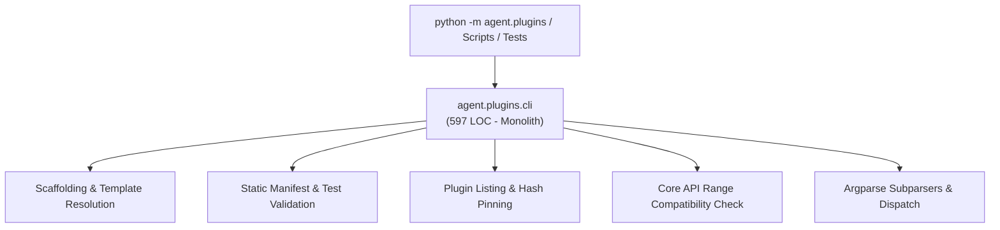
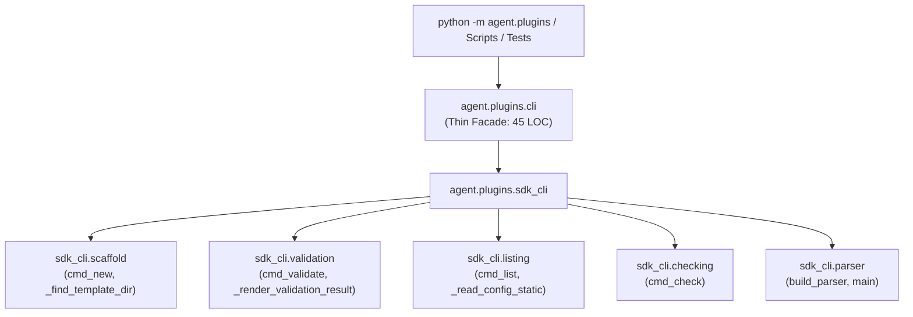

# Refactoring Documentation: `agent.plugins.cli`

## 1. What the File Was For
Originally, [`agent/plugins/cli.py`](../../agent/plugins/cli.py) (~597 lines) served as the Plugin SDK command-line interface:
- Name constraints and template scaffolding: validating plugin name rules against reserved identifiers and generating plugin directory skeletons from `plugins/_template` (`RESERVED_PLUGIN_NAMES`, `_find_template_dir`, `cmd_new`).
- Static manifest and test verification: parsing `plugin.json` without executing untrusted code, validating required fields, semantic versions, core API version ranges, tool/sensor/action schemas, risk classes, state directory security constraints, and ensuring non-empty test files exist (`cmd_validate`, `_render_validation_result`).
- Plugin discovery and status listing: scanning shipped and workspace plugin directories, reading `plugins.json` configuration, computing SHA-256 state-invariant hashes, and reporting enablement and hash pinning status (`_read_config_static`, `cmd_list`).
- Core API version compatibility check: statically verifying all installed and workspace plugins against current core API version (`cmd_check`).
- CLI argument parsing and dispatch: defining the `argparse` CLI entry point with 4 subcommands (`new`, `validate`, `list`, `check`), and handling exit codes (`build_parser`, `main`).

## 2. Purpose and Extraction Map

| Function / Symbol | What it does | How it serves the file's purpose | Smell / SRP violation | Target Module |
| :--- | :--- | :--- | :--- | :--- |
| `RESERVED_PLUGIN_NAMES`, `_find_template_dir`, `cmd_new` | Validates plugin naming conventions, resolves template path, copies skeleton, and customizes `plugin.json`. | Enables developers and autonomous agent to bootstrap valid plugin structures. | Template copying and string formatting mixed with argument parsing. | [`agent/plugins/sdk_cli/scaffold.py`](../../agent/plugins/sdk_cli/scaffold.py) |
| `_render_validation_result`, `cmd_validate` | Validates plugin manifest structure, core API compatibility, and test directory completeness statically. | Ensures plugin safety and compliance without importing untrusted code. | ~180-line static validation procedure with deep JSON schema checking. | [`agent/plugins/sdk_cli/validation.py`](../../agent/plugins/sdk_cli/validation.py) |
| `_read_config_static`, `cmd_list` | Reads `plugins.json`, scans directories, hashes plugin files, and reports status. | Displays discovered plugins and hash pinning status. | Config reading, directory traversal, and hash verification in CLI facade. | [`agent/plugins/sdk_cli/listing.py`](../../agent/plugins/sdk_cli/listing.py) |
| `cmd_check` | Scans all plugin manifests and compares `core_api` semver ranges against `CORE_API_VERSION`. | Checks compatibility of all plugins before session run. | Compatibility verification logic mixed with CLI output formatting. | [`agent/plugins/sdk_cli/checking.py`](../../agent/plugins/sdk_cli/checking.py) |
| `build_parser`, `main` | Defines argparse subparsers (`new`, `validate`, `list`, `check`) and dispatches commands. | Provides the standard CLI entry point (`python -m agent.plugins`). | CLI parser definition tightly coupled with command implementation logic. | [`agent/plugins/sdk_cli/parser.py`](../../agent/plugins/sdk_cli/parser.py) |
| `agent.plugins.cli` | Thin backward-compatible facade re-exporting all functions, constants, and entry points. | Preserves all existing import paths, scripts, and `python -m agent.plugins.cli` execution. | High cohesion; pure facade delegating to `agent.plugins.sdk_cli`. | [`agent/plugins/cli.py`](../../agent/plugins/cli.py) |

## 3. Dependency Structure (Before vs After)

### Before Refactoring

### After Refactoring

## 4. Facade Re-exports Kept
All symbols remain re-exported via `agent.plugins.cli` and its `__all__`:
- `RESERVED_PLUGIN_NAMES`
- `_find_template_dir`
- `_read_config_static`
- `_render_validation_result`
- `build_parser`
- `cmd_check`
- `cmd_list`
- `cmd_new`
- `cmd_validate`
- `main`
- Executable shim: `if __name__ == "__main__": sys.exit(main())`

## 5. Verification
- **Plugins Test Suite**: Verified with `python -m unittest discover -s agent/tests/plugins -v` (86/86 tests passing).
- **Import Layering**: Verified with `python -m unittest agent/tests/infra/test_import_layers.py` (strict DAG layer 2 compliance).
- **Golden Prompts**: Verified with `python -m unittest agent/tests/body/test_golden_prompts.py`.
- **Architecture & Claims Guard**: Verified with `python scripts/check_architecture_docs.py` and `python scripts/check_docs_claims.py` (4 CLI commands, 29 tools, 135 events, 357 tests total).
