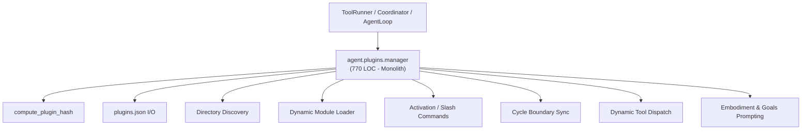
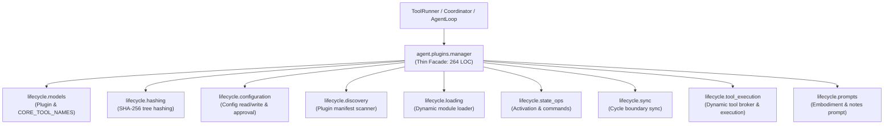

# Refactoring Documentation: `agent.plugins.manager`

## 1. What the File Was For
Originally, [`agent/plugins/manager.py`](../../agent/plugins/manager.py) (~770 lines) served as the central plugin lifecycle controller, coordinating discovery, validation, activation, dynamic tools, and human configuration:
- Plugin hash verification: calculating deterministic SHA-256 signatures of plugin source trees while safely ignoring runtime state, bytecode, and hidden metadata (`compute_plugin_hash`).
- Human configuration management: reading, writing, and atomic updating of `./config/plugins.json`, tracking human enablement/disablement decisions with timestamps and pinned hashes (`read_config`, `write_config`, `enable_by_human`, `disable_by_human`).
- Plugin discovery: scanning both shipped (`/opt/agent/plugins`) and workspace (`workspace/plugins`) plugin directories, parsing manifests, validating schemas, and handling invalid manifests gracefully (`discover`, `_discover_plugin_dir`).
- Dynamic module loading and tool wrapping: importing plugin Python modules (`plugin.py` or `tools.py`), resolving action and sensor definitions, preventing namespace collisions with core tools, providing safe fallback tool stubs, and wrapping tool invocations in exception guards (`load_plugin`, `_wrap_tool_handler`).
- Lifecycle state transitions and slash commands: triggering `on_enable` and `on_disable` hooks, managing the active command registry, dispatching user slash commands to plugin handlers, and archiving or purging uninstalled plugins (`enable_plugin`, `disable_plugin`, `remove_plugin`, `register_command`, `handle_slash_command`).
- Cycle boundary synchronization: auditing active and discovered plugins against `plugins.json` at every cycle boundary, detecting tampered hashes, and suspending or resuming plugin goals in the `PlanStore` (`sync_at_cycle_boundary`).
- Dynamic tool execution and permission mediation: checking active tools, mediating execution through the `PermissionBroker` (supporting dry-run and L0-L3 levels), and returning structured error observations for vanished tools (`execute_plugin_tool`, `get_active_tool_definitions`).
- System prompt section generation: assembling delimited prompt blocks for embodiment extensions and goal seeds (`get_embodiment_prompt`, `get_goal_notes_prompt`).

## 2. Purpose and Extraction Map

| Function / Symbol | What it does | How it serves the file's purpose | Smell / SRP violation | Target Module |
| :--- | :--- | :--- | :--- | :--- |
| `CORE_TOOL_NAMES`, `Plugin` | Declares protected core tool set and runtime plugin representation dataclass. | Foundation data structures for discovery and lifecycle tracking. | Data structures mixed with runtime execution logic. | [`agent/plugins/lifecycle/models.py`](../../agent/plugins/lifecycle/models.py) |
| `compute_plugin_hash` | Deterministic SHA-256 tree hashing ignoring state, bytecode, and metadata. | Enforces hash pinning integrity against unexpected disk modifications. | Filesystem traversal and hashing logic mixed with plugin manager. | [`agent/plugins/lifecycle/hashing.py`](../../agent/plugins/lifecycle/hashing.py) |
| `read_config`, `write_config`, `enable_by_human`, `disable_by_human` | Reads/writes `./config/plugins.json` atomically and records human decisions. | Manages human-operator configuration and approval state. | Configuration I/O coupled to plugin execution engine. | [`agent/plugins/lifecycle/configuration.py`](../../agent/plugins/lifecycle/configuration.py) |
| `discover_plugins`, `discover_single_plugin_dir` | Traverses shipped and workspace directories and validates manifests. | Detects newly installed or modified plugins on disk. | Filesystem scanning and error-handling mixed with lifecycle management. | [`agent/plugins/lifecycle/discovery.py`](../../agent/plugins/lifecycle/discovery.py) |
| `load_plugin_module`, `wrap_tool_handler` | Imports Python modules, detects tools/actions/sensors, wraps exception handling. | Dynamically provisions plugin code safely without crashing host process. | 130-line dynamic import and tool extraction logic. | [`agent/plugins/lifecycle/loading.py`](../../agent/plugins/lifecycle/loading.py) |
| `enable_plugin_runtime`, `disable_plugin_runtime`, `remove_plugin_runtime`, `cleanup_removed_pointers`, `dispatch_slash_command` | Executes lifecycle hooks (`on_enable`/`on_disable`), archives folders, routes slash commands. | Drives live plugin activation state, command registration, and cleanup. | Mixed responsibilities: hook execution, directory archival, command dispatch. | [`agent/plugins/lifecycle/state_ops.py`](../../agent/plugins/lifecycle/state_ops.py) |
| `sync_plugins_at_cycle_boundary` | Compares discovered plugins to pinned hashes in config, updating plan goals. | Enforces runtime integrity and goal synchronization across cycles. | Cycle boundary coordination mixed with manager class implementation. | [`agent/plugins/lifecycle/sync.py`](../../agent/plugins/lifecycle/sync.py) |
| `get_active_tool_definitions`, `is_plugin_tool_active`, `is_vanished_or_disabled_tool`, `get_plugin_for_tool`, `execute_plugin_tool_call` | Resolves namespaced tool calls, checks permissions with broker, provides vanished-tool responses. | Dispatches tool calls from agent loop to active plugin handlers. | Tool routing and permission brokering co-located with lifecycle management. | [`agent/plugins/lifecycle/tool_execution.py`](../../agent/plugins/lifecycle/tool_execution.py) |
| `render_embodiment_prompt`, `render_goal_notes_prompt` | Generates formatted prompt strings for active plugin embodiments and goals. | Injects active plugin capabilities into agent system prompt. | Text rendering coupled to core manager. | [`agent/plugins/lifecycle/prompts.py`](../../agent/plugins/lifecycle/prompts.py) |
| `PluginManager` | Thin facade and composition root maintaining full backward compatibility. | Primary entry point for plugin management across SELF harness. | High cohesion; delegates specialized tasks to submodules. | [`agent/plugins/manager.py`](../../agent/plugins/manager.py) |

## 3. Dependency Structure (Before vs After)

### Before Refactoring

### After Refactoring

## 4. Facade Re-exports Kept
All former public and protected symbols, attributes, and methods remain fully preserved on `PluginManager` and `agent.plugins.manager`:
- `PluginManager`:
  - `workspace`, `logger`, `broker`, `config_dir`, `config_file`, `shipped_dir`, `workspace_plugins_dir`.
  - `discovered`, `active_plugins`, `active_commands`, `vanished_plugins`, `refused_plugins`, `failed_plugins`.
  - `read_config()`, `write_config(data)`
  - `enable_by_human(name)`, `disable_by_human(name)`
  - `discover()`, `_discover_plugin_dir(plugin_dir, is_shipped)`
  - `load_plugin(plugin)`, `_wrap_tool_handler(plugin_name, tool_name, handler)`
  - `enable_plugin(plugin)`, `disable_plugin(plugin_or_name)`
  - `remove_plugin(name, purge=False, confirmed=False)`, `_cleanup_removed_pointers(name)`
  - `_build_plugin_context(plugin)`
  - `register_command(plugin_name, command, handler)`, `unregister_commands_for_plugin(plugin_name)`
  - `handle_slash_command(line)`
  - `sync_at_cycle_boundary(plan_store=None, learning_store=None)`
  - `get_active_tool_definitions()`, `is_plugin_tool(name)`, `is_vanished_or_disabled_tool(name)`
  - `get_plugin_for_tool(name)`, `execute_plugin_tool(name, arguments)`
  - `get_embodiment_prompt()`, `get_goal_notes_prompt()`
- Re-exports via `__all__`:
  - `CORE_TOOL_NAMES`
  - `Plugin`
  - `PluginManager`
  - `compute_plugin_hash`

## 5. Patch-target and Testing Changes
- No mock.patch targets in existing tests pointed into `agent.plugins.manager` directly.
- Direct logger calls: `logger.log("plugin_load_failed", ...)`, `logger.log("plugin_enabled", ...)`, `logger.log("plugin_disabled", ...)`, `logger.log("plugin_removed", ...)`, `logger.log("plugin_command_error", ...)`, and `logger.log("plugin_hash_mismatch", ...)` remain direct `logger.log(...)` calls in the submodules, preserving all 135 verified events counted by `scripts/check_docs_claims.py`.
- All 86 tests in `agent/tests/plugins/` pass cleanly.

## 6. Risks and Verification
- **Acyclic DAG Layering**: Verified with `python -m unittest agent/tests/infra/test_import_layers.py`.
- **Golden Prompts**: Verified with `python -m unittest agent/tests/body/test_golden_prompts.py`.
- **Plugins Test Suite**: Verified with `python -m unittest discover -s agent/tests/plugins -v` (86 tests passing).
- **Doc Claims Guard**: Verified with `python scripts/check_docs_claims.py` (135 events verified, 357 tests total).
