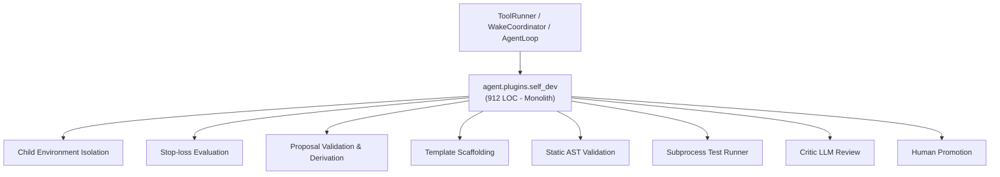
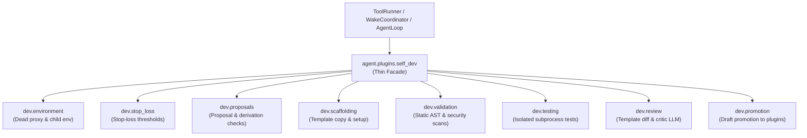

# Refactoring Documentation: `agent.plugins.self_dev`

## 1. What the File Was For
Originally, [`agent/plugins/self_dev.py`](../../agent/plugins/self_dev.py) (~912 lines) served as the plugin self-development subsystem, handling the complete lifecycle of agent-authored plugins:
- Proposal validation, strict snake_case naming, cost derivation auditing against the `CostLedger`, and milestone plan injection (`propose_plugin`, `list_proposals`, `get_proposal`).
- Stop-loss threshold tracking and unacknowledged review detection at 25%, 50%, and 100% of estimate (`get_pending_stop_loss`, `record_review_decision`).
- Draft scaffolding from the core template into `workspace/plugin_dev/<name>/` (`scaffold_plugin`).
- Multi-phase static validation: manifest schema, core API versioning, tool name collisions, sensor L0 permissions, secret reads in `environ`/`getenv`, undeclared network/subprocess imports, prompt injection scanning, and test file presence (`validate_plugin`).
- Subprocess test execution under dead-proxy isolation (`_child_env`) with PEP 578 audit hook protection, anti-mutation hash verification, and `STOP` file monitoring (`test_plugin`).
- Critic review packet generation with unified diffing against the starter template, LLM critic dispatch using `PLUGIN_CRITIC_PROMPT`, and review packet saving (`request_plugin_review`).
- Human-only promotion copying validated drafts to `workspace/plugins/` as `DISABLED` (`promote_draft_by_human`).

## 2. Purpose and Extraction Map

| Function / Symbol | What it does | How it serves the file's purpose | Smell / SRP violation | Target Module |
| :--- | :--- | :--- | :--- | :--- |
| `SECRET_NAME_MARKERS`, `now_utc`, `child_env` | Isolates environment variables and routes network to dead proxy. | Prevents secret leakage and network calls during tests. | Environment isolation logic mixed with plugin orchestration. | [`agent/plugins/dev/environment.py`](../../agent/plugins/dev/environment.py) |
| `get_pending_stop_loss`, `record_review_decision` | Evaluates ledger spend against proposal estimate thresholds. | Enforces stop-loss review checkpoints before further dev actions. | Budget review calculation coupled to dev manager. | [`agent/plugins/dev/stop_loss.py`](../../agent/plugins/dev/stop_loss.py) |
| `validate_and_record_proposal`, `validate_derivation`, `list_proposals`, `get_proposal` | Validates proposal fields, verifies arithmetic derivation, appends JSONL, adds milestones. | Registers new plugin projects and creates plan milestones. | 180-line proposal verification method mixed with tool dispatch. | [`agent/plugins/dev/proposals.py`](../../agent/plugins/dev/proposals.py) |
| `scaffold_plugin_draft` | Copies template directory and configures `plugin.json`. | Creates the workspace/plugin_dev draft structure. | Filesystem template copying mixed with review pipeline. | [`agent/plugins/dev/scaffolding.py`](../../agent/plugins/dev/scaffolding.py) |
| `validate_draft_plugin`, `PROMPT_INJECTION_PATTERNS`, `NETWORK_MODULES`, `SUBPROCESS_MODULES` | Performs multi-phase AST and text validation of draft files. | Ensures drafts comply with security envelope before execution. | 190-line static analyzer embedded in project manager. | [`agent/plugins/dev/validation.py`](../../agent/plugins/dev/validation.py) |
| `execute_isolated_test`, `snapshot_file_hashes` | Runs unittests via `run_process` with audit hook and anti-mutation guard. | Verifies plugin test suite passes in sandboxed subprocess. | Subprocess management and hash verification mixed with business logic. | [`agent/plugins/dev/testing.py`](../../agent/plugins/dev/testing.py) |
| `execute_plugin_review`, `build_template_diff` | Computes diff against template, requests LLM review, saves packet. | Produces review packet for human promotion decision. | LLM prompting and diff formatting mixed into developer tool. | [`agent/plugins/dev/review.py`](../../agent/plugins/dev/review.py) |
| `promote_draft_by_human` | Copies draft to `workspace/plugins/` and configures `plugins.json` as `DISABLED`. | Implements human promotion gate. | Deployment configuration logic co-located with development. | [`agent/plugins/dev/promotion.py`](../../agent/plugins/dev/promotion.py) |
| `PluginDevManager` | Thin facade and composition root maintaining full backward compatibility. | Primary entry point for plugin self-development operations. | High cohesion; delegates specialized tasks to submodules. | [`agent/plugins/self_dev.py`](../../agent/plugins/self_dev.py) |

## 3. Dependency Structure (Before vs After)

### Before Refactoring

### After Refactoring

## 4. Facade Re-exports Kept
All former public symbols and instance attributes remain available on `PluginDevManager` and `agent.plugins.self_dev`:
- `PluginDevManager`:
  - `workspace`, `dev_dir`, `plugins_dir`, `state_dir`, `proposals_file`, `logger`, `cost_ledger`, `review_call`, `reviewed_thresholds`.
  - `get_proposal(name)`
  - `get_pending_stop_loss(name)`
  - `record_review_decision(name, threshold)`
  - `ensure_directories()`
  - `propose_plugin(...)`
  - `scaffold_plugin(...)`
  - `validate_plugin(name)`
  - `test_plugin(name, test_type, timeout)`
  - `request_plugin_review(name)`
  - `promote_draft_by_human(name)`
  - `list_proposals()`
- Constants and re-exports:
  - `SECRET_NAME_MARKERS`
  - `PROMPT_INJECTION_PATTERNS`
  - `NETWORK_MODULES`
  - `SUBPROCESS_MODULES`
  - `PLUGIN_CRITIC_PROMPT`
  - `now_utc`
  - `_child_env`
  - `run_process`

## 5. Patch-target and Testing Changes
- **Known Patch Target Preserved**: `unittest.mock.patch("agent.plugins.self_dev.run_process")` is actively used in `agent/tests/plugins/test_release_regression.py` (line 483). `run_process` is imported directly into `agent.plugins.self_dev` and passed from `PluginDevManager.test_plugin` to `execute_isolated_test(..., run_process_fn=run_process)`, ensuring patches on `agent.plugins.self_dev.run_process` take effect without needing test path alterations.
- All 86 tests in `agent/tests/plugins/` continue passing cleanly.
- AST event discovery in `scripts/check_docs_claims.py` requires literal `logger.log("event_name", ...)` calls. Event logging calls in `dev/*` submodules retain direct `logger.log(...)` signatures to verify the 135-event claim.

## 6. Risks and Verification
- **Acyclic DAG Layering**: Verified with `python -m unittest agent/tests/infra/test_import_layers.py`.
- **Golden Prompts**: Verified with `python -m unittest agent/tests/body/test_golden_prompts.py`.
- **Plugins Test Suite**: Verified with `python -m unittest discover -s agent/tests/plugins -t agent/tests -v` (86 tests passing).
- **Doc Claims Guard**: Verified with `python scripts/check_docs_claims.py` (135 events verified, 357 tests total).
