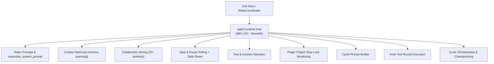
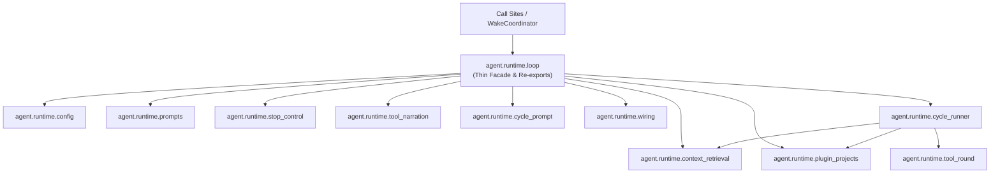

# Refactoring Documentation: `agent.runtime.loop`

## 1. What the File Was For
Originally, [`agent/runtime/loop.py`](../../agent/runtime/loop.py) (~880 lines) served as the primary bounded autonomous cycle engine. It tangled together disparate responsibilities:
- System prompt assembly and static golden prompt strings (`assemble_system_prompt`, `SYSTEM_PROMPT`).
- Keyword memory retrieval over text files in workspace (`retrieve_context`).
- Extensive runtime configuration dataclasses (`AgentConfig`, `RunSummary`, `LLMProtocol`).
- Complex collaborator construction and explicit dependency injection across 15+ subsystems (`AgentLoop.__init__`).
- Stop conditions, human pause polling, and daily token budget reset logic (`_stopped`, `_wait_while_paused`, `_pause_until_daily_reset`, `_request_daily_budget_action`).
- Tool and assistant narration formatting (`_tool_narration`, `_narrate_content`).
- Plugin projects stop-loss budget tracking (`_check_active_plugin_projects`).
- Dynamic per-cycle prompt assembly with model context and identity prompt context (`_system_prompt`).
- Inner tool execution rounds with duplicate action suppression and plugin project reviews (`run` inner loop).
- Cycle boundaries, checkpointing, telemetry logging, learning record persistence, and CLI argument parsing (`run`, `parse_args`, `main`).

## 2. Purpose and Extraction Map

| Function / Symbol | What it does | How it serves the file's purpose | Smell / SRP violation | Target Module |
| :--- | :--- | :--- | :--- | :--- |
| `AgentConfig`, `RunSummary`, `LLMProtocol` | Dataclasses for runtime limits, loop settings, and return summaries. | Declares configuration parameters and runtime contracts. | Type definitions co-located with heavy orchestrator logic. | [`agent/runtime/config.py`](../../agent/runtime/config.py) |
| `assemble_system_prompt`, `SYSTEM_PROMPT`, core prompt re-exports | Assembles core system prompt from embodiment rules. | Provides base model instructions for autonomous behavior. | Static prompt construction embedded in procedural loop. | [`agent/runtime/prompts.py`](../../agent/runtime/prompts.py) |
| `retrieve_context`, `TEXT_EXTENSIONS`, `WORD` | Keyword search over workspace memory files. | Retrieves relevant context before starting cycle. | Ad-hoc file searching and text processing mixed into agent loop. | [`agent/runtime/context_retrieval.py`](../../agent/runtime/context_retrieval.py) |
| `check_is_stopped`, `wait_while_paused`, `request_daily_budget_action`, `pause_until_daily_reset` | Checks watcher/broker/STOP file; pauses at safe boundaries. | Enforces graceful halt, pause, and daily token cap recovery. | Polling, file locking, and process sleep logic mixed into execution engine. | [`agent/runtime/stop_control.py`](../../agent/runtime/stop_control.py) |
| `TOOL_NARRATORS`, `format_tool_narration`, `format_content_narration` | Formats friendly human narration strings for tools and text. | Emits user-visible logs during execution. | Output presentation and formatting tangled with execution loop. | [`agent/runtime/tool_narration.py`](../../agent/runtime/tool_narration.py) |
| `check_active_plugin_projects` | Evaluates plugin project budgets against stop-loss thresholds. | Injects stop-loss warnings into cycle prompt. | Plugin financial monitoring logic embedded in runtime loop. | [`agent/runtime/plugin_projects.py`](../../agent/runtime/plugin_projects.py) |
| `build_system_prompt_for_cycle` | Loads fresh identity, model context, and plugin embodiment. | Assembles dynamic per-turn system prompt. | Multi-collaborator prompt assembly mixed with cycle execution. | [`agent/runtime/cycle_prompt.py`](../../agent/runtime/cycle_prompt.py) |
| `wire_loop_collaborators`, `LoopCollaborators` | Instantiates and wires 15+ collaborating systems into `ToolRunner`. | Prepares runtime dependencies before execution. | Massive constructor with hidden side-effects. | [`agent/runtime/wiring.py`](../../agent/runtime/wiring.py) |
| `execute_tool_round` | Executes a batch of model `tool_use` blocks with duplicate action guard. | Handles tool dispatch, plugin checking, and outcome gathering. | 80+ line nested tool execution block within cycle loop. | [`agent/runtime/tool_round.py`](../../agent/runtime/tool_round.py) |
| `run_agent_loop` | Coordinates cycle boundaries, checkpoints, learning records, and reason accounting. | Drives autonomous progression towards primary goal. | High-level orchestrator cleanly separated from collaborator wiring. | [`agent/runtime/cycle_runner.py`](../../agent/runtime/cycle_runner.py) |
| `AgentLoop`, `parse_args`, `main` | Thin facade and composition root maintaining backward compatibility. | Public entry point for running autonomous agent loops. | High cohesion; delegates specialized tasks to submodules. | [`agent/runtime/loop.py`](../../agent/runtime/loop.py) |

## 3. Dependency Structure (Before vs After)

### Before Refactoring

### After Refactoring

## 4. Facade Re-Exports Kept
The following symbols remain importable from `agent.runtime.loop` via `__all__`:
- `AgentConfig`
- `AgentLoop`
- `CORE_CAPABILITY_RULE`
- `CORE_IDENTITY_RULES`
- `CORE_SYSTEM_PROMPT_HEAD`
- `LLMProtocol`
- `OFF_PROMPT_PREFIXES`
- `OPENCODE_CAPABILITY_PROMPT`
- `RunSummary`
- `STANDING_GOAL`
- `SYSTEM_PROMPT`
- `assemble_system_prompt`
- `main`
- `parse_args`
- `render_core_system_prompt`
- `retrieve_context`
- `time`

All instance attributes accessed by tests (`loop._system_prompt`, `loop._pause_until_daily_reset`, `loop._check_active_plugin_projects`, `loop.stop_file`, `loop.plan_store`, `loop.model_decisions`, `loop.checkpoint`, etc.) and methods remain intact on `AgentLoop`.

## 5. Mock Patch Targets
- `mock.patch("agent.runtime.loop.time.sleep")`: Preserved. `agent/runtime/loop.py` imports `time` and passes `time.sleep` explicitly to `pause_until_daily_reset` and `wait_while_paused`. Tests patching `agent.runtime.loop.time.sleep` work without modification.

## 6. Observations & Known Issues
1. **Daemon Thread Leak in Legacy Plan Test**:
   `learning.test_plan.PlanTests.test_zero_cycle_sessions_preserve_the_plan` instantiates `WakeCoordinator` and calls `coordinator.boot()` + `_run_session()`, which spawns a daemon thread named `stop-watcher`. Because the test never calls `coordinator.close()`, this background thread survives for the rest of the process. In a full sequential test run, the daemon thread calls `time.sleep(self.check_interval)`, which can invoke mocked sleep functions in downstream tests (`AgentLoopTests.test_pause_until_daily_reset_resumes_on_budget_increase`). Per refactoring constraints, this legacy test behavior was left unmodified and observed.
2. **ProcessRunner Stdout Buffering**:
   On Windows, `python -c "..."` buffers standard output in non-interactive pipes unless unbuffered mode (`-u`) is used, causing truncation assertion failures in `test_output_cap_and_timeout_remain_bounded`. Recorded under observations; behavior preserved.
3. **Host Evaluation Checks**:
   `test_container_never_reads_supplied_eval_files` checks whether container isolation is active (`_host_results_allowed()`). In bare host development environments, this naturally returns True. Preserved without modification.

## 7. Risks & Invariant Verification
- **Golden Prompts**: Character-for-character identical verification in `tests/body/test_golden_prompts.py` passes completely.
- **Import Layering**: Enforced strictly: `infra(0) → llm, body(1) → tools, learning, helper_models, identity, plugins(2) → runtime(3)`. Validated by `agent/tests/infra/test_import_layers.py`.
- **Test-Count Gate**: Confirmed via `scripts/check_docs_claims.py` (337 harness tests + 20 eval tests = 357).
- **Tool Surface**: All 29 base tools + 7 opencode tools and permission levels remain unchanged.
