# God-File Refactoring Report: agent/session/coordinator.py

## 1. Overview & Purpose

Original file: [`agent/session/coordinator.py`](../../agent/session/coordinator.py)  
Initial LOC: ~1,191 lines  
Refactored LOC: 391 lines (facade) across 11 focused submodules  
Layer: 4 (`session`)  
Target: Split monolithic `WakeCoordinator` and surrounding lifecycle helpers into single-purpose modules following SOLID principles, while strictly preserving backward compatibility, public and private attribute access patterns, and import layering.

`coordinator.py` serves as the orchestrator of one autonomous wake/sleep session lifecycle around `AgentLoop`. Before refactoring, it mixed eleven distinct responsibilities:
1. Live runtime telemetry tracking and presence snapshots.
2. Event listener fan-out, activity logging, and cycle checkpointing.
3. Reflection trigger evaluation and background scheduling.
4. Human CLI slash commands for plugins and proposals.
5. Boot sequence, environment spot-checks, orientation sensing, and greeting generation.
6. Plan recovery from budget blocks, normalization, and display formatting.
7. Durable handoff generation, tool inventory, and pending input aggregation.
8. Shutdown LLM reflection with retry loop and fallback handling.
9. Human input queuing, name extraction, and conversation context snapshotting.
10. Execution lifecycle and loop coordination (`_run_session`).
11. Unattended foreground headless execution loop (`run_headless`).

---

## 2. Architecture & Target Split

The monolithic file was split into 10 single-purpose submodules inside `agent/session/`, with `agent/session/coordinator.py` retained as the re-exporting facade and composition root:

```mermaid
graph TD
    Facade["agent/session/coordinator.py<br/>(WakeCoordinator Facade & Re-export)"]

    Facade --> Telemetry["session/telemetry.py<br/>RuntimeTelemetry & WakeStatus"]
    Facade --> EventRouter["session/event_router.py<br/>handle_session_event & checkpointing"]
    Facade --> ReflSched["session/reflection_scheduler.py<br/>schedule_reflection & triggers"]
    Facade --> PlugCmds["session/plugin_commands.py<br/>handle_plugins_command & proposals"]
    Facade --> Boot["session/boot.py<br/>run_boot_sequence & compose_greeting"]
    Facade --> PlanRec["session/plan_recovery.py<br/>normalized_plan & recover_budget"]
    Facade --> Handoff["session/handoff_builder.py<br/>make_handoff & pending_human_inputs"]
    Facade --> Shutdown["session/shutdown_reflection.py<br/>run_session_reflection"]
    Facade --> HumanIn["session/human_input.py<br/>human_name_candidate & context"]
    Facade --> Runner["session/session_runner.py<br/>run_session & run_session_with_lock"]
    Facade --> Headless["session/headless.py<br/>run_headless"]
```



---

## 3. Function & Purpose Map

| Original Function / Method | Original Purpose | Destination Module |
|---|---|---|
| `WakeStatus` | Dataclass tracking session timing and usage | [`agent/session/telemetry.py`](../../agent/session/telemetry.py) |
| `RuntimeTelemetry` | Dataclass tracking presence panel facts | [`agent/session/telemetry.py`](../../agent/session/telemetry.py) |
| `WakeCoordinator._update_telemetry` | Process event records to update telemetry | [`agent/session/telemetry.py`](../../agent/session/telemetry.py) (`update_telemetry`) |
| `WakeCoordinator.runtime_snapshot` | Build dictionary snapshot of live telemetry | [`agent/session/telemetry.py`](../../agent/session/telemetry.py) (`build_runtime_snapshot`) |
| `WakeCoordinator._checkpoint_cycle` | Record cycle tokens and run periodic checkpoints | [`agent/session/event_router.py`](../../agent/session/event_router.py) (`handle_checkpoint_cycle`) |
| `WakeCoordinator._event_listener` | Fan out events to telemetry, activity feed, and chat | [`agent/session/event_router.py`](../../agent/session/event_router.py) (`handle_session_event`) |
| `WakeCoordinator._reflection_triggers` | Identify triggers for reflection from actions | [`agent/session/reflection_scheduler.py`](../../agent/session/reflection_scheduler.py) (`reflection_triggers`) |
| `WakeCoordinator._schedule_reflection` | Submit reflection candidate to manager | [`agent/session/reflection_scheduler.py`](../../agent/session/reflection_scheduler.py) (`schedule_reflection`) |
| `WakeCoordinator._reflection_ready` | Deliver completed reflection to chat or logger | [`agent/session/reflection_scheduler.py`](../../agent/session/reflection_scheduler.py) (`handle_reflection_ready`) |
| `WakeCoordinator.accept_reflection_reply` | Record human reply and inject into inbox | [`agent/session/reflection_scheduler.py`](../../agent/session/reflection_scheduler.py) (`accept_reflection_reply`) |
| `WakeCoordinator.handle_plugins_command` | Execute human CLI /plugins commands | [`agent/session/plugin_commands.py`](../../agent/session/plugin_commands.py) (`handle_plugins_command`) |
| `WakeCoordinator.handle_proposals_command` | List plugin proposals and submit comments | [`agent/session/plugin_commands.py`](../../agent/session/plugin_commands.py) (`handle_proposals_command`) |
| `WakeCoordinator.handle_slash_command` | Dispatch human slash commands to plugins | [`agent/session/plugin_commands.py`](../../agent/session/plugin_commands.py) (`handle_slash_command`) |
| `WakeCoordinator._orientation_changes` | Read sensory diffs from body | [`agent/session/boot.py`](../../agent/session/boot.py) (`orientation_changes`) |
| `WakeCoordinator._spot_check_map` | Verify map against OS/CPU/disk realities | [`agent/session/boot.py`](../../agent/session/boot.py) (`spot_check_map`) |
| `WakeCoordinator._identity_observation` | Extract evidence-backed personality trait | [`agent/session/boot.py`](../../agent/session/boot.py) (`identity_observation`) |
| `WakeCoordinator.boot` | Wake sequence: initialize state, greeting, recover plan | [`agent/session/boot.py`](../../agent/session/boot.py) (`run_boot_sequence`) |
| `now_utc` | Return UTC timestamp ISO string | [`agent/session/boot.py`](../../agent/session/boot.py) (`now_utc`) |
| `visible_plan_items` | Filter out completed items for live panel display | [`agent/session/plan_recovery.py`](../../agent/session/plan_recovery.py) (`visible_plan_items`) |
| `normalized_plan` | Clean actionable items for durable plan state | [`agent/session/plan_recovery.py`](../../agent/session/plan_recovery.py) (`normalized_plan`) |
| `format_starting_plan` | Format starting targets markdown | [`agent/session/plan_recovery.py`](../../agent/session/plan_recovery.py) (`format_starting_plan`) |
| `WakeCoordinator._recover_budget_blocked_plan` | Clear stale blockers when daily allowance is available | [`agent/session/plan_recovery.py`](../../agent/session/plan_recovery.py) (`recover_budget_blocked_plan`) |
| `WakeCoordinator.revise_plan` | Revise active plan via LLM review | [`agent/session/plan_recovery.py`](../../agent/session/plan_recovery.py) (`revise_session_plan`) |
| `WakeCoordinator.render_starting_plan` | Render session starting targets markdown | [`agent/session/coordinator.py`](../../agent/session/coordinator.py) |
| `_requests_text` | Aggregate pending human request files | [`agent/session/handoff_builder.py`](../../agent/session/handoff_builder.py) (`requests_text`) |
| `WakeCoordinator._pending_human_inputs` | List pending human requests from state and root | [`agent/session/handoff_builder.py`](../../agent/session/handoff_builder.py) (`pending_human_inputs`) |
| `WakeCoordinator._tool_list` | Read registered tool names from workspace | [`agent/session/handoff_builder.py`](../../agent/session/handoff_builder.py) (`tool_list`) |
| `WakeCoordinator._make_handoff` | Create durable handoff structure for sleep | [`agent/session/handoff_builder.py`](../../agent/session/handoff_builder.py) (`make_handoff`) |
| `WakeCoordinator._reflection` | LLM reflection with retry loop and fallback | [`agent/session/shutdown_reflection.py`](../../agent/session/shutdown_reflection.py) (`run_session_reflection`) |
| `WakeCoordinator._human_name_candidate` | Regex rule-based person name extraction | [`agent/session/human_input.py`](../../agent/session/human_input.py) (`human_name_candidate`) |
| `WakeCoordinator.receive_human_input` | Add human input to inbox and update name | [`agent/session/human_input.py`](../../agent/session/human_input.py) (`handle_receive_human_input`) |
| `WakeCoordinator.models_snapshot` | Snapshot active models and recent decisions | [`agent/session/human_input.py`](../../agent/session/human_input.py) (`build_models_snapshot`) |
| `WakeCoordinator.recent_decisions` | Format recent human input decisions | [`agent/session/human_input.py`](../../agent/session/human_input.py) (`format_recent_decisions`) |
| `WakeCoordinator.conversation_context` | Build bounded read-only context for chats | [`agent/session/human_input.py`](../../agent/session/human_input.py) (`build_conversation_context`) |
| `WakeCoordinator.start_conversation` | Submit background conversation thread | [`agent/session/coordinator.py`](../../agent/session/coordinator.py) |
| `WakeCoordinator.run` | Execute session under advisory file lock | [`agent/session/session_runner.py`](../../agent/session/session_runner.py) (`run_session_with_lock`) |
| `WakeCoordinator._run_session` | Core session execution lifecycle | [`agent/session/session_runner.py`](../../agent/session/session_runner.py) (`run_session`) |
| `run_headless` | Run unattended foreground loop until stopped | [`agent/session/headless.py`](../../agent/session/headless.py) (`run_headless`) |

---

## 4. Facade & Backward Compatibility

`agent/session/coordinator.py` re-exports all public symbols via `__all__`:
```python
__all__ = [
    "COMPLETED_PLAN_STATUSES",
    "WakeCoordinator",
    "WakeStatus",
    "RuntimeTelemetry",
    "run_headless",
    "visible_plan_items",
    "normalized_plan",
    "format_starting_plan",
    "now_utc",
    "_requests_text",
    "_read_json",
    "_env_int",
]
```
All existing callers (e.g. `agent.ui.wake`, `agent.run`, `agent.session.__init__`, `agent.tests.*`) continue importing from `agent.session.coordinator` with zero changes.

### Preserved Attributes & Methods
All attributes reached into by unit tests remain on `WakeCoordinator`:
- `self.plan`, `self.handoff`, `self.starting_plan`, `self.starting_session_id`, `self.status`, `self.telemetry`
- `self.workspace`, `self.logger`, `self.body`, `self.learning`, `self.sessions`, `self.inbox`, `self.identity`, `self.plan_store`
- `self.daily_ledger`, `self.broker`, `self.audit_trail`, `self.stop_watcher`, `self.conversations`, `self.reflections`, `self.plugins`
- `self._llm`, `self._session_info`, `self._first_awakening_messages`, `self._activity`, `self._cycle_summaries`
- Methods: `_update_telemetry`, `runtime_snapshot`, `_checkpoint_cycle`, `_event_listener`, `_reflection_triggers`, `_schedule_reflection`, `_reflection_ready`, `accept_reflection_reply`, `_pending_human_inputs`, `_pending_requests`, `_tool_list`, `handle_plugins_command`, `handle_proposals_command`, `handle_slash_command`, `_orientation_changes`, `_spot_check_map`, `_identity_observation`, `boot`, `_reflection`, `models_snapshot`, `revise_plan`, `render_starting_plan`, `_recover_budget_blocked_plan`, `_make_handoff`, `receive_human_input`, `request_stop`, `pause`, `resume`, `close`, `recent_decisions`, `conversation_context`, `reflection_context`, `start_conversation`, `_human_name_candidate`, `run`, `_run_session`.

---

## 5. Verification Results

| Suite | Status | Details |
|---|---|---|
| `agent/tests/session` | PASS | 36 / 36 tests passing |
| `agent/tests/infra/test_import_layers.py` | PASS | Strict DAG enforcement holds (layer 4) |
| `agent/tests/body/test_golden_prompts.py` | PASS | Prompts character-for-character identical |
| `agent/tests/plugins/test_self_plugins.py` | PASS | Plugin lifecycle and coordinator interaction verified |
| `agent/tests/plugins/test_tagged_state.py` | PASS | Tagged state round-trip verified |
| `agent/opencode/tests/` | PASS | 45 / 45 pytest tests passing |
| `scripts/check_docs_claims.py` | PASS | All 357 test counts and claims intact |

---

## 6. Observations & Legacy Notes

1. **Plan Filtering Consistency**:
   As identified in Phase 0, `agent/session/coordinator.py`'s original `visible_plan_items` intentionally retains suspended plugin goals (e.g. `suspended:plugin_disabled`), unlike `agent/learning/plan.py` which excludes them during cycle execution. By routing through `agent.learning.plan_statuses.visible_plan_items_incl_suspended`, this UI/session behavior is preserved without duplicate definitions.
2. **Background Watcher Lifecycles**:
   `WakeCoordinator` spins up `StopWatcher` and executor pools. In tests like `test_session.py`, tests should invoke `coordinator.close()` to cleanly terminate the `stop-watcher` daemon thread; the facade's `close()` properly cascades shutdown to `stop_watcher`, `conversations`, and `reflections`.
