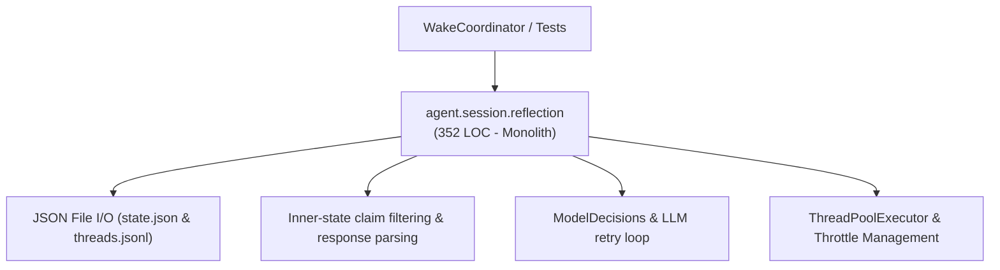
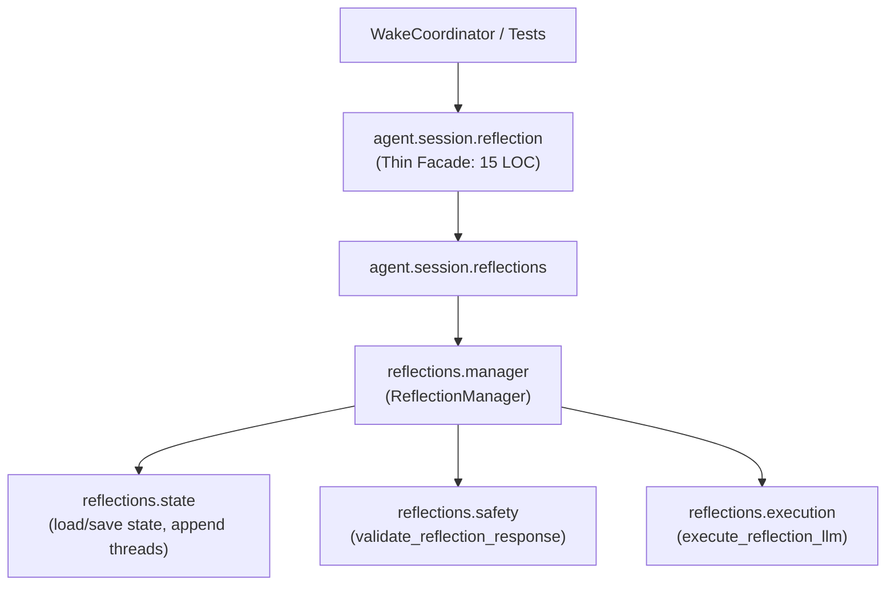

# Refactoring Documentation: `agent.session.reflection`

## 1. What the File Was For
Originally, [`agent/session/reflection.py`](../../agent/session/reflection.py) (~352 lines) managed read-only background reflections initiated by SELF after meaningful work:
- Reflection state & persistence: Loading and saving reflection state (`reflection_state.json`) and logging reflection records and human replies to durable storage (`reflection_threads.jsonl`).
- Bounded candidate scheduling: Throttling reflections per session (`max_per_session`), cycle intervals (`min_cycles`), coalesce queueing of newest candidate when background thread is busy, and suppressing scheduling on active open questions or shutdown requests.
- Model decision & execution: Dynamically selecting a model via `ModelDecisions`, estimating token payload reservation against `DailyTokenLedger`, executing LLM calls with retry nudges on truncated or malformed JSON responses, and recording model outcomes.
- Safety & inner-state filtering: Validating response JSON structure, ensuring `post` boolean is true, and scanning message/question text for unsupported inner-state claims (`"i feel"`, `"i want"`, `"sentient"`, etc.).
- Human-in-the-loop interaction: Extracting open reflection questions for human review and recording human replies into durable threads.

## 2. Purpose and Extraction Map

| Function / Symbol | What it does | How it serves the file's purpose | Smell / SRP violation | Target Module |
| :--- | :--- | :--- | :--- | :--- |
| `_now`, `load_reflection_state`, `save_reflection_state`, `append_thread_record` | Durable I/O for `reflection_state.json` and `reflection_threads.jsonl`. | Persists reflection questions, session limits, and human responses across wake cycles. | Disk I/O and JSON serialization mixed with LLM calling and scheduling. | [`agent/session/reflections/state.py`](../../agent/session/reflections/state.py) |
| `validate_reflection_response` | Validates JSON structure and filters unsupported inner-state claims. | Enforces safety boundaries and extracts valid messages/questions. | Safety policy heuristics mixed with thread orchestration. | [`agent/session/reflections/safety.py`](../../agent/session/reflections/safety.py) |
| `execute_reflection_llm` | Resolves model, checks budget, calls LLM, retries on parse failure, records outcome signals. | Handles LLM interactions and error recovery. | LLM client orchestration and decision telemetry mixed with concurrency locks. | [`agent/session/reflections/execution.py`](../../agent/session/reflections/execution.py) |
| `ReflectionManager` | ThreadPoolExecutor orchestration, rate limiting, and session lifecycle. | Central manager coordinating candidate submission, background execution, and reply intake. | Mixed orchestration with parsing, safety checks, and disk I/O. | [`agent/session/reflections/manager.py`](../../agent/session/reflections/manager.py) |
| `agent.session.reflection` | Thin facade re-exporting `ReflectionManager` and `_now`. | Preserves backward compatibility for external callers and tests. | High cohesion; pure facade delegating to `agent.session.reflections`. | [`agent/session/reflection.py`](../../agent/session/reflection.py) |

## 3. Dependency Structure (Before vs After)

### Before Refactoring

### After Refactoring

## 4. Facade Re-exports Kept
All symbols remain re-exported via `agent.session.reflection` with explicit assignments:
- `ReflectionManager`
- `_now`

## 5. Verification
- **Session Reflection Unit Tests**: Verified with `python -m unittest agent/tests/session/test_reflection.py -v` (4/4 passing).
- **Full Session Test Suite**: Verified with `python -m unittest discover -s agent/tests/session -v` (36/36 passing).
- **Import Layering**: Verified with `python -m unittest agent/tests/infra/test_import_layers.py` (strict layer 4 compliance).
- **Golden Prompts**: Verified with `python -m unittest agent/tests/body/test_golden_prompts.py`.
- **Docs Claims Guard**: Verified with `python scripts/check_docs_claims.py` (135 events verified, 357 tests total).
