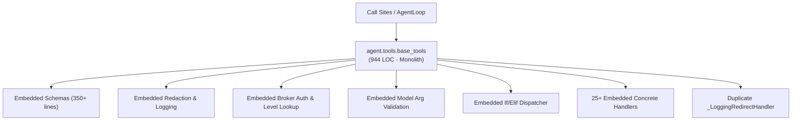
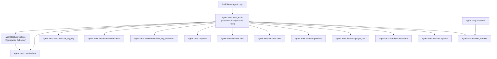

# Refactoring Documentation: `agent.tools.base_tools`

## 1. What the File Was For
Originally, [`agent/tools/base_tools.py`](../../agent/tools/base_tools.py) (944 lines) served as both the data dictionary of built-in tool definitions (nearly 400 lines of JSON schema definitions) and the operational coordinator/dispatcher (`ToolRunner`) for executing tools subject to harness boundaries, permission brokers, and redaction policies. It also housed the duplicated `_LoggingRedirectHandler` (also present in `agent/body/container.py`) and mixed file system checks, plugin stop-loss logic, and opencode delegation helpers into a single monolithic class.

## 2. Purpose and Extraction Map

| Function / Symbol | What it does | How it serves the file's purpose | Smell / SRP violation | Target Module |
| :--- | :--- | :--- | :--- | :--- |
| `DEFAULT_OUTPUT_CAP`, `TOOL_PERMISSION_LEVELS`, `REVERSIBLE_TOOL_NAMES` | Defines permission constants and output character limits. | Establishes the authorization boundaries for tool execution. | Configuration mixed with procedural code. | [`agent/tools/permissions.py`](../../agent/tools/permissions.py) |
| `TOOL_DEFINITIONS`, `HELPER_TOOL_NAMES`, `MODEL_TOOL_SPECS` | JSON schemas for all 28 base tools + model specs. | Informs models and callers of valid tool arguments and schemas. | Massive data dictionary (350+ lines) embedded in dispatcher. | [`agent/tools/definitions/`](../../agent/tools/definitions/) |
| `_LoggingRedirectHandler` | Urllib HTTP redirect handler with audit logging callback. | Audits network redirects during tool execution. | Duplicated verbatim in `agent/body/container.py`. | [`agent/infra/redirect_handler.py`](../../agent/infra/redirect_handler.py) |
| `log_tool_call`, `log_tool_result`, `prepare_logged_arguments` | Hashes and redacts sensitive args, logs structured events. | Provides transparent auditability of tool invocation and results. | Telemetry and payload manipulation tangled with dispatch logic. | [`agent/tools/execution/call_logging.py`](../../agent/tools/execution/call_logging.py) |
| `build_action_request`, `authorize_tool_action`, `record_action_execution` | Translates tool names and plugin manifests to `ActionRequest` and checks broker. | Enforces security boundaries and permission levels. | Security authorization protocol mixed into runner method. | [`agent/tools/execution/authorization.py`](../../agent/tools/execution/authorization.py) |
| `validate_model_tool_arguments` | Validates allowed/required keys and checks model aliases. | Guards model tools against incorrect arguments. | Model-specific validation logic inside generic runner. | [`agent/tools/execution/model_arg_validation.py`](../../agent/tools/execution/model_arg_validation.py) |
| `dispatch_tool` | Routes validated action to handler, collaborator, or plugin. | Bridges model tool requests to actual implementations. | 60+ line if/elif cascade checking multiple collaborator states. | [`agent/tools/dispatch.py`](../../agent/tools/dispatch.py) |
| `handle_run_shell`, `handle_read_file`, `handle_write_file`, `handle_list_dir`, `handle_http_get`, `check_is_core_path` | File, shell, and HTTP actions with stop-loss and protected-path guards. | Executes environmental operations. | Low-level filesystem and stop-loss logic in high-level tool runner. | [`agent/tools/handlers/files.py`](../../agent/tools/handlers/files.py) |
| `handle_read_plan`, `handle_update_plan`, `handle_update_environment_map` | Reads/writes plan items and records plugin review events. | Updates agent goals and environmental map. | Plan persistence event side-effects embedded in runner. | [`agent/tools/handlers/plan.py`](../../agent/tools/handlers/plan.py) |
| `handle_research_provider`, `handle_record_provider_verification`, `handle_request_provider_key`, `handle_ask_brain`, `handle_benchmark_providers`, `handle_probe_local_ollama` | Provider research, verification, key requests, chat, and benchmarks. | Interfaces with external LLM providers and local Ollama. | Provider router adapters embedded in runner. | [`agent/tools/handlers/provider.py`](../../agent/tools/handlers/provider.py) |
| `handle_read_cost_ledger`, `handle_propose_plugin`, `handle_scaffold_plugin`, `handle_validate_plugin`, `handle_test_plugin`, `handle_request_plugin_review` | Plugin self-development lifecycle actions. | Supports agent specialization through plugins. | Plugin development lifecycle mixed into base runner. | [`agent/tools/handlers/plugin_dev.py`](../../agent/tools/handlers/plugin_dev.py) |
| `ensure_opencode`, `ensure_model_decisions`, `handle_opencode_status`, `handle_delegate_coding`, `handle_apply_delegation`, `handle_discard_delegation`, `handle_record_build_route`, `handle_record_build_outcome`, `handle_build_route_stats`, `get_opencode_tool_definitions` | Opencode coding sandbox delegation and build routes. | Enables safe coding delegation. | Lazy dependency injection and sub-process wrapper calls in runner. | [`agent/tools/handlers/opencode.py`](../../agent/tools/handlers/opencode.py) |
| `handle_request_capability`, `handle_propose_core_patch` | Records capability requests and harness patch proposals. | Handles system-level self-modification proposals. | Identity/capability delegation mixed into runner. | [`agent/tools/handlers/system.py`](../../agent/tools/handlers/system.py) |
| `ToolRunner` | Composition root delegating to the focused handler and execution modules. | Public entry point and execution engine for all harness tools. | High cohesion; no longer directly implements the disparate responsibilities. | [`agent/tools/base_tools.py`](../../agent/tools/base_tools.py) |

## 3. Dependency Structure (Before vs After)

### Before Refactoring

### After Refactoring

## 4. Facade Re-Exports Kept
The following public symbols remain fully importable from `agent.tools.base_tools` with identical interfaces:
- `ToolRunner`
- `TOOL_DEFINITIONS`
- `HELPER_TOOL_NAMES`
- `DEFAULT_OUTPUT_CAP`
- `TOOL_PERMISSION_LEVELS`
- `MODEL_TOOL_SPECS`
- `_LoggingRedirectHandler`

All instance attributes accessed by tests (`runner.registry`, `runner.model_registry`, `runner.plan_store`, `runner.plugins`, `runner.plugin_dev`, `runner.cost_ledger`, `runner.broker`, `runner.body`, etc.) and delegating methods are preserved on `ToolRunner`.

## 5. Mock Patch Targets
- No test mock targets required updating for `base_tools`. `run_process` patching in `agent.tools.tool_registry.run_process` remains untouched.

## 6. Risks & Invariant Verification
- **Exact Schema Order**: Validated that `TOOL_DEFINITIONS` order and contents match character-for-character.
- **Authorization & Redaction Order**: Preserved exact broker sequence: `prepare/log tool_call → authorize → validate model args → dispatch → redact → record_broker_execution → log tool_result`.
- **Import Layers**: Validated by `agent/tests/infra/test_import_layers.py` (Layer 2 `tools` importing from Layer 0 `infra` and Layer 1 `body/llm`).
