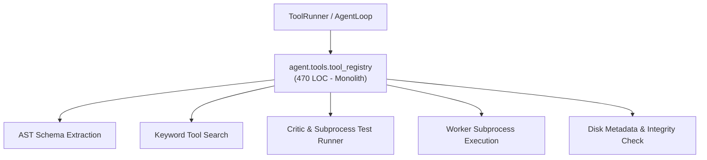
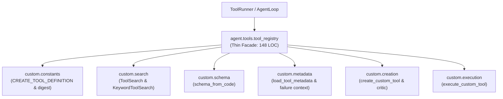

# Refactoring Documentation: `agent.tools.tool_registry`

## 1. What the File Was For
Originally, [`agent/tools/tool_registry.py`](../../agent/tools/tool_registry.py) (~470 lines) managed custom and dynamic workspace tools, coordinating schema derivation, LLM critic reviews, sandboxed testing, and isolated execution:
- Tool definition and search interfaces: defining the `create_tool` specification (`CREATE_TOOL_DEFINITION`), the `ToolSearch` protocol, and keyword search implementation (`KeywordToolSearch`).
- AST schema extraction: parsing synchronous `run(...)` definitions in `tool.py`, verifying explicit `INPUT_SCHEMA` objects against JSON Schema 2020-12 or deriving schemas from type annotations and default values (`schema_from_code`).
- Tool creation pipeline: checking for credential literals, invoking the critic LLM via `review_call`, creating temporary compatibility aliases (`_needs_name_alias`), executing unittests under child environment isolation (`_child_env`) with timeouts, archiving historical versions (`history/vXXXX/`), and recording failure lessons in memory upon reaching the attempt limit (`create_tool`).
- Tool metadata and integrity: loading tools from `workspace/tools/<name>/`, checking code and test SHA-256 hashes against `meta.json` (`refresh`, `_save_meta`), retrieving tools by query relevance (`retrieve`), and assembling recent creation failure context (`recent_failure_context`).
- Isolated execution: executing registered tools via `tool_worker.py` subprocesses with JSON argument validation and return value extraction (`execute`).

## 2. Purpose and Extraction Map

| Function / Symbol | What it does | How it serves the file's purpose | Smell / SRP violation | Target Module |
| :--- | :--- | :--- | :--- | :--- |
| `CREATE_TOOL_DEFINITION`, `digest`, `timestamp` | Schema constants, SHA-256 string hashing, and UTC timestamp generator. | Shared baseline utilities for tool identification and audit records. | Hash calculation and constants mixed with execution logic. | [`agent/tools/custom/constants.py`](../../agent/tools/custom/constants.py) |
| `ToolSearch`, `KeywordToolSearch` | Protocol and keyword-matching implementation ranking tools against search queries. | Enables dynamic retrieval of registered workspace tools. | Search algorithms coupled to tool creation manager. | [`agent/tools/custom/search.py`](../../agent/tools/custom/search.py) |
| `schema_from_code` | AST parser deriving JSON schemas from typed `run(...)` functions or `INPUT_SCHEMA`. | Validates tool inputs and creates schemas for agent tool calls. | Complex AST inspection logic embedded in registry file. | [`agent/tools/custom/schema.py`](../../agent/tools/custom/schema.py) |
| `save_tool_meta`, `load_tool_metadata`, `recent_failure_context` | Reads/writes `meta.json`, checks hashes, aggregates failure diagnostics from actions log. | Manages durable tool disk representation and diagnostic context. | File I/O and log parsing mixed with tool compilation. | [`agent/tools/custom/metadata.py`](../../agent/tools/custom/metadata.py) |
| `needs_name_alias`, `create_custom_tool` | Validates, prompts critic LLM, tests candidate tool in subprocess, updates metadata and archives. | Implements end-to-end tool generation pipeline with safety checks. | 225-line monolithic tool creation and testing method. | [`agent/tools/custom/creation.py`](../../agent/tools/custom/creation.py) |
| `execute_custom_tool` | Validates arguments and executes custom tool in isolated `tool_worker.py` subprocess. | Safely runs untrusted user-created Python tools outside agent loop. | Subprocess management and output extraction logic. | [`agent/tools/custom/execution.py`](../../agent/tools/custom/execution.py) |
| `ToolRegistry` | Thin facade and composition root maintaining full backward compatibility. | Primary entry point for workspace tool management. | High cohesion; delegates specialized tasks to submodules. | [`agent/tools/tool_registry.py`](../../agent/tools/tool_registry.py) |

## 3. Dependency Structure (Before vs After)

### Before Refactoring

### After Refactoring

## 4. Facade Re-exports Kept
All former public, protected, and test-accessed symbols and instance attributes remain available on `ToolRegistry` and `agent.tools.tool_registry`:
- `ToolRegistry`:
  - `root`, `workspace`, `logger`, `review_call`, `model_decisions`, `reserved_names`, `test_timeout`, `execution_timeout`, `output_cap`, `search`, `tools`, `attempt_counts`, `_logged_rejections`.
  - `_needs_name_alias(name, test_code)`
  - `_save_meta(folder, meta)`
  - `refresh()`
  - `retrieve(query, top_k, active_plugins=None)`
  - `recent_failure_context(limit=8)`
  - `_child_env()`
  - `create_tool(name, description, code, test_code)`
  - `execute(name, arguments)`
- Re-exports via `__all__`:
  - `CREATE_TOOL_DEFINITION`
  - `KeywordToolSearch`
  - `ToolRegistry`
  - `ToolSearch`
  - `digest`
  - `run_process`
  - `schema_from_code`
  - `timestamp`

## 5. Patch-target and Testing Changes
- **Known Patch Target Preserved**: `unittest.mock.patch("agent.tools.tool_registry.run_process")` is used in `agent/tests/helper_models/test_model_decisions.py` and `agent/tests/llm/test_token_limits.py`. `run_process` remains imported directly into `agent.tools.tool_registry` (`from agent.infra.process_runner import run_process`) and is passed dynamically as `run_process_fn=run_process` from `create_tool` and `execute`. Any patch targeting `agent.tools.tool_registry.run_process` takes effect seamlessly.
- Direct logger calls: `logger.log("tool_load_rejected", ...)`, `logger.log("tool_loaded", ...)`, `logger.log("tool_retrieval", ...)`, `logger.log("tool_critic", ...)`, `logger.log("tool_test_compat_alias", ...)`, `logger.log("tool_test", ...)`, `logger.log("tool_registered", ...)`, `logger.log("tool_creation_failed", ...)`, `logger.log("tool_failure_lesson", ...)`, and `logger.log("custom_tool_executed", ...)` remain direct `logger.log(...)` calls in the submodules, preserving all 135 verified events counted by `scripts/check_docs_claims.py`.
- All 23 tests in `agent/tests/tools/` pass cleanly.

## 6. Risks and Verification
- **Acyclic DAG Layering**: Verified with `python -m unittest agent/tests/infra/test_import_layers.py`.
- **Golden Prompts**: Verified with `python -m unittest agent/tests/body/test_golden_prompts.py`.
- **Tools Test Suite**: Verified with `python -m unittest discover -s agent/tests/tools -v` (23 tests passing).
- **Doc Claims Guard**: Verified with `python scripts/check_docs_claims.py` (135 events verified, 357 tests total).
