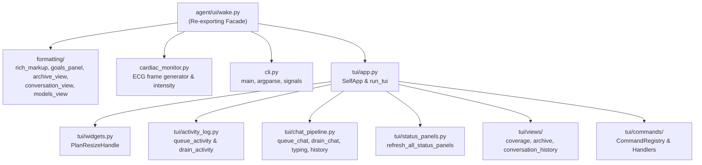

# God-File Refactoring Report: agent/ui/wake.py

## 1. Overview & Purpose

Original file: [`agent/ui/wake.py`](../../agent/ui/wake.py)  
Initial LOC: ~1,455 lines  
Refactored LOC: 91 lines (facade) across 15 focused submodules  
Layer: 5 (`ui`)  
Target: Split monolithic Textual front-end, formatting helpers, and CLI wiring into single-purpose SOLID modules while preserving complete backward compatibility, public API exports, mock/test interaction patterns, and DAG import layering.

`wake.py` serves as the interactive terminal front-end for a wake session. Before refactoring, it mixed numerous unrelated concerns:
1. Pure Rich markup escaping and string sanitation.
2. Animated ECG presence rendering (`cardiac_monitor_frame` and `cardiac_monitor_intensity`).
3. Goal pane formatting, height clamping, and starting target markdown generation.
4. Two-column archive reconstruction from `journal.md`, `sessions.jsonl`, and `PlanStore`.
5. Paginated conversation history formatting and `/models` snapshot rendering.
6. Custom Textual divider widget (`PlanResizeHandle`).
7. Asynchronous worklog activity queuing, draining, and auto-scroll handling.
8. Chat bubble pipeline, typing animation, voice integration, and JSONL persistence.
9. Full-screen overlay views (`coverage`, `archive`, `conversation_history`) with state tracking and scroll restoration.
10. Live telemetry and container resource status panel formatting (`_refresh`).
11. A monolithic ~250-line `if/elif` chain handling all human slash commands.
12. CLI argument parsing, signal trapping, and headless/TUI dispatch (`main`).

---

## 2. Architecture & Target Split

The monolith was decomposed into focused packages and modules under `agent/ui/`:



---

## 3. Function & Purpose Map

| Original Function / Class | Original Responsibility | Destination Module |
|---|---|---|
| `escape_rich_markup` | Escape literal `[` and backslashes for Rich | [`agent/ui/formatting/rich_markup.py`](../../agent/ui/formatting/rich_markup.py) |
| `cardiac_monitor_intensity` | Compute ECG pulse speed/amplitude profile | [`agent/ui/cardiac_monitor.py`](../../agent/ui/cardiac_monitor.py) |
| `cardiac_monitor_frame` | Render ASCII ECG frame across header width | [`agent/ui/cardiac_monitor.py`](../../agent/ui/cardiac_monitor.py) |
| `clamped_plan_height` | Clamp dragged divider height between min/max | [`agent/ui/formatting/goals_panel.py`](../../agent/ui/formatting/goals_panel.py) |
| `format_goals_panel` | Format top 5 active goals with priority & cycle | [`agent/ui/formatting/goals_panel.py`](../../agent/ui/formatting/goals_panel.py) |
| `build_archive_views` | Reconstruct session plans & achieved goals columns | [`agent/ui/formatting/archive_view.py`](../../agent/ui/formatting/archive_view.py) |
| `format_conversation_history_view` | Format paginated conversation history | [`agent/ui/formatting/conversation_view.py`](../../agent/ui/formatting/conversation_view.py) |
| `format_models_snapshot` | Format model registry evidence & decisions | [`agent/ui/formatting/models_view.py`](../../agent/ui/formatting/models_view.py) |
| `PlanResizeHandle` | Draggable Textual divider widget | [`agent/ui/tui/widgets.py`](../../agent/ui/tui/widgets.py) |
| `SelfApp._queue_activity` / `_drain_activity` | Asynchronous worklog activity queue | [`agent/ui/tui/activity_log.py`](../../agent/ui/tui/activity_log.py) |
| `SelfApp._queue_chat` / `_drain_chat` | Chat queue, typing effect, and persistence | [`agent/ui/tui/chat_pipeline.py`](../../agent/ui/tui/chat_pipeline.py) |
| `SelfApp._refresh` panel builders | Formats Identity, Activity, Session, Usage, Container | [`agent/ui/tui/status_panels.py`](../../agent/ui/tui/status_panels.py) |
| `SelfApp._open_coverage` / `_back_from_coverage` | Exploration coverage full-screen overlay view | [`agent/ui/tui/views/coverage.py`](../../agent/ui/tui/views/coverage.py) |
| `SelfApp._open_archive` / `_back_from_archive` | Archive full-screen overlay view | [`agent/ui/tui/views/archive.py`](../../agent/ui/tui/views/archive.py) |
| `SelfApp._open_conversation_history` | Conversation history paginated overlay view | [`agent/ui/tui/views/conversation_history.py`](../../agent/ui/tui/views/conversation_history.py) |
| `SelfApp.on_input_submitted` if-chain | Human slash command dispatching | [`agent/ui/tui/commands/registry.py`](../../agent/ui/tui/commands/registry.py) (Open/Closed) |
| `SelfApp` | UI composition and lifecycle root | [`agent/ui/tui/app.py`](../../agent/ui/tui/app.py) |
| `run_tui` | Entry point for Textual terminal application | [`agent/ui/tui/app.py`](../../agent/ui/tui/app.py) |
| `main` | CLI parser, signal handlers, entry dispatch | [`agent/ui/cli.py`](../../agent/ui/cli.py) |

---

## 4. Facade & Backward Compatibility

[`agent/ui/wake.py`](../../agent/ui/wake.py) re-exports all public symbols with `__all__`:
```python
__all__ = [
    "WakeCoordinator",
    "WakeStatus",
    "RuntimeTelemetry",
    "run_headless",
    "run_tui",
    "main",
    "cardiac_monitor_intensity",
    "cardiac_monitor_frame",
    "CardiacMonitorIntensity",
    "CARDIAC_MONITOR_WIDTH",
    "CARDIAC_MONITOR_BEAT_INTERVAL",
    "MONITOR_STOPPED",
    "MONITOR_THINKING",
    "MONITOR_WORKING",
    "MONITOR_IDLE",
    "escape_rich_markup",
    "visible_plan_items",
    "normalized_plan",
    "clamped_plan_height",
    "format_goals_panel",
    "format_starting_plan",
    "build_archive_views",
    "format_conversation_history_view",
    "format_models_snapshot",
    "COMPLETED_PLAN_STATUSES",
    "PLAN_MIN_HEIGHT",
    "WORKLOG_MIN_HEIGHT",
    "PLAN_RESIZER_HEIGHT",
    "KNOWN_CREDENTIAL_ENV",
    "_requests_text",
    "now_utc",
]
```
The legacy root shim [`agent/wake.py`](../../agent/wake.py) (`from agent.ui.wake import *`) continues functioning without modification.

### Preserved Test Attributes on `SelfApp`
Tests (notably [`agent/tests/learning/test_coverage.py`](../../agent/tests/learning/test_coverage.py)) reach directly into `SelfApp`:
- `app._coverage_open`: Boolean flag toggled when `/coverage` is submitted and restored on `/back`.
- `app._queue_activity`: Method called directly by tests while coverage is active to ensure background activity continues buffering.
- `app._start_agent`: Replaced by tests with a stub to control session execution during UI tests.
All of these attributes and methods are preserved directly on `SelfApp`.

---

## 5. Command Pattern Refactoring (Open/Closed Principle)

The original 250-line `if/elif` chain in `on_input_submitted` was replaced with a `CommandRegistry` maintaining a prioritized chain of handler objects implementing the `CommandHandler` protocol:
1. `ViewCommandHandler`: `/coverage`, `/archive`, `/conversation`, `/previous`, `/next`, `/back`
2. `VoiceCommandHandler`: `/voice`, `/voice on`, `/voice off`, `/listen`
3. `TypingCommandHandler`: `/typing`, `/typing on`, `/typing off`
4. `LifecycleCommandHandler`: `/restart`, `/pause`, `/resume`, `/stop`
5. `PlanGoalsCommandHandler`: `/targets`, `/plan`, `/goals`, `/goal <text>`
6. `IdentityCommandHandler`: `/models`, `/identity`, `/rename <name>`, `/name`, `/name <name>`, `/self`, `/patches`, `/about me`, `/about me delete <line>`
7. `StateInfoCommandHandler`: `/journal`, `/tools`, `/plugins`, `/proposals`, `/requests`, `/inputs`, `/memory <query>`, `/budget`, `/decisions`
8. `PluginSlashCommandHandler`: Dispatches any unhandled `/command` to active plugins.
9. Fallback: Routes non-slash messages to open reflection replies or conversation threads.

---

## 6. Verification Results

| Test Suite | Result | Details |
|---|---|---|
| `agent/tests/ui` | PASS | 2 / 2 tests passing |
| `agent/tests/learning/test_coverage.py` | PASS | Full TUI coverage view lifecycle and navigation verified |
| `agent/tests/session/test_session.py` | PASS | 26 / 26 tests passing (archive views, cardiac monitor, plan clamping) |
| `agent/tests/infra/test_import_layers.py` | PASS | Strict DAG import layering verified (Layer 5) |
| `agent/tests/body/test_golden_prompts.py` | PASS | Character-for-character prompt identity verified |
| `agent/opencode/tests/` | PASS | 45 / 45 pytest tests passing |
| `scripts/check_docs_claims.py` | PASS | All 357 test counts and system claims verified |
