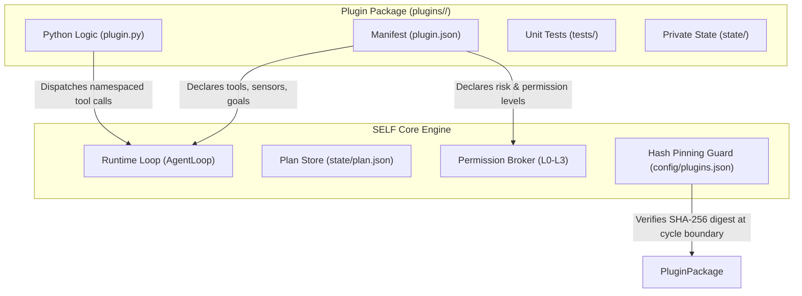

# SELF Plugin Developer Guide

Welcome to the **SELF Plugin Developer Guide**. This document explains what a SELF plugin is, how the plugin architecture works, how to build and test your own plugin from scratch, and how to safely attach and enable it in the SELF autonomous agent runtime.

---

## Table of Contents

1. [What is a Plugin?](#1-what-is-a-plugin)
   - [Core Philosophy: Body-Agnostic Core + Specialization](#core-philosophy-body-agnostic-core--specialization)
   - [Plugins vs. Dynamic Tools](#plugins-vs-dynamic-tools)
   - [Plugin Classes: Body, Skill, and Both](#plugin-classes-body-skill-and-both)
2. [Plugin Architecture & Anatomy](#2-plugin-architecture--anatomy)
   - [Directory Structure](#directory-structure)
   - [The Manifest (`plugin.json`)](#the-manifest-pluginjson)
   - [The Implementation Module (`plugin.py`)](#the-implementation-module-pluginpy)
   - [The Test Suite (`tests/test_plugin.py`)](#the-test-suite-teststest_pluginpy)
   - [Private State Storage (`state/`)](#private-state-storage-state)
3. [Step-by-Step: How to Develop a Plugin](#3-step-by-step-how-to-develop-a-plugin)
   - [Step 1: Scaffold from the Starter Template](#step-1-scaffold-from-the-starter-template)
   - [Step 2: Configure the Manifest](#step-2-configure-the-manifest)
   - [Step 3: Implement Tool, Sensor, and Action Logic](#step-3-implement-tool-sensor-and-action-logic)
   - [Step 4: Write Automated Unit Tests](#step-4-write-automated-unit-tests)
   - [Step 5: Statically Validate the Plugin](#step-5-statically-validate-the-plugin)
   - [Step 6: Run Local Unit Tests](#step-6-run-local-unit-tests)
   - [Step 7: Check Core API Compatibility](#step-7-check-core-api-compatibility)
4. [End-to-End Walkthrough: Building `disk_sentinel`](#4-end-to-end-walkthrough-building-disk_sentinel)
   - [Manifest: `plugin.json`](#manifest-pluginjson)
   - [Implementation: `plugin.py`](#implementation-pluginpy)
   - [Unit Tests: `tests/test_plugin.py`](#unit-tests-teststest_pluginpy)
   - [Validation & Test Execution](#validation--test-execution)
5. [How to Attach a Plugin to SELF](#5-how-to-attach-a-plugin-to-self)
   - [Plugin Discovery Paths](#plugin-discovery-paths)
   - [Cryptographic Hash Pinning](#cryptographic-hash-pinning)
   - [Method A: Attach via Slash Command (Recommended)](#method-a-attach-via-slash-command-recommended)
   - [Method B: Attach via Host Configuration (`config/plugins.json`)](#method-b-attach-via-host-configuration-configpluginsjson)
   - [Configuring Permissions (`config/permissions.json`)](#configuring-permissions-configpermissionsjson)
   - [Cycle-Boundary Synchronization & Hot Pluggability](#cycle-boundary-synchronization--hot-pluggability)
   - [Detaching or Updating a Plugin](#detaching-or-updating-a-plugin)
6. [Autonomous Self-Development & Promotion](#6-autonomous-self-development--promotion)
   - [The Capability Ladder](#the-capability-ladder)
   - [The Isolated Draft Boundary (`plugin_dev/`)](#the-isolated-draft-boundary-plugin_dev)
   - [Human Operator Promotion (`/plugins promote`)](#human-operator-promotion-plugins-promote)
7. [CLI & Slash Command Reference](#7-cli--slash-command-reference)
   - [Plugin SDK CLI (`python -m agent.plugins`)](#plugin-sdk-cli-python--m-agentplugins)
   - [Operator Slash Commands (`/plugins`)](#operator-slash-commands-plugins)
8. [Best Practices & Troubleshooting](#8-best-practices--troubleshooting)
   - [Safety Principles](#safety-principles)
   - [Troubleshooting Common Issues](#troubleshooting-common-issues)

---

## 1. What is a Plugin?

### Core Philosophy: Body-Agnostic Core + Specialization

SELF is designed with a **small, body-agnostic core engine**. The core runtime knows how to run autonomous cycles, balance token budgets, manage memories, evaluate plans, and communicate with LLM providers. However, the core contains no hardcoded hardware drivers, environment-specific actuation code, or domain-specific business rules.

A **plugin** is a self-contained, versioned extension package that attaches to SELF to provide:
1. **Dynamic Callable Tools:** Functions exposed to the LLM during tool-calling turns.
2. **Sensory Telemetry (Sensors):** Passive, read-only observations of the environment (L0 permission).
3. **Active Operations (Actions):** Environment mutations with explicit risk classifications (L1–L3 permissions).
4. **Embodiment Framing:** System prompt context explaining the operational environment to the agent.
5. **Starting Goal Seeds:** Recommended initial objectives seeded into the agent's autonomous plan upon activation.
6. **Isolated State:** A private, persistent state directory (`state/`) preserved across agent restarts.
7. **Custom Slash Commands:** Interactive operator commands (e.g. `/pet`) registered into the session UI.



---

### Plugins vs. Dynamic Tools

SELF allows the agent to synthesize lightweight ad-hoc Python tools on the fly via `create_tool`. It is essential to understand when to use a tool versus when to build a plugin:

| Dimension | Custom Workspace Tool (`create_tool`) | Specialization Plugin |
| :--- | :--- | :--- |
| **Scope** | Single Python function (`run(**kwargs)`) | Full capability package: tools, sensors, actions, and embodiment |
| **Embodiment** | None (does not modify agent persona or environment model) | Provides physical or operational embodiment and system prompt identity framing |
| **Starting Goals** | None | Injects starting goal seeds into the autonomous plan when enabled |
| **Permissions** | Assumes container workspace rights | Explicitly declared permission levels (L0 to L3) and risk classes (`reads`, `writes`, `executes`, `network`) |
| **State Storage** | Shared workspace files | Isolated private state directory (`workspace/plugins/<name>/state/`) |
| **Lifecycle** | Stored in `workspace/tools/<name>/` | Human-governed enablement and cryptographic SHA-256 hash pinning via `config/plugins.json` |
| **Unplug Resilience** | Errors if tool disappears | Intercepted at cycle boundary; returns structured observation on vanished calls |
| **Verification** | Single LLM critic review + unit test execution | Static schema validation, Core API SemVer check, unit test suite, and optional 5-factor critic review |

---

### Plugin Classes: Body, Skill, and Both

The `kind` field in `plugin.json` specifies the plugin's architectural role:

1. **Body Plugin (`kind: "body"`):**
   - Extends the agent's sensory perception and physical environment interaction.
   - Provides **sensors** (passive telemetry, L0 read-only), **actions** (environmental operations, L1-L3), and **embodiment** context.
   - *Example:* A robotics telemetry adapter, simulated hardware controller, or IoT bridge.

2. **Skill Plugin (`kind: "skill"`):**
   - Extends the agent's problem-solving capabilities, tools, and objectives.
   - Provides **tools** (callable functions registered in the LLM tool catalog), **starting goal seeds** (injected into `plan.json`), and **identity notes**.
   - *Example:* A cryptographic hashing suite, data analysis pipeline, or database query engine.

3. **Combined Plugin (`kind: "both"`):**
   - Combines both physical/environment embodiment and high-level cognitive problem-solving tools.
   - *Example:* An interactive pet companion with sensory vitals, simulated actions, and interactive dialogue tools.

---

## 2. Plugin Architecture & Anatomy

### Directory Structure

Every plugin resides in its own directory (e.g. `plugins/<name>/` or `workspace/plugins/<name>/`) and follows this canonical structure:

```
plugins/<name>/
├── plugin.json         # Manifest declaring tools, sensors, actions, and metadata (Required)
├── plugin.py           # Python implementations of handlers and lifecycle hooks (Required)
├── tests/              # Automated unit test suite (Required)
│   └── test_plugin.py  # Non-empty unittest test cases validating functionality
├── state/              # Private runtime state directory (Created automatically at runtime)
└── README.md           # Documentation for developers and operators
```

---

### The Manifest (`plugin.json`)

The manifest is the declarative blueprint of the plugin. It contains up to 15 fields validated statically before any Python code is imported:

```json
{
  "name": "my_plugin",
  "version": "1.0.0",
  "core_api": ">=1.1.0,<2.0.0",
  "kind": "both",
  "description": "Short explanation of plugin capabilities.",
  "tools": [
    {
      "name": "calculate_metric",
      "description": "Calculates a specialized score from text input.",
      "input_schema": {
        "type": "object",
        "properties": {
          "text": {"type": "string", "description": "Input text to evaluate"}
        },
        "required": ["text"]
      }
    }
  ],
  "sensors": [
    {
      "name": "read_telemetry",
      "description": "Reads current operational telemetry.",
      "risk_class": "reads",
      "reversible": true,
      "required_permission_level": "L0"
    }
  ],
  "actions": [
    {
      "name": "apply_setting",
      "description": "Applies a reversible runtime setting.",
      "risk_class": "writes",
      "reversible": true,
      "required_permission_level": "L1"
    }
  ],
  "starting_goal_seeds": [
    "Verify my_plugin telemetry and record baseline metrics."
  ],
  "embodiment": "I have specialized analytics and telemetry tools active.",
  "identity_notes": [
    "I prioritize data-driven analysis using the calculate_metric tool."
  ],
  "state_dir": "state",
  "declared_needs": {
    "env_vars": [],
    "mounts": []
  },
  "tests_entry_point": "tests/test_plugin.py",
  "commands": [
    {
      "name": "status",
      "description": "Displays quick plugin status summary."
    }
  ]
}
```

#### Manifest Fields Reference

| Field | Type | Required | Description & Constraints |
| :--- | :--- | :---: | :--- |
| `name` | string | **Yes** | Alphanumeric identifier (`^[a-zA-Z0-9_-]+$`). Cannot start with `_` or `.`, and cannot use reserved names (`core`, `self`, `template`, `archive`). |
| `version` | string | **Yes** | Semantic version string of the plugin (e.g. `"1.0.0"`). |
| `core_api` | string | **Yes** | SemVer range expression matching the core's API (e.g. `">=1.1.0,<2.0.0"`). SELF strictly rejects plugins if this field is missing or incompatible. |
| `kind` | string | **Yes** | Must be `"body"`, `"skill"`, or `"both"`. |
| `description` | string | **Yes** | Clear human-readable description of plugin functionality. |
| `tools` | list[object] | **Yes** | Dynamic tools exposed to LLM. Each tool has `name`, `description`, and standard JSON Schema `input_schema`. |
| `sensors` | list[object] | **Yes** | Read-only telemetry definitions. Must declare `risk_class: "reads"`, `reversible: true`, and `required_permission_level: "L0"`. |
| `actions` | list[object] | **Yes** | Active operational definitions. Must declare `risk_class` (`writes`, `executes`, or `network`), `reversible` (boolean), and `required_permission_level` (`L1` to `L3`). |
| `starting_goal_seeds` | list[string] | **Yes** | High-level goals automatically seeded into `state/plan.json` when the plugin is enabled. |
| `embodiment` | string | **Yes** | System prompt context explaining the operational embodiment to the LLM. |
| `identity_notes` | list[string] | No | Supplementary identity framing notes injected into the agent prompt while active. |
| `state_dir` | string | No | Relative path for private plugin state storage (default: `"state"`). Absolute paths and `..` traversals are rejected. |
| `declared_needs` | object | No | Declared external requirements: `env_vars` (e.g. `["API_KEY"]`) and `mounts`. |
| `tests_entry_point` | string | No | Relative path to the test module (default: `"tests/test_plugin.py"`). |
| `commands` | list[object] | No | Human-facing slash commands (e.g. `/status`) exposed in session UI. |

---

### The Implementation Module (`plugin.py`)

`plugin.py` contains the executable Python code corresponding to the declarations in `plugin.json`.

#### Key Rules for Plugin Functions
1. **Naming:** Function names in `plugin.py` must match the names declared in `tools`, `sensors`, or `actions`.
2. **Namespacing:** Tools are exposed to the agent loop under the namespaced identifier `<plugin_name>.<tool_name>`. The LLM invokes `<plugin_name>.<tool_name>`, and the core routes the call to the function in your module.
3. **Return Format:** Handlers **must** return a JSON-serializable dictionary with an `"ok"` boolean flag:
   - Success: `{"ok": True, "data": ...}`
   - Error: `{"ok": False, "error": "Human readable explanation"}`
4. **Crash Safety:** If a handler raises an unhandled exception, the core intercepts it, logs a `plugin_call_failed` event, and returns a clean error observation to the LLM. The agent core never crashes due to a faulty plugin.
5. **Lifecycle Hooks:** Plugins can optionally define `on_enable(context)` and `on_disable(context)`:
   - `context["name"]`: Plugin name.
   - `context["version"]`: Plugin version.
   - `context["workspace"]`: `Path` to the agent workspace root.
   - `context["state_dir"]`: `Path` to the plugin's private state folder.
   - `context["logger"]`: Structured event logger.

```python
"""Sample plugin.py implementation."""
from __future__ import annotations
from typing import Any

def calculate_metric(text: str = "") -> dict[str, Any]:
    """Computes a sample metric."""
    if not isinstance(text, str):
        return {"ok": False, "error": "text must be a string"}
    return {"ok": True, "word_count": len(text.split()), "char_count": len(text)}

def read_telemetry() -> dict[str, Any]:
    """Returns passive sensor observation (L0)."""
    return {"ok": True, "status": "nominal", "load": 0.15}

def apply_setting(setting_name: str = "default") -> dict[str, Any]:
    """Applies a setting (L1)."""
    return {"ok": True, "applied": setting_name, "reversible": True}

def on_enable(context: dict[str, Any]) -> None:
    """Invoked when plugin is activated at a cycle boundary."""
    state_dir = context.get("state_dir")
    if state_dir:
        state_dir.mkdir(parents=True, exist_ok=True)

def on_disable(context: dict[str, Any]) -> None:
    """Invoked when plugin is deactivated at a cycle boundary."""
    pass
```

---

### The Test Suite (`tests/test_plugin.py`)

A non-empty, passing test suite is **mandatory**. SELF refuses to validate or promote any plugin that lacks unit tests:
- Tests must use standard Python `unittest.TestCase`.
- Tests must verify normal execution paths, parameter validation, and expected return structures.
- Tests can be run locally on the host using `python -m unittest discover -s plugins/<name>/tests`.

---

### Private State Storage (`state/`)

Each plugin is allocated an isolated directory:
```
workspace/plugins/<name>/state/
```
- **Crash & Restart Persistence:** Files written to this directory persist across agent cycles and container restarts.
- **Excluded from Cryptographic Hash:** Changes to files inside `state/` do **not** invalidate the plugin's pinned SHA-256 hash.
- **Unplug Safety:** If a plugin is disabled or uninstalled, its `state/` directory is preserved intact.

---

## 3. Step-by-Step: How to Develop a Plugin

Follow this standard workflow to develop, test, and package a new plugin.

### Step 1: Scaffold from the Starter Template

SELF includes a built-in scaffolding CLI that copies the starter template `plugins/_template` and customizes the manifest for your new plugin:

```bash
# Scaffold a new plugin named 'system_clock' in the plugins/ directory
python -m agent.plugins new system_clock
```

To scaffold into an alternative destination (such as `workspace/plugins`):

```bash
python -m agent.plugins new system_clock --dest workspace/plugins
```

The CLI verifies that:
- The name contains only alphanumeric characters, hyphens, and underscores.
- The name does not start with `_` or `.`.
- The name is not reserved (e.g. `core`, `self`, `template`).
- The target folder does not already exist (prevents accidental overwrites).

---

### Step 2: Configure the Manifest

Open `plugins/<name>/plugin.json` in your editor. Set:
1. `name`: Matches the directory name.
2. `version`: Semantic version, e.g. `"1.0.0"`.
3. `core_api`: Compatible range against SELF's API version (currently `1.1.0`), e.g.:
   ```json
   "core_api": ">=1.1.0,<2.0.0"
   ```
4. `kind`: `"skill"`, `"body"`, or `"both"`.
5. Declare tools in `tools`, read-only sensors in `sensors`, and actions in `actions`.
6. Define `starting_goal_seeds` and `embodiment`.

---

### Step 3: Implement Tool, Sensor, and Action Logic

Edit `plugins/<name>/plugin.py`:
- Implement every function declared in the manifest.
- Ensure all functions accept appropriate keyword arguments and return `{"ok": True, ...}` on success or `{"ok": False, "error": "..."}` on error.
- Enforce strict defensive checks on all arguments. Never assume inputs from the LLM conform to your schema.

---

### Step 4: Write Automated Unit Tests

Edit `plugins/<name>/tests/test_plugin.py`:
- Import your handlers.
- Write tests for valid input, invalid parameter types, and edge cases.
- Verify that every handler returns a dictionary with `"ok": True` or `"ok": False`.

---

### Step 5: Statically Validate the Plugin

Run SELF's static plugin validator:

```bash
python -m agent.plugins validate plugins/<name>
```

To produce machine-readable JSON for automated scripts or CI:

```bash
python -m agent.plugins validate plugins/<name> --json
```

The validator performs static checks without executing untrusted code:
- Verifies JSON syntax and completeness of all required manifest fields.
- Checks that `core_api` expression is valid and compatible with the active core version.
- Ensures tool names do not collide with reserved core tools (such as `run_shell`, `read_file`, `update_plan`, etc.).
- Verifies that all sensors declare `risk_class: "reads"` and `required_permission_level: "L0"`.
- Checks that `state_dir` is a safe relative path without directory traversal (`..`).
- Ensures non-empty test files exist in `tests/`.

---

### Step 6: Run Local Unit Tests

Run your plugin's unit tests using Python's standard `unittest` test runner:

```bash
python -m unittest discover -s plugins/<name>/tests -v
```

All tests must pass before attaching the plugin to SELF.

---

### Step 7: Check Core API Compatibility

To inspect compatibility across all discovered plugins against the core API:

```bash
python -m agent.plugins check
```

---

## 4. End-to-End Walkthrough: Building `disk_sentinel`

Let's build a real, functional plugin named `disk_sentinel` that checks disk space, monitors scratch usage, and provides a safe scratch cleanup action.

### Manifest: `plugin.json`

Create `plugins/disk_sentinel/plugin.json`:

```json
{
  "name": "disk_sentinel",
  "version": "1.0.0",
  "core_api": ">=1.1.0,<2.0.0",
  "kind": "both",
  "description": "Monitors disk usage and manages workspace scratch hygiene.",
  "tools": [
    {
      "name": "check_storage",
      "description": "Calculates free and total space for a specified path in megabytes.",
      "input_schema": {
        "type": "object",
        "properties": {
          "path": {
            "type": "string",
            "description": "Directory path to inspect (defaults to current workspace)",
            "default": "."
          }
        }
      }
    }
  ],
  "sensors": [
    {
      "name": "disk_telemetry",
      "description": "Passive sensor reading disk utilization percentage.",
      "risk_class": "reads",
      "reversible": true,
      "required_permission_level": "L0"
    }
  ],
  "actions": [
    {
      "name": "purge_scratch",
      "description": "Removes old temporary scratch files from the plugin state directory.",
      "risk_class": "writes",
      "reversible": true,
      "required_permission_level": "L1"
    }
  ],
  "starting_goal_seeds": [
    "Verify disk space availability and establish storage telemetry baseline."
  ],
  "embodiment": "I have storage telemetry and disk hygiene tools active.",
  "identity_notes": [
    "I actively track storage limits and clean ephemeral scratch files."
  ],
  "state_dir": "state",
  "declared_needs": {
    "env_vars": [],
    "mounts": []
  },
  "tests_entry_point": "tests/test_plugin.py"
}
```

---

### Implementation: `plugin.py`

Create `plugins/disk_sentinel/plugin.py`:

```python
"""disk_sentinel plugin implementation."""
from __future__ import annotations

import shutil
from pathlib import Path
from typing import Any

def check_storage(path: str = ".") -> dict[str, Any]:
    """Calculates disk usage metrics for the given path."""
    try:
        target = Path(path).resolve()
        if not target.exists():
            return {"ok": False, "error": f"Path '{path}' does not exist"}
        usage = shutil.disk_usage(target)
        return {
            "ok": True,
            "path": str(target),
            "total_mb": round(usage.total / (1024 * 1024), 2),
            "used_mb": round(usage.used / (1024 * 1024), 2),
            "free_mb": round(usage.free / (1024 * 1024), 2),
            "used_percent": round((usage.used / usage.total) * 100, 1),
        }
    except Exception as exc:
        return {"ok": False, "error": f"Failed to inspect disk usage: {exc}"}

def disk_telemetry() -> dict[str, Any]:
    """Passive sensor reading current root disk usage percentage (L0)."""
    try:
        usage = shutil.disk_usage(".")
        used_pct = round((usage.used / usage.total) * 100, 1)
        return {
            "ok": True,
            "used_percent": used_pct,
            "status": "warning" if used_pct > 90 else "healthy",
        }
    except Exception as exc:
        return {"ok": False, "error": str(exc)}

def purge_scratch(pattern: str = "*.tmp") -> dict[str, Any]:
    """Removes temporary scratch files from private state (L1)."""
    try:
        # State path relative to current working directory in runtime
        state_dir = Path("workspace/plugins/disk_sentinel/state")
        if not state_dir.exists():
            return {"ok": True, "files_removed": 0, "freed_bytes": 0}

        removed = 0
        freed = 0
        for f in state_dir.glob(pattern):
            if f.is_file():
                size = f.stat().st_size
                f.unlink()
                removed += 1
                freed += size

        return {
            "ok": True,
            "pattern": pattern,
            "files_removed": removed,
            "freed_bytes": freed,
        }
    except Exception as exc:
        return {"ok": False, "error": f"Failed to purge scratch: {exc}"}

def on_enable(context: dict[str, Any]) -> None:
    """Initialize state directory on activation."""
    state_dir = context.get("state_dir")
    if state_dir:
        state_dir.mkdir(parents=True, exist_ok=True)

def on_disable(context: dict[str, Any]) -> None:
    """Cleanup hook when deactivated."""
    pass
```

---

### Unit Tests: `tests/test_plugin.py`

Create `plugins/disk_sentinel/tests/test_plugin.py`:

```python
"""Unit tests for disk_sentinel."""
from __future__ import annotations

import sys
import unittest
from pathlib import Path

# Add plugin root to sys.path for direct importing
plugin_dir = Path(__file__).resolve().parent.parent
if str(plugin_dir) not in sys.path:
    sys.path.insert(0, str(plugin_dir))

from plugin import check_storage, disk_telemetry, purge_scratch

class DiskSentinelTests(unittest.TestCase):
    def test_check_storage_valid_path(self) -> None:
        result = check_storage(".")
        self.assertTrue(result["ok"])
        self.assertIn("free_mb", result)
        self.assertGreater(result["total_mb"], 0)

    def test_check_storage_invalid_path(self) -> None:
        result = check_storage("nonexistent_path_xyz_123")
        self.assertFalse(result["ok"])
        self.assertIn("error", result)

    def test_disk_telemetry_sensor(self) -> None:
        telemetry = disk_telemetry()
        self.assertTrue(telemetry["ok"])
        self.assertIn("used_percent", telemetry)
        self.assertIn("status", telemetry)

    def test_purge_scratch_clean(self) -> None:
        result = purge_scratch()
        self.assertTrue(result["ok"])
        self.assertIn("files_removed", result)

if __name__ == "__main__":
    unittest.main()
```

---

### Validation & Test Execution

Run validation:
```bash
python -m agent.plugins validate plugins/disk_sentinel
```

Expected output:
```
PASS: Plugin 'disk_sentinel' at '.../plugins/disk_sentinel' is valid.
```

Run tests:
```bash
python -m unittest discover -s plugins/disk_sentinel/tests -v
```

Expected output:
```
test_check_storage_invalid_path ... ok
test_check_storage_valid_path ... ok
test_disk_telemetry_sensor ... ok
test_purge_scratch_clean ... ok

Ran 4 tests in 0.005s

OK
```

---

## 5. How to Attach a Plugin to SELF

Developing a plugin creates the code; **attaching** it enables the SELF runtime to discover, verify, and load the plugin during autonomous execution.

### Plugin Discovery Paths

When SELF boots or synchronizes at a cycle boundary, `PluginManager.discover()` scans the following locations:
1. **Container Shipped Plugins:** `/opt/agent/plugins/` (Read-only built-in plugins bundled into the Docker image).
2. **Workspace Plugins:** `workspace/plugins/<name>/` (Plugins installed or promoted inside the active agent workspace).
3. **Repository Plugins:** `plugins/<name>/` (Host repository plugins directory).

> [!NOTE]
> Special folders are strictly ignored during discovery:
> - `_template`: Starter template.
> - `_archive`: Backed-up uninstalled plugins.
> - Folders starting with `.` or `_`.
> - `plugin_dev/`: In-progress autonomous drafts.

---

### Cryptographic Hash Pinning

To guarantee software supply-chain integrity, SELF enforces **SHA-256 Content Hash Pinning**:
- An enabled plugin is verified against a pinned SHA-256 digest recorded in `config/plugins.json`.
- The hash is deterministically calculated across all files in the plugin directory sorted by relative POSIX paths.
- Automatically **excluded** from hashing: `state/` directory, `_archive/`, `__pycache__/`, `*.pyc`, and hidden files (`.*`).
- If an enabled plugin's code or manifest is altered on disk without operator re-pinning, SELF detects `actual_hash != pinned_hash`, logs a `plugin_hash_mismatch` event, and **refuses to load the modified plugin**.

---

### Method A: Attach via Slash Command (Recommended)

The easiest and safest way to attach a plugin is using SELF's `/plugins enable` command. This automatically validates the plugin, computes its SHA-256 digest, and writes the pin to configuration.

#### In Interactive Session UI (TUI):
Type directly in the command prompt:
```text
/plugins enable disk_sentinel
```

#### Headless Host Execution:
You can run the command from the host shell via `agent.run`:
```bash
python agent/run.py -c "/plugins enable disk_sentinel"
```

Output:
```text
Plugin 'disk_sentinel' enabled (hash pinned: 7f3b8a1c9d2e...).
Permission requests:
{
  "disk_sentinel.check_storage": {
    "permission_level": "L0",
    "risk_classes": []
  }
}
Takes effect at the next cycle boundary.
```

---

### Method B: Attach via Host Configuration (`config/plugins.json`)

If the agent container's `/config` directory is mounted read-only (standard production hardening), human operators attach plugins directly on the host by editing `config/plugins.json`.

1. **Calculate the plugin's hash:**
   Run `python -m agent.plugins list` to inspect discovered plugins and view current digests:
   ```bash
   python -m agent.plugins list
   ```

2. **Edit `config/plugins.json`:**
   Add your plugin entry with `"enabled": true` and the computed hash:
   ```json
   {
     "plugins": {
       "disk_sentinel": {
         "enabled": true,
         "hash": "7f3b8a1c9d2e4f5a6b7c8d9e0f1a2b3c4d5e6f7a8b9c0d1e2f3a4b5c6d7e8f9a"
       }
     }
   }
   ```

3. **Verify enablement:**
   ```bash
   python -m agent.plugins list
   ```
   The plugin status will now show `enabled` with `pinned_match`.

---

### Configuring Permissions (`config/permissions.json`)

SELF operates under a strict **default-deny** policy for actions exceeding read-only observation:
- **`L0` (Observe / Reads):** Automatically allowed. Sensors and read-only tools run without special configuration.
- **`L1` (Reversible Change / Writes):** Denied by default until granted by the operator.
- **`L2` (Irreversible Change / Executes):** Denied by default until granted by the operator.
- **`L3` (Actuation / External Boundary):** Denied by default until granted by the operator.

If your plugin declares actions or tools requiring `L1` or higher (such as `purge_scratch` in our example), grant permission in `config/permissions.json`:

```json
{
  "default_level": "L0",
  "grants": {
    "plugin:disk_sentinel": "L1"
  },
  "action_grants": {
    "disk_sentinel.purge_scratch": "L1"
  }
}
```

- `grants["plugin:<name>"]`: Sets the maximum permission level granted to the entire plugin actor.
- `action_grants["<plugin>.<action>"]`: Sets granular permission for an individual action.

---

### Cycle-Boundary Synchronization & Hot Pluggability

SELF never loads or unloads plugins in the middle of an autonomous tool execution turn. Instead, synchronization occurs cleanly at **cycle boundaries**:

```mermaid
sequenceDiagram
    participant Op as Human Operator
    participant Cfg as config/plugins.json
    participant Mgr as PluginManager
    participant Loop as AgentLoop
    participant LLM as Language Model

    Op->>Cfg: Enable plugin & pin hash
    Note over Loop: Agent cycle in progress...
    Loop->>Loop: Complete current tool round
    Loop->>Mgr: sync_at_cycle_boundary()
    Mgr->>Cfg: Read updated config
    Mgr->>Mgr: Verify SHA-256 hash match
    Mgr->>Mgr: Load plugin.py & extract handlers
    Mgr->>Loop: Inject namespaced tools & goal seeds
    Note over Loop: New cycle begins with plugin active
    Loop->>LLM: Tool catalog includes <plugin>.<tool>
```

#### Unplug Resilience
If an operator disables a plugin while the agent is running:
1. The plugin's tools and sensors are removed from the active catalog at the cycle boundary.
2. If the LLM subsequently calls a removed tool, the harness intercepts the call and returns:
   ```json
   {
     "ok": false,
     "error": "tool no longer available: plugin disk_sentinel disabled"
   }
   ```
3. Any plan goals associated with the plugin in `state/plan.json` are marked `"suspended: plugin disabled"` rather than deleted, preserving progress.

---

### Detaching or Updating a Plugin

#### To Disable a Plugin:
```bash
python agent/run.py -c "/plugins disable disk_sentinel"
```
Or set `"enabled": false` in `config/plugins.json`.

#### To Update Plugin Code:
1. Modify your code in `plugins/<name>/`.
2. Validate and test:
   ```bash
   python -m agent.plugins validate plugins/<name>
   python -m unittest discover -s plugins/<name>/tests
   ```
3. Re-enable to update the pinned SHA-256 hash:
   ```bash
   python agent/run.py -c "/plugins enable <name>"
   ```

---

## 6. Autonomous Self-Development & Promotion

SELF does not only accept human-authored plugins; the agent can also **develop specialization plugins autonomously** when encountering capability gaps.

### The Capability Ladder

Before proposing a plugin, SELF consults the 5-rung Capability Ladder and chooses the lowest sufficient tier:
1. **Rung A:** Use existing built-in or plugin tools.
2. **Rung B:** Call a helper model (`ask_model`) for isolated text analysis.
3. **Rung C:** Create a custom workspace tool (`create_tool`) for single-cycle calculations.
4. **Rung D:** Develop a specialization plugin (`propose_plugin`) for multi-cycle capabilities requiring embodiment, sensors, private state, or actions.
5. **Rung E:** Request host capability expansion (`request_capability`) for new API keys, ports, or mounts.

---

### The Isolated Draft Boundary (`plugin_dev/`)

When SELF develops a plugin:
- Drafts are created exclusively inside `workspace/plugin_dev/<name>/`.
- **Hard isolation:** The runtime plugin loader strictly ignores `plugin_dev/`. A draft **cannot be loaded, imported, or executed by the runtime loop** while in development.
- Testing occurs in an isolated subprocess with an in-process audit hook via the `test_plugin` tool.
- Critic review is performed by an independent LLM prompt (`request_plugin_review`) evaluating 5 factors: completeness, schema correctness, risk declarations, test coverage, and code hygiene.

---

### Human Operator Promotion (`/plugins promote`)

An autonomously developed plugin can **never enable itself**. Human review is strictly required:

1. The agent submits a proposal visible via `/proposals`.
2. When development and tests pass, the human operator reviews the diff and promotes the draft:
   ```text
   /plugins promote <name>
   ```
3. Promotion moves the code from `workspace/plugin_dev/<name>` to `workspace/plugins/<name>` as **DISABLED**.
4. The operator inspects the code, reviews permission requests, and explicitly enables the plugin:
   ```text
   /plugins enable <name>
   ```

---

## 7. CLI & Slash Command Reference

### Plugin SDK CLI (`python -m agent.plugins`)

The static CLI is located at `agent/plugins/cli.py` and can be invoked from any terminal:

| Command | Usage | Description |
| :--- | :--- | :--- |
| `new` | `python -m agent.plugins new <name> [--dest <dir>]` | Scaffolds a new plugin skeleton from the built-in template. |
| `validate` | `python -m agent.plugins validate <path> [--json]` | Statically validates manifest schemas, risk classes, version ranges, and tests without executing code. |
| `list` | `python -m agent.plugins list [--json]` | Lists all discovered plugins, versions, enabled status, and SHA-256 hash match status. |
| `check` | `python -m agent.plugins check [--json]` | Checks Core API SemVer compatibility across all discovered plugins. |

### Operator Slash Commands (`/plugins`)

Available in the interactive session UI or via headless `python agent/run.py -c "<command>"`:

| Slash Command | Usage | Description |
| :--- | :--- | :--- |
| `/plugins` or `/plugins list` | `/plugins list` | Shows all discovered plugins, versions, kinds, enablement status, and pinned hashes. |
| `/plugins enable <name>` | `/plugins enable <name>` | Validates, calculates SHA-256 digest, pins hash in `config/plugins.json`, and activates plugin at the next cycle boundary. |
| `/plugins disable <name>` | `/plugins disable <name>` | Deactivates plugin in `config/plugins.json`, suspending associated goals cleanly. |
| `/plugins promote <name>` | `/plugins promote <name>` | Promotes an autonomous draft from `workspace/plugin_dev/<name>` to `workspace/plugins/<name>` as DISABLED. |
| `/proposals` | `/proposals` | Displays pending autonomous plugin development proposals and status. |

---

## 8. Best Practices & Troubleshooting

### Safety Principles

When authoring plugins that interact with host resources, networks, or filesystems:

1. **Enforce Limits Deterministically in Python:**
   Never rely on prompt instructions or LLM obedience to enforce bounds, rate limits, or path confinement. Always validate arguments in Python code.
2. **Treat All External Telemetry as Untrusted Data:**
   Sensor readings, API responses, and external files are untrusted. Parse schemas defensively and guard against format string or prompt injections.
3. **Start Read-Only (L0):**
   Design your plugin with read-only sensors first. Only introduce active modification actions (L1/L2) when necessary, and ensure L1 operations provide clean undo or rollback logic.
4. **Never Hardcode Secrets:**
   Do not commit API tokens, passwords, or credentials into plugin files. Declare needed variables in `declared_needs.env_vars` and read them from the environment.

---

### Troubleshooting Common Issues

#### Issue: `plugin_hash_mismatch`
- **Cause:** Files in an enabled plugin were edited on disk, so the current directory SHA-256 hash does not match the pinned digest in `config/plugins.json`.
- **Fix:** Re-enable the plugin to recalculate and update the pinned hash:
  ```bash
  python agent/run.py -c "/plugins enable <name>"
  ```

#### Issue: `Plugin tool collides with reserved core tool name`
- **Cause:** Your plugin declared a tool name that matches one of SELF's built-in core tools (e.g. `run_shell`, `read_file`, `update_plan`, `create_tool`).
- **Fix:** Rename the tool in both `plugin.json` and `plugin.py`.

#### Issue: `core_api range is incompatible with core version`
- **Cause:** The `core_api` field in `plugin.json` excludes the running core version (currently `1.1.0`).
- **Fix:** Update `core_api` in `plugin.json` to include the active version, e.g. `"core_api": ">=1.1.0,<2.0.0"`.

#### Issue: `Action denied by permission broker`
- **Cause:** An action declared with permission level `L1`, `L2`, or `L3` was invoked, but has not been granted by the operator.
- **Fix:** Grant the required permission level in `config/permissions.json` under `grants` or `action_grants`.

#### Issue: `Plugin tests folder missing or contains no non-empty test files`
- **Cause:** `validate_plugin` requires a `tests/` directory containing at least one non-empty test file starting with `test_` or ending with `_test.py`.
- **Fix:** Add a unit test module under `tests/test_plugin.py` verifying your handlers.

---

*For detailed architectural references, see [docs/plugins/overview.md](../docs/plugins/overview.md), [docs/plugins/manifest-reference.md](../docs/plugins/manifest-reference.md), and [docs/plugins/lifecycle.md](../docs/plugins/lifecycle.md).*
